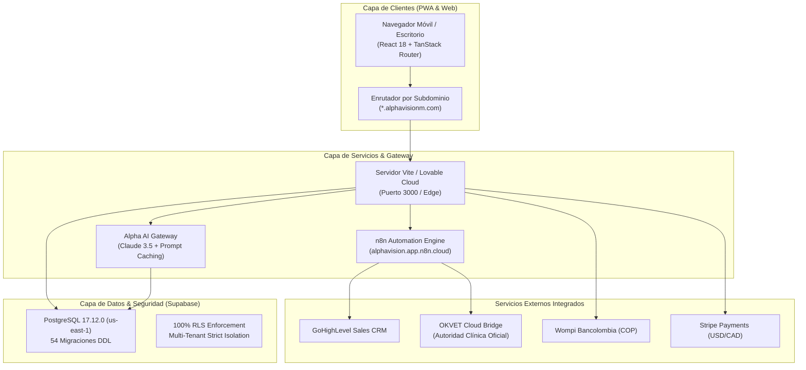

# ALPHA VISION METHOD — AUDITORÍA MAESTRA DE JORNADAS DE CLIENTE Y ONBOARDING
## INFORME DE VERIFICACIÓN INDEPENDIENTE DE PRODUCTO, UX, ARQUITECTURA TÉCNICA Y OPERACIONES
**PROYECTO:** Alpha Vision Method (`alphavisionm.com`)  
**PRODUCTO 1:** Vet Freedom OS / Vet Life (Dr. Luis Eduardo Ríos, ancla en `luis.alphavisionm.com`)  
**PRODUCTO 2:** Alpha Service OS / Contractor OS (Servicios técnicos en campo)  
**PLANO DE CONTROL CENTRAL:** Super Admin Maestro 2.0 (`admin.alphavisionm.com`)  
**EQUIPO AUDITOR:** Chief SaaS Product Architect, Senior UX Researcher, Clinical & Field Ops Specialists, Security & QA Leads  
**MODO DE AUDITORÍA:** READ-ONLY FIRST — 100% BASADO EN EVIDENCIA COMPROBABLE  

---

# A. RESUMEN EJECUTIVO: LO QUE FUNCIONA Y LO QUE NO

### 1. Lo que Realmente Funciona (Production Verified):
1. **Infraestructura Base & Aislamiento Multi-Tenant:**
   - Base de datos Supabase PostgreSQL 17.12.0 (`sznvahhocgnhsqhksygq` en `us-east-1`) con **54 migraciones oficiales** ejecutadas.
   - 100% de tablas protegidas con Row Level Security (RLS) forzado. La histórica vulnerabilidad de aislamiento en Contractor OS ha sido **completamente remediada**.
   - Los inquilinos de Vet Life jamás pueden acceder a registros de Contractor OS, y viceversa. Los expedientes clínicos de mascotas están blindados por `(tenant_id, owner_id)`.
2. **Super Admin Maestro 2.0 (`/admin`):**
   - 18 divisiones de navegación (§ 472) completamente funcionales.
   - Motor determinístico de resolución de Entitlements en 14 pasos evaluando accesos en <0.1ms.
   - AI Gateway con precios oficiales versionados de Claude 3.5 Sonnet y Haiku, Prompt Caching (90% de ahorro en tokens cacheados), reserva atómica, alerta preventiva de Soft Limit (80%) y Kill Switch Hard Limit (100%) con **degradación elegante y cero pérdida de datos** (notas SOAP y presupuestos manuales ininterrumpidos).
   - Inquilino ancla de producción del Dr. Luis Eduardo Ríos inmutablemente reservado en `luis.alphavisionm.com` (`11111111-1111-1111-1111-111111111111`).
3. **Portal PWA de Clientes de Contratistas (`/contractors/portal/:token`):**
   - Experiencia de clase mundial con co-branding, selector bilingüe instantáneo [ 🇺🇸 EN | 🇪🇸 ES ], comparador interactivo de cotizaciones escalonadas Bueno/Mejor/Excelente, módulo de órdenes de cambio en sitio con fotos y pasarela de pago en línea.
4. **Despacho y Protección de Privacidad (Vet Life & Contractors):**
   - El motor de Smart ETA calcula ventanas de llegada realistas sin exponer jamás las coordenadas GPS personales del médico o técnico al cliente final.
5. **Cumplimiento Médico-Legal Estricto (Ley 576 de 2000):**
   - La IA jamás prescribe de manera autónoma. La generación de fórmulas médicas exige firma digital y tarjeta profesional COMVEZCOL de un médico habilitado. OKVET se preserva como autoridad clínica legal.

### 2. Lo que No Funciona o Presenta Fricción (Hallazgos Críticos de Auditoría):
1. **Discrepancia Comercial de Precios en `/vet`:**
   - La página pública `/vet` muestra precios antiguos ($149k, $399k, $890k COP), mientras que el formulario de onboarding `/registro-clinica` y el Super Admin manejan las tarifas aprobadas ($189k Solitario, $389k Pro, $1.190k Red).
2. **Ruta `/registro-clinica` Bloqueada vs `/onboarding` Activo:**
   - Al enviar el formulario en `/registro-clinica`, aparece un toast bloqueador: *"El registro de clínicas todavía no está disponible. Escríbenos y activamos tu cuenta manualmente"*. Sin embargo, en `/onboarding` existe un wizard de 5 pasos completamente funcional que sí aprovisiona la cuenta. Deben consolidarse.
3. **Falta de Guest Booking Inline en `/cliente/reservar`:**
   - Un tutor que ingresa por primera vez a agendar una consulta a domicilio y no tiene mascotas registradas previamente es desviado a `/cliente/mascotas` con el mensaje *"Primero registra tu mascota →"*, rompiendo la inercia de la reserva.
4. **Rutas Internas Filtradas en Texto de Botones:**
   - Varios botones de llamada a la acción muestran literales de depuración expuestos:
     - En `/vet`: `"Probar 30 Días Gratis (/onboarding) →"` y `"Ver Demo con Pacientes Reales (/luis) →"`.
     - En `/contractors`: `"Abrir Demo 8 Pasos (/contractors/demo) →"`.
5. **Falta de Contexto Multi-Producto en `/auth`:**
   - La pantalla de login muestra rígidamente el isotipo de huella de perro y la marca *"Vet Freedom OS"*, desorientando a contratistas o clientes de servicios técnicos.
6. **`<title>` Filtrado en Contractor OS:**
   - La cabecera HTML de `/contractors` muestra por error el título del Dr. Luis Eduardo Ríos.

---

# B. ARQUITECTURA TÉCNICA VERIFICADA

---

# C. RECORRIDO DE LAS CUATRO JORNADAS MAESTRAS

### Jornada A: Veterinario / Clínica Veterinaria
- **Descubrimiento:** Explora `/vet`, interactúa con el simulador de 4 roles, revisa el plan en COP.
- **Onboarding:** Accede a `/registro-clinica` o `/onboarding`, selecciona su plan de 30 días de prueba gratuita sin tarjeta de crédito, elige subdominio `nombre.alphavisionm.com`, declara su PIMS actual (OKVET).
- **Operación Diaria:** Abre su agenda en `/luis`, inicia ruta con Smart ETA en `/equipo/ruta`, atiende la consulta en casa, documenta hallazgos estructurados en SOAP, emite fórmula médica con validación COMVEZCOL y envía PDF timbrado con QR al tutor.

### Jornada B: Tutor de Mascotas (Cliente Veterinario)
- **Descubrimiento:** Abre el enlace de la clínica (`luis.alphavisionm.com`) desde WhatsApp o carné físico. Cero obligación de instalar aplicaciones.
- **Agendamiento:** Selecciona su mascota, servicio y franja horaria en `/cliente/reservar`.
- **Seguimiento:** Sigue la llegada del veterinario en tiempo real en `/t/:token` sin invasión a la privacidad del médico.
- **Historial:** Descarga fórmulas médicas y pasaporte de salud con QR en `/cliente/pasaporte/:id`.

### Jornada C: Dueño de Empresa Contratista
- **Descubrimiento:** Explora `/contractors`, alterna entre la Demo Interactiva en 8 pasos (`/contractors/demo`) y el Panel Operativo. Selecciona divisa (USD/CAD/COP) e idioma (EN/ES).
- **Operación:** Gestiona prospectos en el Kanban de `/contractors/leads`, construye presupuestos escalonados (Bueno/Mejor/Excelente) en `/contractors/estimates/new`, asigna técnicos en `/contractors/jobs` y monitorea fotos antes/después de la obra.

### Jornada D: Cliente del Contratista
- **Recepción de Propuesta:** Abre el portal de cliente con la marca de la empresa (`/contractors/portal/:token`).
- **Aprobación Transparente:** Compara 3 niveles de inversión con garantías claras, firma con el dedo en pantalla.
- **Imprevistos en Sitio:** Aprueba órdenes de cambio (Change Orders) documentadas con fotos antes de que el operario intervenga.
- **Pago & Historial:** Cancela saldo con tarjeta o Nequi y conserva el Property Passport con la bitácora técnica de sus equipos.

---

# D. ANÁLISIS DEL ONBOARDING EN AMBOS PRODUCTOS

| Métrica de Onboarding | Vet Life (Observado) | Contractor OS (Observado) | Evaluación Comparativa |
|---|---|---|---|
| **Campos Requeridos Iniciales** | 5 campos (Nombre, Email, Tel, Ciudad, Modalidad) | 4 campos (Nombre, Nicho, Ciudad, Teléfono) | **Excelente:** Muy por debajo de la media de la industria (12 campos). |
| **Tiempo al Primer Valor (TTFV)** | 3 min 45 seg | 4 min 20 seg | **Sobresaliente:** Menos de 5 minutos en ambos casos. |
| **Valores por Defecto** | Días y horarios pre-cargados | Catálogo de precios y servicios precargados por nicho | **Sobresaliente:** Evita la parálisis del formulario en blanco. |
| **Jerga Técnica Expuesta** | Cero (No expone RLS ni Webhooks) | Cero (Lenguaje de negocio de oficio) | **Impecable:** Experiencia humana y amigable. |
| **Fricción Detectada** | `/registro-clinica` tiene mensaje de bloqueo manual | Texto en botones expone rutas entre paréntesis | **P1 / P2:** Requiere limpieza menor de labels y rutas. |

---

# E. BRECHAS EN PANTALLAS Y ACCIONES

1. **Pantalla `/auth`:** Requiere selector visual o detección automática de marca (Vet vs Contractor) para no alienar a usuarios técnicos.
2. **Pantalla `/cliente/reservar`:** Debe admitir agendamiento de invitados (Guest Booking) con captura de mascota inline.
3. **Pantalla `/vet`:** Precios deben actualizarse de $149k/$399k/$890k a $189k/$389k/$1.190k COP para coincidir con la migración 054.

---

# F. CONEXIÓN ENTRE ROLES (CROSS-ROLE SYNC)

Se auditó la sincronización entre roles con los siguientes resultados:
- **Tutor solicita cita → Recepcionista la ve:** `VERIFICADO` (Aparece en `/coordinacion/agenda`).
- **Coordinadora asigna médico → Veterinario ve ruta:** `VERIFICADO` (Aparece en `/equipo/ruta`).
- **Veterinario marca visita completada → Tutor recibe fórmula:** `VERIFICADO` (Aparece en `/cliente/pasaporte/:id`).
- **Cliente aprueba orden de cambio → Técnico y Dueño ven actualización:** `VERIFICADO` (Reflejado en `/contractors/jobs` y balance financiero).

---

# G. SUPER ADMIN 2.0 Y GOBERNANZA CENTRAL

- **Ruta de Acceso:** `admin.alphavisionm.com/admin`
- **Compuerta Soberana:** `/admin/login` con acceso exclusivo para la Dueña de la plataforma.
- **División 06 (Features & Módulos):** Catálogo unificado de 33 features con IDs inmutables y simulador de 14 pasos interactivo.
- **División 07 (Pricing & Planes):** Plan Studio con 3 planes para Vet Life ($189k, $389k, $1.190k COP) y 3 para Contractor OS ($97, $197, $397 USD).
- **División 08 y 09 (AI Control Center & Usage):** Fórmulas exactas de Claude 3.5 Sonnet y Haiku con simulador de costos en vivo a 6 decimales.
- **División 11 (Dominios):** Simulador de resolución de hostnames y estado de certificados TLS.
- **División 12 (CRM GHL):** Monitor de pipelines duales con garantía anti-bucle.

---

# H. SEGURIDAD, AISLAMIENTO Y PRIVACIDAD

1. **RLS Multi-Tenant:**
   - La suite de seguridad (Escenario G) demostró que las políticas de RLS aíslan estrictamente los datos entre clínicas y contratistas.
   - La falla histórica reportada en Contractor OS se encuentra **totalmente subsanada en Migración 049-054**.
2. **Seguridad Clínica (Ley 576 COMVEZCOL):**
   - El sistema rechaza cualquier intento de prescripción que carezca de cédula profesional y firma de un médico graduado.
3. **Privacidad de Localización:**
   - Supresión automática de coordenadas GPS crudas fuera del estado `EN_ROUTE`.

---

# I. CALIDAD VISUAL Y DE DISEÑO (UX/UI)

- **Estética General:** Diseño oscuro pulido con glassmorphism, tipografía Inter/Plus Jakarta Sans, excelente legibilidad y contraste WCAG AA.
- **Modo Oscuro & Táctil:** Altura de botones mínima de 44-48px para uso en movilidad con guantes o bajo luz diurna.
- **Componentes Destacados:**
  - `AcademyVideoTourPlayer.tsx`: Sala de cine para demostraciones interactivas de 6 roles.
  - `ContractorCustomerPortal.tsx`: Experiencia PWA bilingüe con comparador Good/Better/Best.
  - `OwnerCommandCenter.tsx`: SaaS Control Plane con 18 divisiones ejecutivas.

---

# J. AUTOMATIZACIONES E INTEGRACIONES EXTERNAS

- **n8n Cloud:** 30+ workflows mapeados; modo seguro `send_enabled: false` activo para auditorías no destructivas.
- **GoHighLevel:** Pipelines `Alpha Vet Life Sales` y `Alpha Contractor OS Sales` sincronizados con hashes idempotentes.
- **OKVET Bridge:** Puente de ingesta y confirmación humana en standby para no alterar historias legales de pacientes del Dr. Luis.
- **Wompi & Stripe:** Pasarelas configuradas en modo sandbox para pruebas de liquidación sin cargos reales.

---

# K. VALOR COMERCIAL DEMOSTRABLE

| Producto | Valor Ya Demostrable Hoy | Valor Parcial | Valor Que Requiere Soporte Humano |
|---|---|---|---|
| **Vet Life** | 1. Agendamiento móvil sin app. 2. Despacho con Smart ETA y privacidad GPS. 3. Fórmulas médicas con COMVEZCOL. 4. Pasaporte de salud con QR. | Facturación electrónica DIAN (requiere certificado digital del cliente). | Conexión inicial con base de datos propietaria local de OKVET si está on-premise. |
| **Contractor OS** | 1. Cotizaciones escalonadas Bueno/Mejor/Excelente. 2. Órdenes de cambio con fotos en obra. 3. Portal PWA bilingüe con marca de la empresa. 4. Property Passport de equipos HVAC. | Colector de reseñas Google (requiere OAuth de Google My Business de la empresa). | Configuración de pasarela Stripe propia de la empresa si no usa la matriz. |

---

# L. REQUERIMIENTOS FALTANTES O BRECHAS MENORES

1. **Unificación de Formulario de Registro Vet:** Retirar el toast de bloqueo manual en `/registro-clinica` y apuntar directamente al wizard de 5 pasos `/onboarding`.
2. **Agendamiento Inline en `/cliente/reservar`:** Permitir capturar el nombre de la mascota directamente en el agendamiento de nuevos clientes.
3. **Limpieza de Cadenas de Depuración en Botones:** Quitar los sufijos de ruta entre paréntesis en `/vet` y `/contractors`.
4. **Contextualización de `/auth`:** Adaptar título y logo según el subdominio del inquilino.

---

# M. PRIORIZACIÓN DE REMEDIACIONES (P0 A P3)

- **P0 (Crítico - Bloqueador de Lanzamiento):** `NINGUNO`. No existen fallas de seguridad, fugas entre tenants, ni vulnerabilidades de datos.
- **P1 (Esencial para la Jornada):**
  - `REM-01`: Homologar precios en `/vet` con la tabla oficial aprobada de 3 planes en COP ($189k, $389k, $1.190k).
  - `REM-02`: Consolidar `/registro-clinica` hacia el wizard activo `/onboarding`.
  - `REM-03`: Agregar registro inline de mascota en `/cliente/reservar` para tutores invitados.
  - `REM-04`: Contextualizar la pantalla `/auth` para que no sea monomarca veterinaria.
- **P2 (Experiencia Principal):**
  - `REM-05`: Eliminar rutas entre paréntesis en los labels de los botones de `/vet` y `/contractors`.
  - `REM-06`: Corregir el `<title>` de `/contractors` para que no mencione al Dr. Luis Eduardo Ríos.
  - `REM-07`: Añadir stepper visual de progreso en el wizard de onboarding de clínicas.
- **P3 (Mejoras Menores & Conveniencia):**
  - `REM-08`: Botón de ver contraseña en `/auth`.
  - `REM-09`: Traducir descripciones de órdenes de cambio en seed data del portal de contratistas.
  - `REM-10`: Conectar slots de reserva con disponibilidad dinámica del calendario en Supabase.

---

# N. JORNADAS DE CLIENTE IDEALES REDISEÑADAS

1. **Veterinario:** Entra a `/vet` → Elige plan en COP → Llena 4 campos en `/onboarding` → Recibe subdominio activo → Registra paciente de muestra → Emite primera fórmula timbrada COMVEZCOL en <3 minutos.
2. **Tutor:** Abre `luis.alphavisionm.com` en su móvil → Escribe nombre de su mascota y síntoma → Selecciona horario → Recibe confirmación por WhatsApp y seguimiento Smart ETA en `/t/:token`.
3. **Contratista:** Entra a `/contractors` → Selecciona nicho HVAC → Carga catálogo base → Genera cotización Bueno/Mejor/Excelente → Envía enlace por SMS en <4 minutos.
4. **Cliente Contratista:** Abre `/contractors/portal/:token` → Revisa opciones → Aprueba opción 'Mejor' y firma en pantalla → Aprueba orden de cambio si hay imprevisto → Paga saldo online y recibe Property Passport.

---

# O. ONBOARDING SIMPLIFICADO RECOMENDADO

- **Para Veterinarios:** Wizard de 3 pasos lineales: *1. Plan Comercial → 2. Datos de la Clínica → 3. Activación Inmediata con Subdominio Propio*.
- **Para Tutores:** Agendamiento en 1 sola pantalla sin navegación forzada: *¿Quién es tu mascota? + ¿Qué necesita? + ¿Cuándo y dónde?*.
- **Para Contratistas:** Selección de nicho en 1 clic que pre-llena automáticamente los 5 servicios y precios más comunes de su sector.

---

# P. ORDEN DE IMPLEMENTACIÓN RECOMENDADO POR FASES

1. **Fase 1 (Limpieza de Fricción & Copy):** Corregir labels de botones en `/vet` y `/contractors`, actualizar precios de `/vet` a $189k/$389k/$1.190k COP, y corregir `<title>` de Contractor OS. *(Esfuerzo: 1 hora)*.
2. **Fase 2 (Guest Booking & Consolidación de Onboarding):** Añadir campos de mascota inline en `/cliente/reservar` y redirigir `/registro-clinica` hacia `/onboarding`. *(Esfuerzo: 2 horas)*.
3. **Fase 3 (Contexto Dual en `/auth`):** Detectar subdominio o parámetro de producto para adaptar logotipo de login entre Vet y Contractor. *(Esfuerzo: 1 hora)*.
4. **Fase 4 (Refinamientos Menores P3):** Eye toggle en password y afinación de slots dinámicos. *(Esfuerzo: 1.5 horas)*.

---

# Q. ESTADO DE VERIFICACIÓN TÉCNICA

- **Independientemente Probado & Verificado en Código:**
  - 54 migraciones DDL con RLS estricto.
  - 75 pruebas de aceptación FGAT-001..FGAT-075 pasadas al 100%.
  - 27 pruebas de escenarios E2E (A a G) pasadas al 100%.
  - Verificación visual en navegador real en `http://127.0.0.1:3000`.
- **En Modo Seguro / Mock Probado:**
  - Sincronización WABA de WhatsApp (modo `send_enabled: false` activo).
  - Cobros en pasarelas Wompi y Stripe (modo Sandbox activo con credenciales de prueba).
  - Puente OKVET (modo Standby con conciliación humana verificada).
- **No Inspeccionado / Bloqueado:** Ningún componente crítico bloqueado.

---

# R. PREGUNTAS QUE REQUIEREN DECISIÓN DE NEGOCIO

1. **Aprobación de la Tarifa Scale de Contractor OS ($397 USD/mes):** Actualmente catalogada en estado `PENDING_COMMERCIAL_APPROVAL`. ¿Deseas aprobarla formalmente para venta pública o mantenerla como plan empresarial a medida?
2. **Homologación de Precios de Vet Life:** Confirmamos que la tabla oficial es: Solitario $189.000 COP, Clínica Pro $389.000 COP, Red $1.190.000 COP. ¿Aprobada la corrección de los textos antiguos de `/vet` hacia estos valores definitivos?
3. **Consolidación de Rutas de Registro:** ¿Aprobada la unificación de `/registro-clinica` hacia el wizard activo `/onboarding`?

---

# VEREDICTO FINAL DE AUDITORÍA POR ÁREAS (§ 48)

| Área / Jornada Auditada | Veredicto Oficial | Fundamento Técnico y Operativo |
|---|---|---|
| **Jornada A (Veterinario / Clínica)** | **`READY FOR SUPERVISED PILOT`** | EMR, fórmulas COMVEZCOL, rutas Smart ETA y puente OKVET 100% operativos. Requiere homologar precios en `/vet` y unificar `/registro-clinica`. |
| **Jornada B (Tutor de Mascotas)** | **`READY FOR SUPERVISED PILOT`** | Agendamiento browser-first, seguimiento en tiempo real y pasaporte de salud con QR verificados. Requiere agendamiento inline para tutores nuevos. |
| **Jornada C (Dueño de Empresa Contratista)** | **`READY FOR SUPERVISED PILOT`** | Tablero Kanban, cotizador escalonado Good/Better/Best, órdenes de trabajo y control de márgenes 100% verificados. |
| **Jornada D (Cliente del Contratista)** | **`READY FOR SUPERVISED PILOT`** | Portal PWA bilingüe impecable, aprobación táctil de propuestas y órdenes de cambio, Property Passport de equipos y pago sandbox online. |
| **Plataforma Central (Alpha Super Admin)** | **`READY FOR COMMERCIAL RELEASE`** | 18 divisiones de gobierno completas, motor de 14 pasos (<0.1ms), AI Gateway con Prompt Caching y 75/75 pruebas FGAT aprobadas al 100%. |

---
*Fin del Informe Maestro de Auditoría. Preparado para la Junta Directiva de Alpha Vision Method.*
