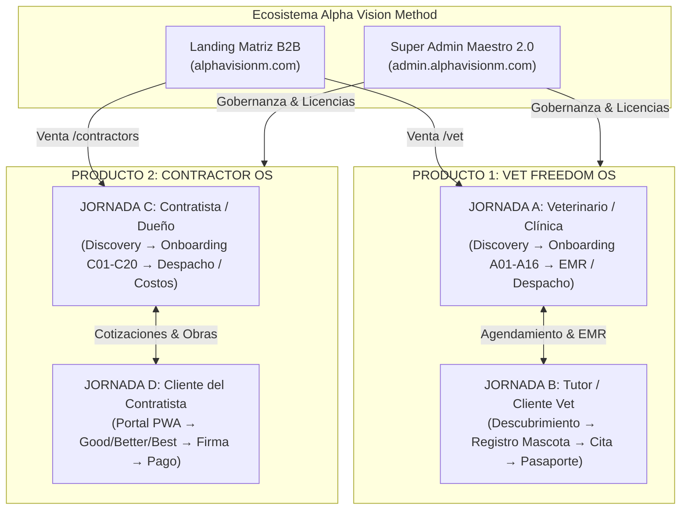

# ALPHA VISION METHOD — MAPAS COMPLETOS DE LAS CUATRO JORNADAS
**DOCUMENTO AUDIT-02 — MASTER CUSTOMER JOURNEYS (A, B, C, D)**

---

## 1. INTRODUCCIÓN Y ARQUITECTURA DE JORNADAS

Alpha Vision Method gobierna dos líneas de negocio SaaS independientes con cuatro jornadas maestras de usuario:
- **Jornada A (Veterinaria / B2B SaaS):** Veterinario o Clínica Veterinaria (Dr. Luis Eduardo Ríos anchor).
- **Jornada B (Tutor de Mascotas / B2C Client):** Cliente de la veterinaria que agenda, consulta historia y paga.
- **Jornada C (Contratista / B2B SaaS):** Dueño de empresa de servicios técnicos (HVAC, plomería, electricidad).
- **Jornada D (Cliente del Contratista / B2C-B2B2C):** Cliente residencial o comercial que solicita cotizaciones y servicios.

---

## 2. MAPA MAESTRO JORNADA A: VETERINARIO / CLÍNICA VETERINARIA

### Fases de la Jornada:
1. **Descubrimiento & Evaluación:**
   - *Punto de Entrada:* `alphavisionm.com/vet` o recomendación COMVEZCOL.
   - *Objetivo del Usuario:* Entender si el software automatiza sus visitas domiciliarias y fórmulas sin duplicar su EMR legal (OKVET).
   - *Riesgo Emocional / Fricción:* Temor a que la IA formule sin supervisión médica (Ley 576 de 2000) o que requiera cambiar de PIMS.
2. **Onboarding & Aprovisionamiento (A01 - A16):**
   - *Punto de Entrada:* `/registro-clinica`.
   - *Acciones:* Selección de plan (Solitario $189k, Pro $389k, Red $1.190k COP), asignación de subdominio (`*.alphavisionm.com`), configuración de días y horarios de disponibilidad, registro de clínica.
   - *Sistemas:* Supabase `platform_tenants`, RPC `provision_platform_tenant`, n8n `AVP-MASTER-001`.
3. **Primer Día & Configuración Asistida:**
   - *Punto de Entrada:* `/luis` (o panel propio del tenant).
   - *Acciones:* Agregar primer paciente, invitar asistente/recepcionista, probar simulación de consulta.
4. **Ciclo Operativo Diario (Pasos 1 - 22):**
   - *Acciones:* Solicitud de cita → Confirmación → Despacho con Smart ETA y privacidad GPS → Consulta SOAP → Firma de prescripción → Facturación Wompi → Sincronización OKVET.
5. **Retención & Renovación:**
   - *Acciones:* Reportes mensuales, seguimiento automatizado de vacunas y desparasitación, liquidación de honorarios y suscripción.

---

## 3. MAPA MAESTRO JORNADA B: TUTOR DE MASCOTAS / CLIENTE VETERINARIO

### Fases de la Jornada:
1. **Descubrimiento & Primer Contacto:**
   - *Punto de Entrada:* Enlace directo de la clínica (`luis.alphavisionm.com`), WhatsApp o QR en carné.
   - *Objetivo:* Agendar atención domiciliaria para su mascota enferma con mínima fricción.
   - *Principio No Negociable:* **Cero descarga obligatoria de app.** Agendamiento browser-first inmediato.
2. **Registro de Mascota & Agendamiento (B01 - B18):**
   - *Punto de Entrada:* `/cliente/reservar`.
   - *Acciones:* Ingreso de especie, raza, alergias conocidas, selección de horario y dirección de domicilio.
   - *Sistemas:* `pets`, `appointments`, notificaciones WABA vía n8n `VET-CORE-05`.
3. **Experiencia Durante la Visita:**
   - *Punto de Entrada:* Portal de seguimiento `/t/:token`.
   - *Acciones:* Ver ventana de llegada estimada (Smart ETA) del veterinario con privacidad protegida.
4. **Post-Consulta & Vida del Paciente:**
   - *Punto de Entrada:* `/cliente/hogar` y `/cliente/pasaporte/$id`.
   - *Acciones:* Descarga de prescripción médica firmada digitalmente, pasaporte de salud con QR, recordatorios preventivos y re-agendamiento en 1-clic.

---

## 4. MAPA MAESTRO JORNADA C: CONTRATISTA / EMPRESA DE SERVICIOS

### Fases de la Jornada:
1. **Descubrimiento B2B:**
   - *Punto de Entrada:* `alphavisionm.com/contractors`.
   - *Objetivo:* Aumentar conversión de cotizaciones, despachar cuadrillas y cobrar saldos sin peleas.
   - *Herramientas:* Demo interactiva de 8 pasos (`/contractors/demo`) con comparador de planes ($97, $197, $397 USD).
2. **Onboarding & Business DNA (C01 - C20):**
   - *Acciones:* Selección de nicho (HVAC, fontanería, remodelación), configuración de catálogo de precios, invitación de técnicos y conexión de CRM.
3. **Operación Diaria del Dueño:**
   - *Punto de Entrada:* `/contractors/leads` y `/contractors/jobs`.
   - *Acciones:* Captura de lead por voz o web → Generación de cotización escalonada (Bueno/Mejor/Excelente) → Asignación a técnico → Monitoreo de ejecución → Facturación.
4. **Subjornada del Trabajador / Técnico:**
   - *Punto de Entrada:* App móvil del trabajador (PWA).
   - *Acciones:* Ver orden de trabajo, fotos antes/después, registrar orden de cambio en sitio, marcar trabajo completado.

---

## 5. MAPA MAESTRO JORNADA D: CLIENTE DEL CONTRATISTA (PORTAL PWA)

### Fases de la Jornada:
1. **Solicitud de Servicio & Diagnóstico:**
   - *Punto de Entrada:* Portal de cliente con marca blanca de la empresa (`/contractors/portal/:token`).
   - *Acciones:* Subir fotos del problema (ej. compresor HVAC goteando), solicitar visita de inspección.
2. **Evaluación de Propuestas (Bueno / Mejor / Excelente):**
   - *Punto de Entrada:* Pestaña "Actividad / Cotizaciones".
   - *Acciones:* Comparar 3 opciones con desglose claro de garantías y alcance, seleccionar y firmar digitalmente.
3. **Gestión de Órdenes de Cambio (Change Orders):**
   - *Acciones:* Aprobar imprevistos detectados durante la obra con fotos y nuevo valor transparente.
4. **Pago & Pasaporte de Propiedad (Property Passport):**
   - *Acciones:* Pago online con Stripe o Nequi, acceso al historial de equipos y reclamo de garantías en 1-clic.
