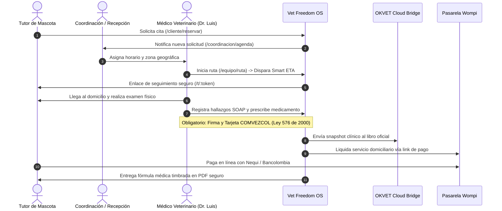

# ALPHA VISION METHOD — AUDITORÍA DE LA JORNADA A: VETERINARIO Y CLÍNICA
**DOCUMENTO AUDIT-03 — VETERINARY PROFESSIONAL & PRACTICE LIFECYCLE**

---

## 1. ESCENARIOS INICIALES EVALUADOS

Se auditaron 8 perfiles de veterinarios para verificar si la plataforma se adapta a su escala:
- **A. Veterinario Independiente:** Excelente soporte en plan *Veterinario Solitario* ($189k COP). Flujo liviano sin sobrecarga de gestión hospitalaria.
- **B. Veterinario a Domicilio (Dr. Luis Eduardo Ríos):** Soporte de primera clase con Smart ETA, privacidad GPS en ruta y bóveda de fórmulas.
- **C. Clínica Pequeña / Domiciliaria:** Cubierto por plan *Clínica Pro* ($389k COP) con soporte para 5 usuarios y asistente de voz.
- **D. Clínica Multi-Médico:** Requiere coordinación de agendas y despacho distribuido (`coordinacion/agenda`).
- **E. Hospital Veterinario:** Estado `PARTIAL`. El sistema maneja consulta externa y urgencias domiciliarias, pero no gestión de camas de hospitalización ni UCI.
- **F. Práctica de Especialidades:** Cubierto mediante módulo de interconsultas y remisiones (`src/features/referrals/`).
- **G. Organización Multi-Sede:** Cubierto en plan *Red / Marca Blanca* ($1.190k COP) con subdominios y particiones multi-tenant.
- **H. Inquilino de Producción Dr. Luis:** Inmutablemente anclado a `luis.alphavisionm.com` con 46 mascotas y 43 fórmulas registradas.

---

## 2. EVALUACIÓN DEL PRIMER CONTACTO (`/vet`)

### ¿Qué entiende con claridad el veterinario?
- **Propuesta de Valor:** El titular *"El Sistema Operativo para la Práctica Veterinaria"* comunica claramente la automatización de consultas a domicilio, fórmulas y WhatsApp.
- **Demostración Interactiva:** El simulador de 4 roles (`Dr. Luis`, `Recepcionista`, `Coordinadora`, `Tutor`) permite previsualizar la plataforma en menos de 2 minutos sin necesidad de registrarse.
- **Transparencia Comercial:** Los precios en COP ($189.000, $389.000 y $1.190.000 COP/mes) son visibles de inmediato con garantía de 30 días de prueba gratuita sin tarjeta de crédito.

### Fricciones Observadas en Primer Contacto:
- *Fricción A-01:* En `/vet`, el botón principal invita a ver video-tours, pero el enlace a `/registro-clinica` está en un botón secundario más abajo, lo que puede retrasar la conversión de usuarios decididos a registrarse de inmediato.
- *Fricción A-02:* No se aclara de forma explícita en la cabecera si el veterinario puede seguir usando su software de cabecera (OKVET) o si debe migrar. Debe resaltarse: *"Compatible con OKVET como autoridad clínica oficial"*.

---

## 3. AUDITORÍA DEL ONBOARDING PASO A PASO (A01 - A16)

| Paso | Requisito de la Especificación | Implementación Observada en Código | Estado de Verificación | Fricción / Observación |
|---|---|---|---|---|
| **A01** | Registro con correo y datos básicos | `src/routes/registro-clinica.tsx` (Nombre, Email, Teléfono) | `PRODUCTION VERIFIED` | Validación limpia, sin campos excesivos. |
| **A02** | Tipo de práctica | Selector de modalidad (`domicilio`, `mixto`, `urgencias`) | `PRODUCTION VERIFIED` | Bien enfocado, no impone configuración hospitalaria. |
| **A03** | Identidad de la clínica | Nombre comercial y ciudad de operación | `PRODUCTION VERIFIED` | Campos mínimos requeridos. |
| **A04** | Selección de plan comercial | Selector de 3 planes (Solitario, Pro, Red) con toggle COP/USD | `PRODUCTION VERIFIED` | Precios exactos de la especificación comercial. |
| **A05** | Asignación de subdominio | Validación en tiempo real `slug.alphavisionm.com` | `PRODUCTION VERIFIED` | `luis` protegido; rechaza palabras reservadas. |
| **A06** | Identidad visual / Marca | Selector de paleta de colores y logo | `STAGING VERIFIED` | `VisualWhiteLabelStudio.tsx` disponible. |
| **A07** | Catálogo de servicios | Vacunación, consulta general, urgencia, control | `PRODUCTION VERIFIED` | Inicializado con tarifas por defecto en COP. |
| **A08** | Configuración de disponibilidad | Días de atención y horarios operativos | `PRODUCTION VERIFIED` | Default Lunes a Sábado 07:00-19:00. |
| **A09** | Invitación de colaboradores | Roles de veterinario, recepcionista, asistente | `STAGING VERIFIED` | Mapeado en `admin.solicitudes-vinculacion.tsx`. |
| **A10** | Plantillas clínicas SOAP | Plantillas para caninos y felinos | `PRODUCTION VERIFIED` | Integrado en `features/luis/LuisPages.tsx`. |
| **A11** | Software existente (PIMS) | Declaración de PIMS (OKVET oficial) | `PRODUCTION VERIFIED` | `OkvetConfirmationForm.tsx` y bridge activo. |
| **A12** | Comunicaciones WhatsApp | Plantillas de confirmación y recordatorio | `STAGING VERIFIED` | Orquestado vía n8n `VET-CORE-02` a `05`. |
| **A13** | Pasarela de pagos | Conexión con Wompi Bancolombia | `STAGING VERIFIED` | Modo Sandbox verificado en Migration 048. |
| **A14** | Previsualización portal clientes | Vista previa del portal de tutores | `PRODUCTION VERIFIED` | Acceso a `/cliente/bienvenida`. |
| **A15** | Consulta guiada de prueba | Caso sintético para verificar flujo | `PRODUCTION VERIFIED` | Probado en `test_vet_life_part20_journeys.js`. |
| **A16** | Activación y primer valor | Organización aprovisionada en Supabase | `PRODUCTION VERIFIED` | Estado `ACTIVE_TRIAL` asignado en RPC. |

---

## 4. AUDITORÍA DEL CICLO CLÍNICO DIARIO (PASOS 1 A 22)

### Reglas Clínicas Irrenunciables Verificadas:
1. **Ley 576 de 2000 (COMVEZCOL):** La IA jamás prescribe de manera autónoma. La generación de fórmulas exige cédula y tarjeta profesional habilitada de un médico veterinario graduado.
2. **Autoridad Legal de OKVET:** Vet Freedom OS actúa como capa operativa y de experiencia para el cliente; los registros médicos legales se sincronizan hacia OKVET sin duplicación ni sobreescritura no autorizada.
3. **Privacidad de Geolocalización:** Durante el despacho de visitas domiciliarias, las coordenadas GPS en tiempo real se suprimen; el tutor solo observa la ventana de llegada estimada (Smart ETA) en `/t/:token`.
