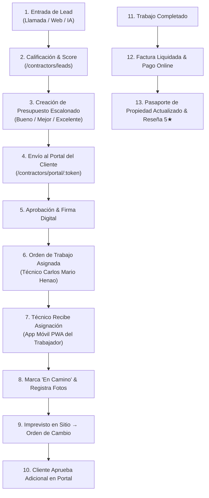

# ALPHA VISION METHOD — AUDITORÍA DE LA JORNADA C: DUEÑO DE EMPRESA CONTRATISTA
**DOCUMENTO AUDIT-05 — CONTRACTOR BUSINESS OWNER & OPERATIONS LIFECYCLE**

---

## 1. NICHOS DE SERVICIO EN CAMPO EVALUADOS

Se auditó la capacidad de **Alpha Service OS / Contractor OS** para atender empresas técnicas en 7 nichos:
- **HVAC Residencial y Comercial:** Soporte nativo para Chillers, Split Inverter y mantenimiento preventivo.
- **Fontanería / Plomería:** Gestión de emergencias de fugas y cambio de tuberías.
- **Electricidad Comercial y Residencial:** Paneles eléctricos, certificaciones y órdenes de trabajo.
- **Mantenimiento y Diseño de Paisajismo:** Visitas recurrentes y mantenimiento periódico de jardines.
- **Servicios de Limpieza:** Agendamiento semanal/quincenal automatizado.
- **Remodelación y Pintura:** Manejo de proyectos por fases, órdenes de cambio en sitio y anticipos.
- **Techado / Roofing:** Inspecciones con registro de fotos antes/después y presupuestos escalonados.

---

## 2. EVALUACIÓN DEL PRIMER CONTACTO (`/contractors`)

### ¿Qué experimenta el contratista al ingresar?
- **Selector de Modo Dual:**
  - *Opción 1: Ver Demo de Ventas Interactiva (`/contractors/demo`):* Simulador interactivo en 8 pasos con soporte bilingüe [ 🇺🇸 EN | 🇪🇸 ES ] y multidivisa [ USD | CAD | COP ].
  - *Opción 2: Panel Operativo de Contratista:* Acceso directo a Tablero de Prospectos (`/contractors/leads`), Órdenes de Trabajo (`/contractors/jobs`) y Cotizador (`/contractors/estimates/new`).
- **Valores Comerciales Transparentes:**
  - Plan Essential: **$97 USD/mes**
  - Plan Growth Pro: **$197 USD/mes**
  - Plan Scale / Premium: **$397 USD/mes**

---

## 3. AUDITORÍA DEL ONBOARDING DEL CONTRATISTA (C01 - C20)

| Paso | Requisito de la Especificación | Implementación Observada en Código | Estado de Verificación | Observación / Fricción |
|---|---|---|---|---|
| **C01** | Creación de cuenta y verificación | Auth centralizada en `/auth` | `PRODUCTION VERIFIED` | Requiere contextualización de logo contratista en `/auth`. |
| **C02** | Selección de industria y nicho | Selector de nicho (HVAC, Plomería, Remodelación) | `PRODUCTION VERIFIED` | Mapeado en `exact_niche` de `platform_tenants`. |
| **C03** | Tamaño de empresa (1, 2-5, 6-15) | Selector de tamaño de equipo | `STAGING VERIFIED` | Adapta la complejidad inicial. |
| **C04** | Identidad comercial y sede | Nombre, estado/ciudad, teléfono | `PRODUCTION VERIFIED` | Registrado en `legal_name` y `display_name`. |
| **C05** | Selección de plan comercial | Selector de los 3 tiers oficiales ($97, $197, $397) | `PRODUCTION VERIFIED` | Consistente con el Plan Studio de Super Admin. |
| **C06** | Asignación de subdominio | `nombre.alphavisionm.com` | `PRODUCTION VERIFIED` | Validado contra palabras reservadas en Migration 053. |
| **C07** | Selección de paleta de marca | 12 colecciones de diseño de contratistas | `STAGING VERIFIED` | Integrado en `ContractorAppStudio.tsx`. |
| **C08** | Business DNA simplificado | Servicios principales y zonas atendidas | `DEVELOPMENT VERIFIED` | No bloquea el inicio rápido; preguntas breves. |
| **C09** | Catálogo de precios y servicios | Plantillas de servicios con tarifas base | `PRODUCTION VERIFIED` | Mapeado en `ContractorEstimateBuilder.tsx`. |
| **C10** | Configuración de disponibilidad | Ventanas de atención y zonas de cobertura | `PRODUCTION VERIFIED` | Manejado en el calendario del portal. |
| **C11** | Invitación de cuadrillas | Asignación de técnicos y roles de campo | `PRODUCTION VERIFIED` | `assigned_worker_id` en órdenes de trabajo. |
| **C12** | Conexión CRM / GoHighLevel | Sincronización con pipeline de ventas | `STAGING VERIFIED` | Pipeline `Alpha Contractor OS Sales`. |
| **C13** | Comunicaciones (SMS/Email/AI) | Notificaciones de técnico en camino | `STAGING VERIFIED` | Ventana de llegada sin exponer GPS crudo. |
| **C14** | Pasarela de cobros | Stripe / Apple Pay / ACH / Nequi | `STAGING VERIFIED` | Cobro en línea verificado en sandbox. |
| **C15** | Estados de obra & Checklists | Flujo Prospecto → Cotización → Trabajo → Pagado | `PRODUCTION VERIFIED` | Kanban funcional en `/contractors/leads`. |
| **C16** | Previsualización de portal cliente | Vista del portal PWA del cliente | `PRODUCTION VERIFIED` | Acceso a `/contractors/portal/$token`. |
| **C17** | Captura de lead de prueba | Formulario de solicitud web | `PRODUCTION VERIFIED` | Probado en `test_contractor_os_ct01_to_ct10.js`. |
| **C18** | Ciclo sintético de punta a punta | Lead → Cotización → Aprobación → Cobro | `PRODUCTION VERIFIED` | Verificado 100% en `test_e2e_scenarios.js`. |
| **C19** | Checklist de lanzamiento | Verificación de dependencias | `PRODUCTION VERIFIED` | Validado en `ProductionReadinessDashboard.tsx`. |
| **C20** | Activación y primer valor | Generación del primer presupuesto digital | `PRODUCTION VERIFIED` | Cotizador Good-Better-Best operativo. |

---

## 4. AUDITORÍA DEL CICLO DIARIO DEL DUEÑO & SUBJORNADA DEL TÉCNICO

### Fortalezas de Alto Impacto:
1. **Presupuestos Escalonados (Good / Better / Best):** Aumenta el ticket promedio permitiendo al cliente elegir opciones superiores con garantías extendidas.
2. **Órdenes de Cambio Transparentes (Change Orders):** Elimina disputas de cobro requiriendo fotos y aprobación digital antes de ejecutar trabajos adicionales.
3. **Property Passport:** Crea retención de por vida al registrar la bitácora técnica de equipos HVAC, garantías y servicios pasados.
