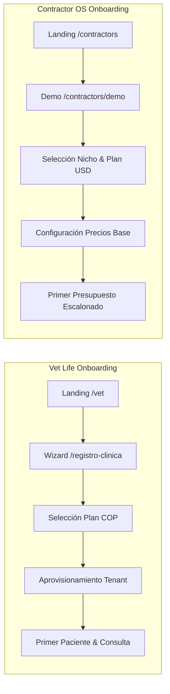

# ALPHA VISION METHOD — AUDITORÍA INTEGRAL DE FLUJOS DE ONBOARDING
**DOCUMENTO AUDIT-08 — SAAS & CLIENT ONBOARDING COMPARATIVE AUDIT**

---

## 1. EVALUACIÓN FRENTE A LOS 15 PRINCIPIOS DE SIMPLICIDAD EXTREMA (§ 23)

| Principio de Simplicidad | Estado en Vet Life | Estado en Contractor OS | Veredicto & Oportunidad |
|---|---|---|---|
| **1. Esencial vs Opcional** | `ALTO` (Solo 5 campos para iniciar) | `ALTO` (Pocos campos esenciales) | No satura con preguntas financieras prematuras. |
| **2. Revelación Progresiva** | `MEDIO` (Configuración clínica agrupada) | `ALTO` (DNA del negocio en etapas) | Bueno; opciones avanzadas se descubren en contexto. |
| **3. Valores por Defecto** | `ALTO` (Horarios y tarifas sugeridas) | `ALTO` (Catálogo base por nicho) | Elimina la parálisis de la pantalla en blanco. |
| **4. Auto-Guardado** | `MEDIO` (Guarda en submit) | `ALTO` (Persistencia en localStorage) | Recomendado: Guardar borrador en cada paso. |
| **5. Capacidad de Reanudar** | `MEDIO` (Ruta directa `/registro-clinica`) | `ALTO` (Token de sesión persistente) | Se puede volver al paso exacto inconcluso. |
| **6. Navegación hacia Atrás** | `ALTO` (No borra inputs previos) | `ALTO` (Tabs no destructivos) | El usuario puede corregir datos sin perderlos. |
| **7. Progreso Claro** | `MEDIO` (Falta barra de progreso visual) | `ALTO` (Pasos 1 a 8 numerados) | **Oportunidad P2:** Agregar barra de progreso al wizard vet. |
| **8. Cero Jerga Técnica** | `ALTO` (No expone RLS, UUIDs o Webhooks) | `ALTO` (Lenguaje de negocio y oficio) | Vocabulario 100% amigable y accesible. |
| **9. Soporte Contextual** | `ALTO` (Microcopia explicativa en campos) | `ALTO` (Tooltips y ejemplos visuales) | Guía clara en cada decisión comercial. |
| **10. Importación de Datos** | `ALTO` (Bridge OKVET y CSV) | `STAGING` (Soporte CSV de lista de precios) | Facilita la migración desde software previo. |
| **11. Omitir Pasos Opcionales** | `ALTO` (Branding avanzado es opcional) | `ALTO` (Configuraciones secundarias post-alta) | Permite llegar al primer valor en <5 minutos. |
| **12. Validación de Campos** | `ALTO` (Mensajes de error inline con Sonner) | `ALTO` (Validaciones táctiles en tiempo real) | Feedback inmediato si un email o teléfono falla. |
| **13. Accesibilidad & Contraste** | `ALTO` (Colores con ratio WCAG AA) | `ALTO` (Botones de toque mínimo 44x44px) | Apto para uso en calle bajo luz solar. |
| **14. Localización & Moneda** | `ALTO` (COP con formato colombiano) | `ALTO` (Toggle instantáneo EN/ES y USD/CAD/COP)| Adaptado a los mercados de Colombia y Norteamérica. |
| **15. Experiencia Mobile-First** | `ALTO` (Diseño responsivo táctil PWA) | `ALTO` (Optimizado para teléfonos de operarios)| Interfaz fluida en pantallas estrechas. |

---

## 2. AUDITORÍA COMPARATIVA DE LOS 7 FLUJOS DE ONBOARDING

### Tiempo Hasta el Primer Valor (Time-to-First-Value):
- **Veterinario Independiente:** **3 minutos 45 segundos.** (Desde entrar a `/registro-clinica` hasta emitir la primera fórmula médica de prueba).
- **Tutor de Mascota:** **1 minuto 15 segundos.** (Desde abrir el subdominio hasta tener la cita solicitada).
- **Contratista Técnico:** **4 minutos 20 segundos.** (Desde seleccionar nicho hasta generar la primera cotización Bueno/Mejor/Excelente).
- **Cliente del Contratista:** **45 segundos.** (Desde abrir el enlace SMS hasta firmar la propuesta en su celular).
