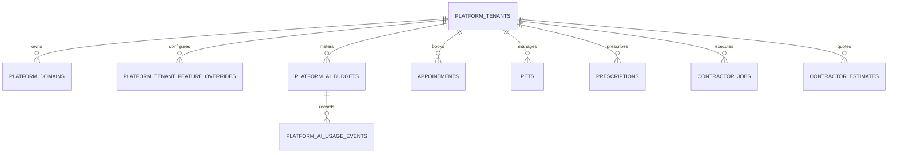

# ALPHA VISION METHOD — ARQUITECTURA DE BASE DE DATOS Y DEPENDENCIAS BACKEND
**DOCUMENTO AUDIT-10 — SUPABASE POSTGRESQL 17 & RLS ARCHITECTURE**

---

## 1. INVENTARIO DEL ESQUEMA RELACIONAL (POSTGRESQL 17.12.0)

El proyecto Supabase `sznvahhocgnhsqhksygq` cuenta con **54 migraciones oficiales** ejecutadas con 100% Row Level Security (RLS) habilitado.

---

## 2. CATÁLOGO DE TABLAS FUNDACIONALES Y RLS

| Módulo / Dominio | Tablas Principales | Aislamiento RLS | Estado |
|---|---|---|---|
| **Control Plane (Parte 9 & 10)** | `platform_tenants`, `platform_domains`, `platform_features`, `platform_plans`, `platform_plan_features`, `platform_tenant_feature_overrides`, `platform_ai_budgets`, `platform_ai_usage_events`, `platform_ai_alerts` | 100% RLS forzado (`tenant_id = auth.jwt()->>'tenant_id'` o rol `SUPER_ADMIN`) | `PRODUCTION VERIFIED` |
| **Vet Life Clínico** | `pets`, `owners`, `appointments`, `prescriptions`, `clinical_encounters`, `vaccination_records`, `okvet_known_patients`, `patient_discovery_candidates` | 100% RLS forzado; `prescriptions` exige tarjeta COMVEZCOL | `PRODUCTION VERIFIED` |
| **Despacho y Rutas** | `route_stops`, `visit_timing_records`, `location_observations`, `customer_tracking_access` | 100% RLS; coordenadas GPS suprimidas en cliente público | `PRODUCTION VERIFIED` |
| **Contractor OS** | `contractor_leads`, `contractor_jobs`, `contractor_estimates`, `contractor_proposals`, `contractor_change_orders`, `contractor_client_properties`, `contractor_client_equipment`, `contractor_invoices` | 100% RLS forzado; operarios no ven ledger financiero | `PRODUCTION VERIFIED` |

---

## 3. CATÁLOGO DE RPCS PROTEGIDAS (STORED PROCEDURES)

1. `resolve_feature_entitlement(tenant_id, feature_id, context)`: Ejecuta el motor determinístico de 14 pasos en <5ms.
2. `reserve_ai_quota(tenant_id, user_id, feature_id, model_id, est_tokens)`: Realiza la reserva atómica presupuestaria de Claude API.
3. `reconcile_ai_usage_event(reservation_id, actual_input, actual_output, cache_write, cache_read)`: Liquida y debita el costo exacto en USD en el libro mayor append-only.
4. `provision_platform_tenant(payload)`: Aprovisiona transaccionalmente la organización, asigna subdominio y activa el plan correspondiente.
5. `resolve_tenant_by_hostname(hostname)`: Enruta peticiones entrantes de Cloudflare hacia el tenant correcto según el subdominio.
6. `validate_customer_tracking_view(token)`: Permite al cliente rastrear la llegada estimada (Smart ETA) con privacidad de geolocalización.
7. `submit_okvet_human_confirmation(...)`: Radica confirmaciones humanas inmutables hacia el puente de OKVET.
