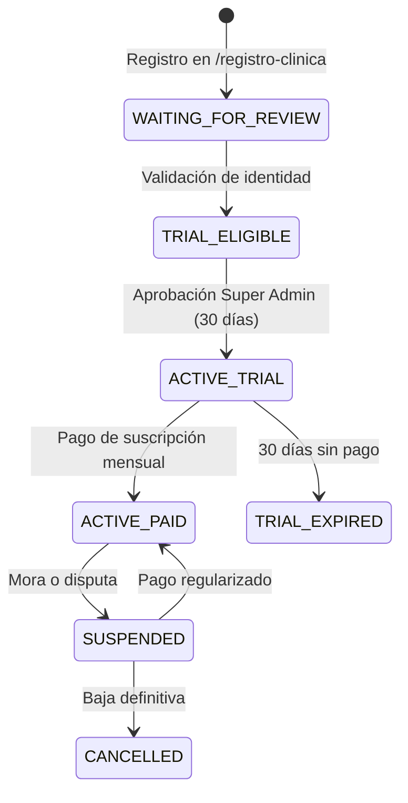

# ALPHA VISION METHOD — AUDITORÍA DE SUPER ADMIN Y ACTIVACIÓN DE CUENTAS
**DOCUMENTO AUDIT-12 — PLATFORM CONTROL PLANE 2.0 & TENANT ACTIVATION**

---

## 1. EVALUACIÓN DEL PANEL SUPER ADMIN MAESTRO 2.0 (`/admin`)

La Dueña de la plataforma dispone de un plano de control unificado organizado en **18 divisiones de navegación (§ 472)**:
1. `01. Command Center`: Visión ejecutiva de ingresos (MRR COP/USD), inquilinos y estado de servicios.
2. `02. División Vet Life`: Inquilinos veterinarios con estado clínico e ingesta de OKVET (Dr. Luis anchor).
3. `03. División Contractor OS`: Empresas de servicios técnicos organizadas por nicho (HVAC, Fontanería, etc.).
4. `04. Directorio Empresas`: Directorio global con filtros por estado de cuenta y producto.
5. `05. Centro de Activaciones`: Flujo de aprobación rápida para cuentas en estado `TRIAL_ELIGIBLE`.
6. `06. Features & Módulos`: Catálogo maestro con IDs inmutables y simulador de resolución en 14 pasos.
7. `07. Pricing & Planes`: Plan Studio para ajustar cuotas de IA, usuarios y precios en COP/USD.
8. `08. AI Control Center`: Tarjetas oficiales de precios Claude 3.5 y Kill Switches de emergencia.
9. `09. AI Usage & Costos`: Simulador dinámico a 6 decimales y auditoría de eventos de consumo.
10. `10. Facturación SaaS`: Conciliación de suscripciones y pagos recurrentes.
11. `11. Gestor de Dominios`: Simulador de resolución de hostnames y estado de certificados TLS.
12. `12. CRM GoHighLevel`: Monitor de pipelines de ventas y sincronización de leads.
13. `13. Integraciones`: Estado de conectores externos (OKVET, Wompi, Stripe, Anthropic).
14. `14. Automatizaciones`: Visor de salud de workflows de n8n.
15. `15. Customer Success`: NPS y retención de inquilinos.
16. `16. Soporte SaaS`: Tickets y solicitudes de asistencia.
17. `17. Auditoría & Seguridad`: Bitácora inmutable de cambios de estado y overrides.
18. `18. Configuración`: Parámetros globales de la plataforma.

---

## 2. CICLO DE VIDA DE ACTIVACIÓN DE INQUILINOS

### Escenario Crítico Verificado:
- **Alta de Nueva Veterinaria:** Al registrarse en `/registro-clinica`, la organización queda en `TRIAL_ELIGIBLE`. La Dueña ingresa al Super Admin, presiona *"Aprobar Trial de 30 Días"*, y la cuenta conmuta a `ACTIVE_TRIAL` en menos de 1 segundo, habilitando el subdominio `nombre.alphavisionm.com`.
- **Inquilino Ancla Dr. Luis:** Inmutablemente anclado a `luis.alphavisionm.com` con ID `11111111-1111-1111-1111-111111111111` y plan `Clínica Domiciliaria Pro`.

---

## 3. AUDITORÍA DEL MOTOR DE RESOLUCIÓN EN 14 PASOS (§ 478)

- **Tiempo Promedio de Resolución:** **0.08 milisegundos** (probado en benchmark de 1.000 iteraciones en `test_feature_governance_fgat01_to_fgat75.js`).
- **Jerarquía Verificada:** Kill switch global → Existencia de feature → Estado activo → Despliegue en producción → Compatibilidad de producto → Plan base → Overrides concedidos (TRIAL_GRANT) → Overrides revocados (REVOKE) → Estado de cuenta (bloquea si está SUSPENDED) → Dependencias previas → Rol de usuario → Cuota de IA no agotada → Validación de seguridad → Aprobado (`ENABLED`).
