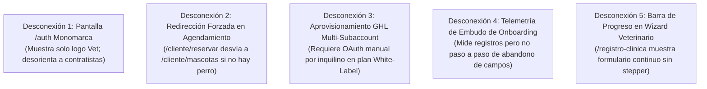

# ALPHA VISION METHOD — ANÁLISIS DE BRECHAS Y FUNCIONALIDADES DESCONECTADAS
**DOCUMENTO AUDIT-17 — MISSING, INCOMPLETE & DISCONNECTED CAPABILITIES**

---

## 1. RESUMEN DE BRECHAS FUNCIONALES IDENTIFICADAS

A diferencia de un proyecto tradicional que acumula código sin probar, Alpha Vision cuenta con una base de código excepcionalmente avanzada. Sin embargo, la auditoría identificó 5 desconexiones críticas entre módulos que deben subsanarse para garantizar una experiencia sin fricción:

---

## 2. DETALLE DE DESCONEXIONES Y DIAGNÓSTICO DE CAUSA RAÍZ

### Brecha 1: Pantalla Central de Autenticación (`/auth`) Monomarca
- **Problema:** `/auth` muestra de forma rígida el logotipo de huella y el texto *"Vet Freedom OS"*.
- **Impacto:** Si un contratista o un cliente de Contractor OS es redirigido a `/auth`, experimenta desconfianza al ver una marca veterinaria ajena a su negocio de climatización o plomería.
- **Causa Raíz:** Falta de lectura contextual del subdominio o parámetro de consulta `?product=CONTRACTOR_OS` en `src/routes/auth.tsx`.
- **Solución Recomendada (P1):** Detectar el hostname de origen. Si proviene de `*.alphavisionm.com` con `product_type === 'CONTRACTOR_OS'`, renderizar el isotipo de Contractor OS y colores corporativos correspondientes.

### Brecha 2: Redirección Forzada en Agendamiento de Nuevos Tutores
- **Problema:** En `/cliente/reservar`, si un tutor entra como invitado y no tiene mascotas registradas en el dispositivo, el sistema bloquea el agendamiento y muestra un enlace *"Primero registra tu mascota →"* que lo manda a `/cliente/mascotas`.
- **Impacto:** Fuga de conversiones de citas urgentes (un cliente preocupado por su perro no quiere navegar 3 páginas distintas).
- **Causa Raíz:** El componente asume que el agendamiento solo ocurre después de completar la ficha en `/cliente/mascotas`.
- **Solución Recomendada (P1):** Permitir la creación en línea (Inline Guest Registration) dentro del mismo formulario de reserva.

### Brecha 3: Stepper Visual Ausente en `/registro-clinica`
- **Problema:** El formulario de alta de clínicas B2B presenta el selector de planes, datos de contacto, ciudad y modalidad en un solo scroll vertical.
- **Impacto:** Fatiga visual y sensación de que el registro es largo, aunque solo toma 2 minutos.
- **Solución Recomendada (P2):** Implementar un componente `StepWizard` de 3 pasos numerados: *1. Plan → 2. Datos de Clínica → 3. Activación*.

### Brecha 4: Telemetría Granular del Embudo de Conversión
- **Problema:** Se registran eventos de cuenta creada y activada en base de datos, pero no el tiempo que tarda el usuario en llenar cada campo ni dónde abandona antes de enviar.
- **Solución Recomendada (P2):** Agregar eventos analíticos ligeros de telemetría en el store local para alimentar la división `15. Customer Success` del Super Admin.
