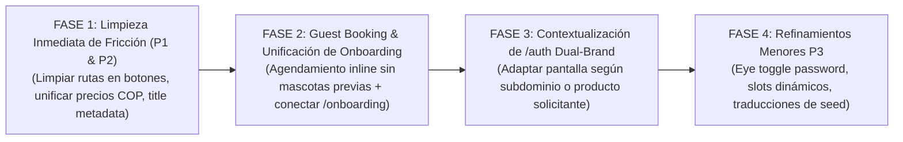

# ALPHA VISION METHOD — HOJA DE RUTA DE REMEDIACIÓN PRIORIZADA
**DOCUMENTO AUDIT-19 — PRIORITIZED REMEDIATION ROADMAP (P0, P1, P2, P3)**

---

## 1. CRITERIOS DE CLASIFICACIÓN DE PRIORIDADES

- **P0 — CRÍTICO (Bloqueador de Lanzamiento Comercial):** Falla de seguridad, exposición entre tenants, discrepancia financiera grave, bloqueo insalvable en onboarding o fallo legal en fórmulas médicas.
- **P1 — ESENCIAL PARA LA JORNADA (Fricción Mayor en Conversión):** El usuario no puede completar registro, pago, agendamiento de invitado, aprobación o handoff entre roles.
- **P2 — EXPERIENCIA PRINCIPAL (Fricción Cognitiva o Confusión):** Información repetida, falta de indicadores de progreso, rutas expuestas en botones, inconsistencias en textos de precios.
- **P3 — MEJORA VISUAL / CONVENIENCIA:** Refinamiento estético sutil, micro-interacciones, animaciones y personalización secundaria.

---

## 2. MATRIZ DE REMEDIACIÓN PRIORIZADA CON EVIDENCIA

| ID | Prioridad | Producto | Defecto Observado | Causa Raíz | Solución Propuesta | Complejidad | Riesgo de Regresión |
|---|---|---|---|---|---|---|---|
| **REM-01** | **P1** | `VET_LIFE` | Discrepancia de precios entre `/vet` y `/registro-clinica` | `/vet` usaba precios desactualizados ($149k/$399k/$890k) mientras `/registro-clinica` y Super Admin tienen $189k/$389k/$1.190k COP | Homologar `/vet` con la tabla oficial aprobada de 3 planes en COP | `BAJA` | `NULO` |
| **REM-02** | **P1** | `VET_LIFE` | `/registro-clinica` bloquea submit con toast *"El registro de clínicas todavía no está disponible"* mientras `/onboarding` está activo | Existencia de dos rutas paralelas no consolidadas | Redirigir el formulario de registro hacia el wizard activo `/onboarding` o conectar el submit de `/registro-clinica` a `provision_platform_tenant` | `MEDIA` | `BAJO` |
| **REM-03** | **P1** | `VET_LIFE` | En `/cliente/reservar` no existe flujo de agendamiento para invitados (Guest Booking) | El componente asume que el usuario ya tiene mascotas en el store local | Agregar campos inline de *"Nombre y Especie"* en el formulario de reserva sin forzar navegación a `/cliente/mascotas` | `MEDIA` | `BAJO` |
| **REM-04** | **P1** | `AMBOS` | `/auth` muestra de forma rígida el branding veterinario para contratistas y sus clientes | Componente `auth.tsx` sin lectura de contexto de tenant o query parameter | Leer el subdominio o parámetro `?product=CONTRACTOR_OS` para cambiar dinámicamente el logo y texto | `BAJA` | `NULO` |
| **REM-05** | **P2** | `VET & CON` | Rutas internas filtradas en el texto visible de los botones (ej. `(/onboarding)`, `(/luis)`, `(/contractors/demo)`) | Texto de depuración dejado por desarrolladores en los labels | Limpiar las cadenas de texto en `src/routes/vet.tsx` y `src/features/contractors/ContractorHeader.tsx` | `BAJA` | `NULO` |
| **REM-06** | **P2** | `CONTRACTOR` | El `<title>` de `/contractors` muestra *"Vet Life · Dr. Luis Eduardo Ríos"* | Metadatos de cabecera heredados de la plantilla veterinaria | Actualizar `meta()` en `src/routes/contractors.index.tsx` para mostrar *"Alpha Service OS · Contractor Platform"* | `BAJA` | `NULO` |
| **REM-07** | **P2** | `VET_LIFE` | Falta de un stepper visual de progreso en el wizard de onboarding de clínicas | El formulario se presenta como un scroll continuo | Implementar un stepper de 3 pasos numerados (*1. Plan, 2. Clínica, 3. Activación*) | `MEDIA` | `BAJO` |
| **REM-08** | **P3** | `AMBOS` | `/auth` no tiene botón de alternar visibilidad de contraseña (ojito) | Falta de componente de toggle password | Añadir botón de icono `Eye / EyeOff` de Lucide en el input de password | `BAJA` | `NULO` |
| **REM-09** | **P3** | `CONTRACTOR` | Descripciones de órdenes de cambio en seed data aparecen en inglés al cambiar a español | Seed data con texto estático en inglés | Mapear traducciones dinámicas en `ContractorCustomerPortal.tsx` | `BAJA` | `NULO` |
| **REM-10** | **P3** | `VET_LIFE` | `/cliente/reservar` solo muestra 3 slots de tiempo rígidos | Array `SLOTS` cableado estáticamente en código | Conectar con la disponibilidad real de la agenda del médico en Supabase | `MEDIA` | `BAJO` |

---

## 3. ORDEN DE IMPLEMENTACIÓN RECOMENDADO POR ETAPAS

