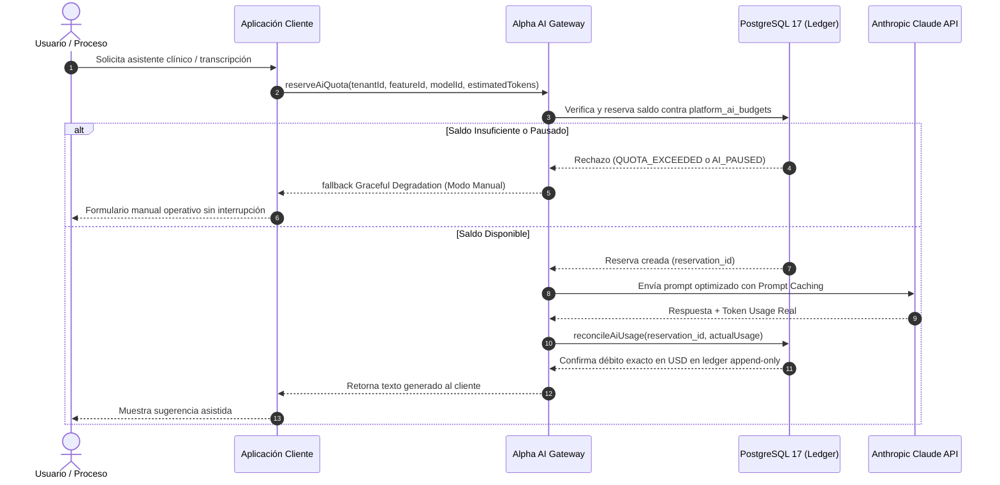

# ALPHA VISION METHOD — ARQUITECTURA DEL GATEWAY DE INTELIGENCIA ARTIFICIAL & METERING DE TOKENS
**DOCUMENTO TÉCNICO MAESTRO — CONTROL PLANE 2.0 (PARTE 10)**

---

## 1. OBJETIVO Y ARQUITECTURA DEL GATEWAY DE IA

El **Alpha AI Gateway** es el punto único de entrada, auditoría, medición y control de costos para todas las capacidades de inteligencia artificial en **Vet Freedom OS** y **Contractor OS**.

### Principios de Operación:
1. **Protección Presupuestaria Atómica**: Ninguna llamada a un LLM externo (Anthropic Claude API) se ejecuta sin una reserva previa de presupuesto contra el saldo mensual asignado al inquilino.
2. **Cero Pérdida de Datos (Graceful Degradation)**: Si un inquilino agota su cuota de IA o si la API externa experimenta fallas, **la aplicación nunca se bloquea ni pierde datos clínicos o comerciales**. Los formularios de consulta SOAP, notas clínicas, recetas y presupuestos de contratistas conmutan instantáneamente a modo manual de alta disponibilidad.
3. **Optimización Financiera Extrema**: Enrutamiento inteligente hacia modelos de alta eficiencia (Haiku para operaciones frecuentes y Sonnet solo para análisis clínico profundo), aprovechando soporte nativo de **Prompt Caching** (descuento del 90% en tokens de entrada cacheados).
4. **Filtro Heurístico Local ($0.00 USD)**: Consultas comunes (horarios, estados del sistema, menús de navegación) se resuelven localmente en el cliente sin costo de tokens.

---

## 2. PRECIOS OFICIALES Y FÓRMULA DE COSTOS DE CLAUDE 3.5

Los costos se calculan exactamente con la fórmula canónica de Anthropic:

$$\text{Costo USD} = \frac{T_{\text{in}}}{10^6} \times P_{\text{in}} + \frac{T_{\text{out}}}{10^6} \times P_{\text{out}} + \frac{T_{\text{cw}}}{10^6} \times P_{\text{cw}} + \frac{T_{\text{cr}}}{10^6} \times P_{\text{cr}}$$

Donde:
- $T_{\text{in}}$: Tokens de entrada estándar.
- $T_{\text{out}}$: Tokens generados de salida.
- $T_{\text{cw}}$: Tokens de escritura en caché de prompt (creación).
- $T_{\text{cr}}$: Tokens de lectura desde caché de prompt (reutilización con 90% descuento).

### Tabla de Tarifas por Millón de Tokens (USD):
| Modelo | Entrada ($P_{\text{in}}$) | Salida ($P_{\text{out}}$) | Caché Escritura ($P_{\text{cw}}$) | Caché Lectura ($P_{\text{cr}}$) | Ahorro en Caché |
|---|---|---|---|---|---|
| **Claude 3.5 Sonnet** (`claude-3-5-sonnet-20241022`) | \$3.00 | \$15.00 | \$3.75 | \$0.30 | 90.0% |
| **Claude 3.5 Haiku** (`claude-3-5-haiku-20241022`) | \$0.80 | \$4.00 | \$1.00 | \$0.08 | 90.0% |

---

## 3. CICLO DE VIDA DE UNA LLAMADA DE IA: RESERVA ATÓMICA Y RECONCILIACIÓN

---

## 4. GOBERNANZA DE LÍMITES PRESUPUESTARIOS

1. **Límite Suave (Soft Limit - 80%)**:
   - Cuando el consumo acumulado mensual de un inquilino alcanza el 80% de su presupuesto asignado, se genera un evento de alerta `WARNING` vía n8n (`FG-010`).
   - Se notifica al Super Admin y al inquilino informando el ritmo de consumo.
   - **No interrumpe el servicio**.
2. **Límite Duro (Hard Limit - 100%)**:
   - Cuando el consumo acumulado alcanza el 100%, el sistema activa automáticamente el interruptor `is_paused = true` para ese inquilino (`FG-011`).
   - Se dispara alerta `CRITICAL`.
   - El sistema conmuta instantáneamente al modo de **degradación elegante sin pérdida de datos**.
3. **Interruptor de Emergencia (Emergency Kill Switch - Global o por Inquilino)**:
   - La Dueña de la plataforma puede desactivar instantáneamente el gateway de IA desde la pestaña `08. AI Control Center` con un solo clic en caso de sospecha de bucles o anomalías.
