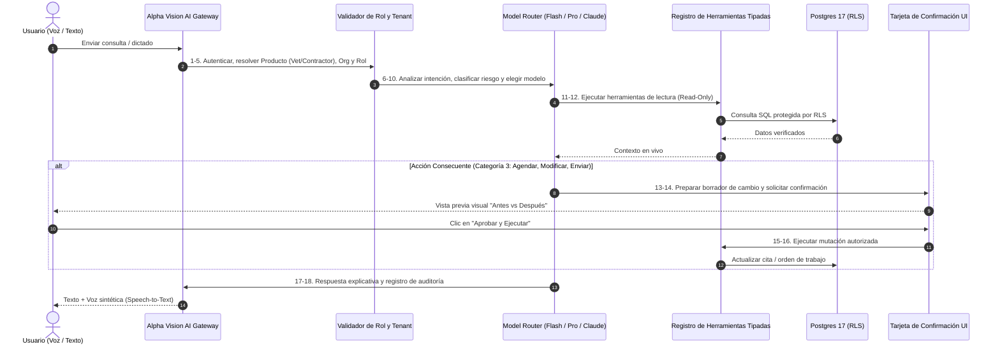

# ALPHA VISION — UNIVERSAL OPERATIONAL AI ENGINE (PART 17)
## Motor Conversacional Universal, Voz en Tiempo Real, Control Operativo y Automatización Segura para Vet Life y Contractor OS
**Plataforma Matriz:** Alpha Vision Method (`alphavisionm.com`)  
**Productos:** VET FREEDOM OS / Vet Life (`vet.alphavisionm.com`) & CONTRACTOR OS (`contractors.alphavisionm.com`)  
**Versión:** 17.0 — Authoritative Universal Architecture  
**Fecha:** 2026-11-23  
**Estado:** `CANONICAL OPERATIONAL AI SPECIFICATION`

---

## 1. PRINCIPIO ARQUITECTÓNICO FUNDAMENTAL: SEPARACIÓN DE AGENTES

> [!CRITICAL]
> **Separación Total entre Agentes de Ingeniería (Antigravity) y Asistentes de Clientes (Copilots):**
> - **Google Antigravity:** Entorno primario de ingeniería de software, pruebas autónomas, CI/CD, análisis de código y auto-recuperación 24/7. **Sus herramientas (terminal, shell, edición de código, git, browser automation) JAMÁS se exponen a usuarios finales.**
> - **Alpha Vision Operational AI Engine:** Servicio de runtime de producción orientado al cliente final (veterinarios, tutores de mascotas, contratistas, técnicos de campo y dueños de negocio). Solo tiene acceso a herramientas de negocio fuertemente tipadas (`vet_*` y `contractor_*`) respaldadas por Row Level Security (RLS) en PostgreSQL 17.

---

## 2. PIPELINE DE EJECUCIÓN DEL MOTOR CONVERSACIONAL (19 PASOS)

Cada mensaje de voz o texto enviado por un usuario recorre obligatoriamente este pipeline determinista:

---

## 3. ASISTENTES ESPECIALIZADOS POR INDUSTRIA

### 3.1 Vet Life Copilot (Veterinaria & Cuidado Animal)
1. **Inteligencia de Agenda (`vet_appointments`):**
   - Consultas de agenda en lenguaje natural: "¿Qué citas tengo hoy en Envigado?", "¿Cuál es mi primera visita de mañana?".
   - Detección determinista de huecos y ventanas de traslado entre domicilios.
   - Respeta estrictamente los registros oficiales de OKVET (Dr. Luis).
2. **Asistencia de Pacientes e Historia Clínica:**
   - Resumen clínico estructurado de pacientes (peso, tratamientos previos, vacunas).
   - **Salvaguarda COMVEZCOL (Ley 576 de 2000):** La IA sugiere borradores en formato SOAP (*Subjetivo, Objetivo, Análisis, Plan*), pero **NUNCA firma ni emite prescripciones médicas**. La fórmula exige la tarjeta profesional del Dr. Luis.
3. **Telemetría y Despacho en Ruta:**
   - Ruta óptima para auxiliares y veterinarios en Medellín y Oriente Antioqueño.
   - Cálculo de hora estimada de llegada (ETA) y aviso automático de retrasos a la siguiente cita.

### 3.2 Contractor Business Copilot (Contratistas & Servicios en Campo)
1. **Programación y Despacho de Trabajos (`contractor_jobs`):**
   - Agrupación geográfica de cuadrillas (Plomería, HVAC, Pintura, Remodelación, Electricidad).
   - "¿Qué técnico está libre a las 2:00 PM cerca de El Poblado?".
2. **Seguimiento Comercial y Presupuestos (Leads & Estimates):**
   - "¿Qué clientes tienen cotizaciones pendientes desde hace más de 3 días?".
   - Redacción de borradores de seguimiento de presupuestos para aprobación del contratista.
3. **Asistente del Trabajador de Campo (Field Worker):**
   - Acceso exclusivo a los trabajos asignados al técnico en su móvil: dirección, notas del cliente y carga de fotografías del antes/después del trabajo.

### 3.3 Pet Owner AI Companion (Tutor de Mascota en PWA)
- Consulta amigable del carné de vacunación de su mascota.
- "¿Cuándo le toca la próxima desparasitación a Luna?".
- Respuestas basadas estrictamente en la ficha médica verificada de la clínica. Si no hay registro, responde honestamente *"No tengo registrado ese dato en tu ficha oficial; te sugiero consultarlo con el Dr. Luis"*.

---

## 4. REGISTRO DE HERRAMIENTAS FUERTEMENTE TIPADAS

Las llamadas de la IA se canalizan exclusivamente a través de funciones tipadas:

| Tipo | Herramienta Vet Life | Herramienta Contractor OS | Clasificación de Riesgo |
| :--- | :--- | :--- | :--- |
| **Lectura** | `vet_get_my_appointments` | `contractor_get_my_jobs` | **Categoría 1 (Segura):** Ejecución automática sin confirmación. |
| **Lectura** | `vet_get_patient_summary` | `contractor_get_job_details` | **Categoría 1 (Segura):** Filtrada por permisos del rol. |
| **Borrador** | `vet_draft_soap_note` | `contractor_draft_estimate` | **Categoría 2 (Bajo riesgo):** Guarda borrador privado local. |
| **Mutación** | `vet_prepare_schedule_change` | `contractor_prepare_schedule_change` | **Categoría 3 (Consecuente):** Exige tarjeta de confirmación humana. |
| **Mutación** | `vet_submit_approved_message` | `contractor_submit_customer_message` | **Categoría 3 (Consecuente):** Dispara n8n WhatsApp previa aprobación. |

---

## 5. INTERFAZ DE VOZ EN TIEMPO REAL (MOBILE-FIRST)

- **Reconocimiento de Voz (STT):** Implementado mediante la Web Speech API nativa del navegador (`es-CO` y `en-US`) con respaldo en audio comprimido (`MediaRecorder`) para máxima velocidad y cero latencia.
- **Respuesta Sonora (TTS):** Síntesis de voz fluida para lectura de resúmenes de jornada en el vehículo mientras el profesional conduce hacia el domicilio.
- **Seguridad en Comandos de Voz:** Una orden hablada para reagendar una cita **NUNCA omite la confirmación visual**. La pantalla siempre muestra la tarjeta *"¿Confirmas mover a Toby para mañana a las 3:00 PM?"* antes de alterar la base de datos.

---

## 6. ENRUTAMIENTO INTELIGENTE DE MODELOS Y CONTROL FINANCIERO

| Tipo de Tarea | Modelo Primario | Modelo de Respaldo | Razón y Control de Costos |
| :--- | :--- | :--- | :--- |
| **Consultas Rápidas de Agenda** | `google/gemini-2.5-flash` | `claude-3-5-haiku` | Latencia ultrabaja (< 600ms) y costo despreciable ($0.0005 USD). |
| **Borradores Clínicos SOAP y Análisis** | `google/gemini-2.5-pro` | `claude-3-7-sonnet` | Razonamiento clínico profundo y síntesis de historial médico. |
| **Procesamiento de Voz y Transcripción** | Web Speech API (Local) | Whisper / Audio API | Procesamiento en dispositivo sin consumo de cuota cloud. |
| **Orquestación en Segundo Plano** | n8n Cloud (Node LangChain) | Supabase pg_net | Tareas encoladas con retroceso exponencial. |

- **Tope Presupuestal de Negocio:** El asistente de cada clínica u organización tiene un tope mensual asignado según su plan ($189k, $389k o $1.19M COP). Si se agota, el sistema degrada con gracia a los formularios tradicionales sin detener la operación diaria.
