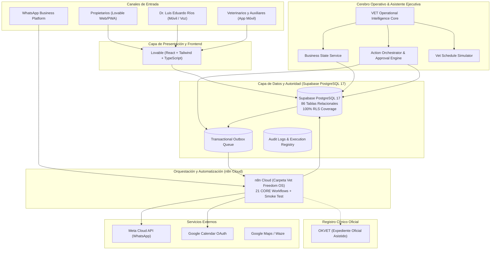

# VET FREEDOM OS — ARQUITECTURA GENERAL DEL SISTEMA
**Proyecto:** VET FREEDOM OS  
**Empresa:** Vet Life — Veterinaria a Domicilio  
**Dirección Médica:** Dr. Luis Eduardo Ríos  
**Dirección Estratégica:** Alpha Vision Method  
**Ambiente:** Supabase PostgreSQL 17 (`sznvahhocgnhsqhksygq`) + n8n Cloud (`alphavision.app.n8n.cloud`) + Lovable  
**Zona Horaria:** America/Bogota  
**Moneda:** COP  

---

## 1. VISIÓN Y OBJETIVO ARQUITECTÓNICO

VET FREEDOM OS es una plataforma operativa unificada diseñada para transformar a **Vet Life — Veterinaria a Domicilio** en una organización veterinaria autónoma, altamente coordinada, eficiente y escalable, reduciendo la dependencia cotidiana del Dr. Luis Eduardo Ríos sin sacrificar la calidez humana ni el rigor clínico.

---

## 2. COMPONENTES ARQUITECTÓNICOS PRINCIPALES

### 2.1 Lovable (Frontend Web / Mobile-First)
- **Rol:** Interfaz visual única para clientes, cuidadores, equipo operativo y el Dr. Luis.
- **Tecnología:** React, TypeScript, Tailwind CSS, Vite.
- **Tipado Estricto:** Tipos autogenerados en [`types/supabase.ts`](file:///c:/Users/Freud/N8NVET/types/supabase.ts).
- **Seguridad:** Autenticación vía Supabase Auth; todas las operaciones respetan estrictamente las políticas Row Level Security (RLS).

### 2.2 Supabase PostgreSQL 17 (Capa de Datos y Soberanía)
- **Rol:** Fuente única de verdad empresarial, autorización server-side e integridad transaccional.
- **Estructura:** 86 tablas relacionales distribuidas en los Módulos A al V.
- **Seguridad RLS:** 100% de tablas protegidas (`rowsecurity = true`). Matriz de permisos server-side para 11 roles operativos:
  - `OWNER_CLIENT`, `CAREGIVER`, `VETERINARIAN`, `VET_ASSISTANT`, `COORDINATOR`, `RECEPTION`, `FINANCE`, `ADMINISTRATOR`, `DIRECTOR`, `TECH_SUPPORT`, `ALPHA_CONSULTANT`.
- **Patrón Outbox Transaccional:** Tabla `transactional_outbox` acoplada con vista `v_n8n_outbox_queue` (`security_invoker = true`) para entrega asíncrona confiable hacia n8n.
- **Audit Logs:** Registro inmutable en `audit_logs`, `ai_action_proposals` y `ai_action_executions`.

### 2.3 OKVET (Autoridad Clínica Oficial)
- **Principio Inquebrantable:** OKVET mantiene la autoridad legal del expediente clínico veterinario en Colombia.
- **Interacción:** Proceso asistido y conciliado. El sistema NO inventa endpoints ni escribe registros médicos sin validación profesional humana.

### 2.4 n8n Cloud (Motor de Automatización y Mensajería Externa)
- **Instancia:** `alphavision.app.n8n.cloud` en carpeta `Vet Freedom OS` (`EWfSa40jLDxPUOKX`).
- **Capacidades:** 21 workflows CORE que atienden el ciclo completo de vida del negocio:
  - Recepción y envío seguro de WhatsApp (`send_enabled: false` en desarrollo).
  - Sincronización bidireccional de Google Calendar.
  - Recordatorios pre y post-visita.
  - Coordinación de rutas de desplazamiento en Bogotá y sabana.
  - Seguimiento de compromisos clínicos y experiencia del cliente (NPS).
  - Reportes ejecutivos diarios y semanales al Dr. Luis.
  - Manejo de reintentos con Dead-Letter Queue y health monitoring.

### 2.5 VET Operational Intelligence Core & Asistente Ejecutiva
- **Asistente Privada de Luis:** Capacidad conversacional móvil para consultar el negocio en tiempo real.
- **Business State Service:** Función RPC `get_business_snapshot` que entrega métricas verificadas, citas del día, recaudos en COP y alertas operativas.
- **Approval Engine & Action Orchestrator:**
  - Clasificación de riesgo de operaciones (`READ_ONLY`, `LOW_RISK_WRITE`, `APPROVAL_REQUIRED`, `CLINICAL_APPROVAL_REQUIRED`, `PROHIBITED`).
  - Previene alucinaciones y ejecución de acciones no aprobadas.
- **Vet Schedule Simulator:** Motor de simulación en memoria y snapshots que proyecta escenarios de contingencia (incapacidades, retrasos, inserción de urgencias) calculando métricas de impacto antes de tocar la agenda real.

---

## 3. FLUJO DE VIDA DE UNA OPERACIÓN

1. **Consulta:** El Dr. Luis solicita el estado del negocio o plantea un cambio desde su teléfono.
2. **Evaluación:** El Business State Service recopila la verdad factual desde PostgreSQL.
3. **Simulación:** Si la operación modifica la agenda, el Simulador crea un snapshot inmutable y proyecta el impacto comparativo (citas conservadas vs desplazamientos).
4. **Propuesta:** La asistente presenta la recomendación estructurada y el requerimiento de aprobación.
5. **Autorización:** Luis autoriza con un clic ("Aprobado").
6. **Ejecución Transaccional:** El Action Orchestrator ejecuta la mutación y publica el evento en `transactional_outbox`.
7. **Dispersión:** n8n consume el evento, notifica al cliente por WhatsApp y sincroniza Google Calendar.
8. **Auditoría:** La acción queda registrada con responsable, fecha, timestamp de Colombia y estado completado.
