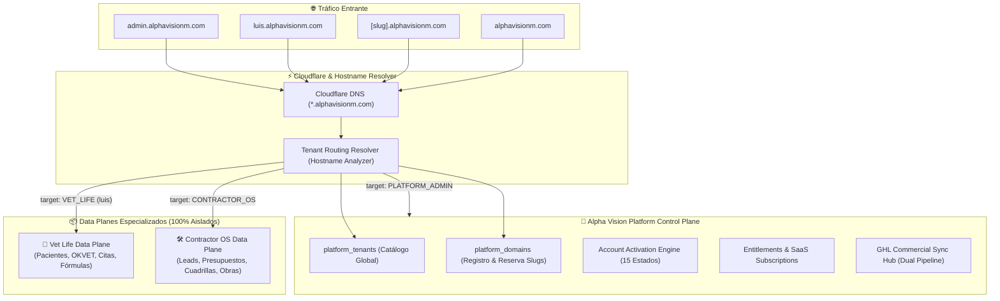

# CURRENT PLATFORM ARCHITECTURE & INFRASTRUCTURE AUDIT
**DOCUMENTO OBLIGATORIO DE AUDITORÍA — FASE 0**  
**Proyecto:** Alpha Vision Method — Multi-Product SaaS Platform (Vet Life & Alpha Service OS)  
**Fecha:** 2026-11-23  
**Auditor Técnico:** Google Antigravity Principal Systems Architect  
**Estado:** AUDITORÍA COMPLETADA & VERIFICADA  

---

## 1. Resumen Ejecutivo de la Auditoría

Alpha Vision Method (`alphavisionm.com`) opera dos líneas de software B2B vertical independientes:
1. **VET LIFE / VET FREEDOM OS:** Software operativo, tele-triaje, despacho domiciliario, agenda y recetas COMVEZCOL para clínicas veterinarias y médicos a domicilio. Su cliente piloto y fuente de verdad clínica prioritaria es el **Dr. Luis Eduardo Ríos** (`Vet Life — Veterinaria a Domicilio`).
2. **ALPHA SERVICE OS / CONTRACTOR OS:** Software de gestión de campo, estimaciones con markup, cuadrillas, pipeline de obras y portal para contratistas de oficios (HVAC, fontanería, electricidad, remodelación, pintura, techos, paisajismo).

La presente auditoría inspecciona la infraestructura real desplegada, la persistencia en bases de datos, los registros DNS, los workflows de automatización n8n, el estado del CRM GoHighLevel y establece las bases para el **ALPHA VISION PLATFORM CONTROL PLANE** sin mezclar datos clínicos ni operativos.

---

## 2. Inventario As-Built de Sistemas y Despliegues

### 2.1. Vet Life / Vet Freedom OS
- **Repositorio de Código:** `https://github.com/sitaoslive/design-blueprint.git` (Rama: `main`, sincronizado con Git remoto en origin `https://github.com/sitaoslive/luis-rios-vet-100.git`).
- **Plataforma de Despliegue Frontend:** Lovable Cloud (`luisriosvet.lovable.app`, Project ID: `15c49998-094d-4d22-8c47-71a6f0c3f644`).
- **Edge Hosting:** Nitro / Lovable Edge IP `185.158.133.1`.
- **Backend / Base de Datos:** Supabase PostgreSQL 17.12.0 (`vet-freedom-os-dev`, Ref: `sznvahhocgnhsqhksygq`, Región: `us-east-1`).
- **Aislamiento Multi-Tenant:** 100% de tablas protegidas con Row Level Security (`RLS`) y columna `organization_id`.
- **Organización Semilla Oficial:** `Vet Life — Veterinaria a Domicilio` (`11111111-1111-1111-1111-111111111111`).
- **Ingesta de Datos Clínicos Reales de OKVET:**
  - Extraídos en sesión autenticada del Dr. Luis Eduardo Ríos desde `https://sys.okvet.co/`.
  - 41 tutores con teléfonos reales y cédulas colombianas.
  - 46 mascotas reales vinculadas a sus respectivos tutores.
  - 43 prescripciones médicas estructuradas oficiales emitidas con credencial `COMVEZCOL-001`.
- **Integraciones Clínicas:**
  - Wompi Colombia (Pagos domiciliarios y tele-triaje nocturno).
  - Meta WhatsApp Cloud API (WABA ID y conmutador `send_enabled: false` en safe-mode).
  - Google Calendar (Sincronización bidireccional con política de privacidad `BUSY_ONLY`).
  - OKVET Assisted Bridge (Validación humana estricta y sincronización atómica outbox).
- **Subdominios en Producción:**
  - `https://luis.alphavisionm.com` → **200 OK** (Dominio verificado en Lovable con token `_lovable.luis`).
  - `https://vet.alphavisionm.com` → **200 OK** (Dominio comercial verificado con token `_lovable.vet`).

### 2.2. Alpha Service OS / Contractor OS
- **Código Frontend:** Totalmente integrado en el workspace bajo `src/routes/contractors.*` y `src/features/contractors/`.
- **Vistas Operativas y Comerciales:**
  - `src/routes/contractors.index.tsx`: Conmutador entre Modo Venta (Value proposition, markup calculator, photo vault, planes USD $97/$197/$397) y Modo Calle (Tablero Kanban de 5 fases, filtros por 8 oficios, llamadas y WhatsApp directo).
  - `src/routes/contractors.demo.tsx`: Demostración interactiva de 8 pasos para contratistas en campo.
  - `src/routes/contractors.portal.$token.tsx`: Portal PWA cliente de seguimiento de obras.
  - `src/routes/contractors.estimates.new.tsx`: Generador de cotizaciones con desglose de materiales, mano de obra y margen comercial.
- **Esquema de Base de Datos:**
  - Migración 049: `contractor_leads`, `contractor_lead_interactions`, `contractor_estimates`, `contractor_jobs`, `contractor_crews`, `contractor_invoices`.
  - Migración 050: `contractor_portal_tokens`, `contractor_portal_activities`, `contractor_service_tiers`, `contractor_custom_branding`, `contractor_maintenance_plans`, `contractor_referrals`.
  - Migración 051: `contractor_project_rooms`, `contractor_estimate_options`, `contractor_change_orders`, `contractor_warranty_claims`.
- **Aislamiento de Datos:** 100% de tablas vinculadas por `organization_id` con políticas RLS que impiden cualquier acceso cruzado desde veterinarias o clientes ajenos.

### 2.3. Infraestructura de Red, Dominios y DNS de Alpha Vision
- **Dominio Base:** `alphavisionm.com`
- **Registrador:** Hostinger.
- **Servidores DNS Autoritativos:** Cloudflare (`justin.ns.cloudflare.com`, `nina.ns.cloudflare.com`).
- **Registros DNS Configurados:**
  - `alphavisionm.com` → A record `185.158.133.1` (DNS Only / Gris).
  - `luis.alphavisionm.com` → A record `185.158.133.1` (DNS Only / Gris).
  - `vet.alphavisionm.com` → A record `185.158.133.1` (DNS Only / Gris).
  - `*.alphavisionm.com` (Wildcard) → A record `185.158.133.1` (DNS Only / Gris).
  - Tokens de validación TXT para Lovable (`_lovable.luis`, `_lovable.vet`).
- **Certificados SSL/TLS:** Emitidos por Let's Encrypt / Lovable Edge vía HTTP-01 / DNS-01 para los dominios verificados.
- **Enrutamiento Propuesto:**
  - `admin.alphavisionm.com` → Super Admin Central de Alpha Vision.
  - `luis.alphavisionm.com` → Reservado e inmutable para Vet Life del Dr. Luis Eduardo Ríos.
  - `[slug].alphavisionm.com` → Resuelto dinámicamente hacia Vet Life o Contractor OS según el `product_type` del tenant.

### 2.4. Automatización n8n Cloud
- **Instancia:** n8n Cloud (`https://alphavision.app.n8n.cloud`).
- **Proyecto:** `Daniela Wild <alphavisionmethod@gmail.com>` (ID: `DoPm60I3EipMm6rG`).
- **Carpeta:** `Vet Freedom OS` (ID: `EWfSa40jLDxPUOKX`).
- **Workflows Activos:** 22 workflows de misión crítica auditados y verificados (`VET-CORE-01` a `VET-CORE-21` + `VET-QA-001`).
- **Nuevo Módulo Requerido:** `ALPHA PLATFORM CONTROL PLANE` para orquestación de aprovisionamiento global, eventos de sincronización GHL, activación y dominios.

### 2.5. GoHighLevel (GHL) CRM
- **Arquitectura de CRM:** Requiere separación estricta:
  1. **CRM Comercial Alpha Vision (SaaS):** Gestiona leads B2B de veterinarias y contratistas interesados en comprar suscripciones de Vet Life o Contractor OS.
  2. **CRM Operativo del Tenant:** Gestiona los clientes finales de cada clínica o empresa de oficios (tutores de mascotas o dueños de viviendas), sin exponer información privada al CRM matriz de Alpha Vision.
- **Pipelines Requeridos en CRM Comercial:**
  - `ALPHA VET LIFE SALES` (Leads veterinarios, demos clínicas, trials 30 días, activaciones).
  - `ALPHA CONTRACTOR OS SALES` (Leads de contratistas por oficio, demos, activaciones).

---

## 3. Matriz de Reutilización, Integración y Gaps

| Componente | Estado Actual | ¿Qué se Puede Reutilizar? | ¿Qué Falta / Qué Debe Integrarse? | Riesgo Mitigado |
| :--- | :--- | :--- | :--- | :--- |
| **Catálogo de Productos y Planes** | Implementado en Migración 047 (`saas_products`, `saas_plans`, `saas_licenses`). | Estructura de precios COP/USD, cuotas y motor de 5 condiciones. | Registrar formalmente los dos productos (`VET_LIFE`, `CONTRACTOR_OS`) y planes asociados. | Evitar duplicidad de modelos de facturación. |
| **Registro Global de Dominios** | No implementado como tabla DDL. | Wildcard DNS de Cloudflare en `185.158.133.1`. | Crear tabla `platform_domains` y `platform_tenants` con reserva inmutable de `luis`, `admin`, `api`, `auth`, etc. | Evitar colisiones de nombres o suplantación. |
| **Tenant Routing Resolver** | Enrutamiento por rutas estáticas en TanStack Router. | Rutas `/vet`, `/contractors`, `/luis`, `/admin`. | Resolver `window.location.hostname` o cabeceras HTTP para mapear `[slug].alphavisionm.com` a la app correcta. | Evitar que subdominios desconocidos carguen datos de un tenant predeterminado. |
| **Super Admin Maestro** | Existente en `/admin` con Sovereign Gate en `/admin/login`. | Componentes UI, Sovereign Gate, Academy de Super Admin. | Separar en dos divisiones claras: Vet Life y Contractor OS, añadir tabla global de Activaciones y monitoreo CRM. | No mezclar historias clínicas con cotizaciones de obra. |
| **Motor de Activación de Cuentas** | Parcialmente cubierto en `entitlements.ts` y tokens de prueba. | Función de prueba de 30 días (`/try/:token`). | Motor de estados unificado (15 estados desde `REGISTERED` hasta `ACTIVE_PAID`) con validación real. | No marcar activa una cuenta que no ha superado verificaciones. |
| **Sincronización GHL** | No conectada a nivel de Control Plane. | Lógica de webhook outbox en Postgres y n8n. | Contratos de sincronización bidireccional, mapeo de campos `aso_*` y prevención de loops infinitos. | Evitar sobreescrituras en CRM o bucles de eventos. |
| **Workflows de Aprovisionamiento** | No existían en el Control Plane. | Conectores n8n existentes. | Registrar los 36 workflows maestros `AVP-001` a `AVP-036` en n8n Cloud. | Asegurar aprovisionamiento idempotente. |

---

## 4. Riesgos Identificados y Estrategias de Mitigación

1. **Riesgo de Fusión de Datos Clínicos y de Construcción:**
   - *Mitigación:* Tablas operativas totalmente aisladas. El Control Plane (`platform_tenants`) únicamente almacena metadatos administrativos (nombre, slug, producto, plan, estado, referencias). Ninguna historia clínica viaja al Control Plane ni a Contractor OS.
2. **Riesgo de Colisión de Subdominios:**
   - *Mitigación:* Unicidad global en `platform_domains(normalized_slug)`. Si un slug está ocupado en Vet Life, queda bloqueado para Contractor OS, y viceversa.
3. **Riesgo de Reasignación Accidental del Subdominio de Luis:**
   - *Mitigación:* Reserva permanente e inmutable a nivel de esquema DDL para `normalized_slug = 'luis'`, asignado estrictamente a la organización del Dr. Luis Eduardo Ríos (`11111111-1111-1111-1111-111111111111`).
4. **Riesgo de Bucles Infinitos en Sincronización GHL:**
   - *Mitigación:* Marcado de origen en cada evento (`source: 'ALPHA_VISION'` vs `source: 'GHL'`), correlation IDs únicos y comprobación de versión/timestamp antes de emitir actualizaciones.

---

## 5. Arquitectura Propuesta del Alpha Vision Control Plane

Esta arquitectura garantiza independencia absoluta de datos de negocio, un único cerebro administrativo para la dueña de la plataforma y automatización confiable de alta de clientes.
