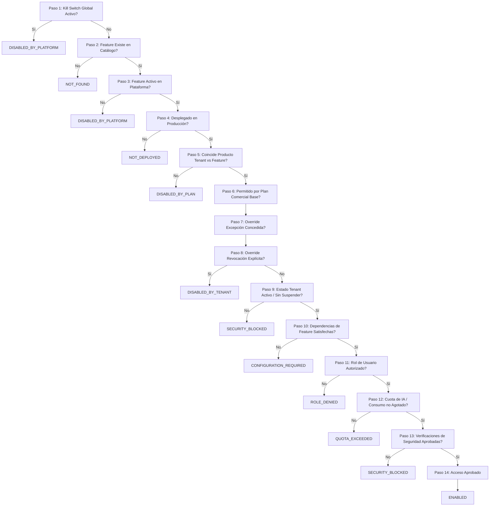

# ALPHA VISION METHOD — ARQUITECTURA DEL REGISTRO DE FEATURES & GOBERNANZA
**DOCUMENTO TÉCNICO MAESTRO — CONTROL PLANE 2.0 (PARTE 10)**

---

## 1. VISIÓN Y PRINCIPIOS DE DISEÑO

El **Feature Registry de Alpha Vision Method** es la autoridad central e inmutable de empaquetamiento, gobernanza y resolución de capacidades para todo el ecosistema multi-producto:
1. **Vet Life / Vet Freedom OS**: Dirigido al sector veterinario y clínico (con el Dr. Luis Eduardo Ríos como inquilino ancla).
2. **Alpha Service OS / Contractor OS**: Dirigido a contratistas y técnicos de servicios en campo (HVAC, plomería, electricidad, remodelación, techos).
3. **Platform Core**: El plano de control administrativo y comercial central (`admin.alphavisionm.com`).

### Principios Fundamentales:
- **Identificadores Inmutables**: Toda funcionalidad tiene un ID único con estructura jerárquica estricta: `PRODUCTO.MÓDULO.FEATURE` (ej. `VET.CORE.PATIENT_RECORD`, `CONTRACTOR.ESTIMATES.GOOD_BETTER_BEST`).
- **Estados de Verificación Auditables**: Ninguna feature se da por completa sin evidencia verificable en ejecución. Se distinguen exactamente 10 estados de verificación técnica.
- **Desacoplamiento Código vs Empaquetamiento**: El código puede estar desplegado en producción, pero su acceso para cada empresa u organización se rige estrictamente por su plan comercial o excepciones temporales.
- **Aislamiento Multi-Tenant con RLS**: Las excepciones (overrides) y configuraciones de cada empresa están protegidas por Row Level Security en PostgreSQL 17.

---

## 2. TAXONOMÍA Y FORMATO DE IDENTIFICADORES

Cada funcionalidad se identifica mediante un código en mayúsculas sostenidas, separado por puntos:

```
[NAMESPACE].[MODULE].[FEATURE_NAME]
```

- **Namespace de Producto**:
  - `VET`: Exclusivo de Vet Life / Vet Freedom OS.
  - `CONTRACTOR`: Exclusivo de Alpha Service OS / Contractor OS.
  - `PLATFORM`: Funcionalidades compartidas del plano de control administrativo.

### Matriz de Estados de Verificación (10 Estados Canónicos):
| Estado | Código | Descripción Técnica |
|---|---|---|
| 1 | `PRODUCTION_VERIFIED` | Ejecutado, verificado con datos reales y validado en producción sin errores. |
| 2 | `STAGING_VERIFIED` | Probado en entorno de pruebas integrado con conectores externos. |
| 3 | `MOCK_TESTED` | Probado con mocks de datos o contratos sintéticos. |
| 4 | `IMPLEMENTED_UNTESTED` | Código fuente escrito pero sin suite de pruebas automatizadas ejecutada. |
| 5 | `SPECIFIED` | Diseñado en blueprints y requerimientos, pero sin código fuente aún. |
| 6 | `PARTIAL` | Implementación parcial en curso; algunas rutas o pantallas activas. |
| 7 | `BROKEN` | Código implementado que arroja excepciones o fallas conocidas. |
| 8 | `BLOCKED` | Bloqueado por dependencia externa, falta de credenciales o API de terceros. |
| 9 | `NOT_FOUND` | No hallado en el repositorio tras auditoría exhaustiva. |
| 10 | `NOT_APPLICABLE` | Característica descartada deliberadamente o reemplazada por un estándar superior. |

---

## 3. MOTOR DE RESOLUCIÓN DE ENTITLEMENTS EN 14 PASOS (§ 478)

Cuando un usuario, proceso o flujo intenta ejecutar o visualizar una funcionalidad, el motor evalúa la siguiente secuencia determinística en orden estricto:



### Respuestas Canónicas del Motor:
- `ENABLED`: Acceso total autorizado.
- `DISABLED_BY_PLAN`: Requiere actualizar el plan de suscripción comercial.
- `DISABLED_BY_TENANT`: Deshabilitado por la configuración del propio inquilino o revocación.
- `DISABLED_BY_PLATFORM`: Deshabilitado administrativamente a nivel global.
- `NOT_DEPLOYED`: Funcionalidad en fase de especificación o desarrollo.
- `INTEGRATION_REQUIRED`: Falta configurar credenciales de terceros (ej. Wompi, OKVET).
- `QUOTA_EXCEEDED`: Límite mensual de presupuesto de tokens o llamadas alcanzado.
- `ROLE_DENIED`: El rol del usuario actual no posee permiso clínico o administrativo.
- `SECURITY_BLOCKED`: Inquilino suspendido por falta de pago o sospecha de fraude.
- `CONFIGURATION_REQUIRED`: Dependencia previa no satisfecha (ej. falta configurar datos de clínica).

---

## 4. BASE DE DATOS Y RLS (MIGRACIÓN 054)

El esquema implementado en PostgreSQL 17 incluye las tablas maestras:
- `platform_features`: Catálogo maestro con status, dependencias y metadata.
- `platform_plans`: Planes de suscripción versionados con precio en COP/USD.
- `platform_plan_features`: Matriz de pertenencia de features por versión de plan.
- `platform_tenant_feature_overrides`: Sobrescrituras granulares con vigencia temporal y auditoría.
- `platform_ai_budgets`: Presupuestos mensuales de tokens Claude con límites de 80% y 100%.
- `platform_ai_usage_events`: Libro mayor append-only de cada consulta a Claude con desglose de tokens y costo USD.
- `platform_ai_alerts`: Registro de advertencias presupuestarias y disparos de interruptor de emergencia.

Todas las tablas cuentan con políticas Row Level Security (RLS) habilitadas, garantizando aislamiento total entre inquilinos y acceso irrestricto solo al rol `SUPER_ADMIN`.
