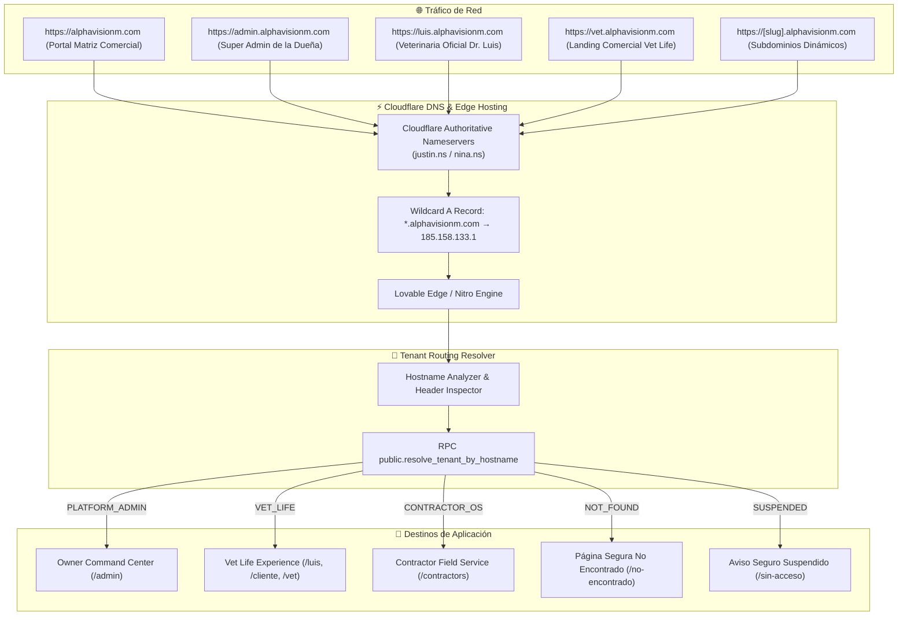
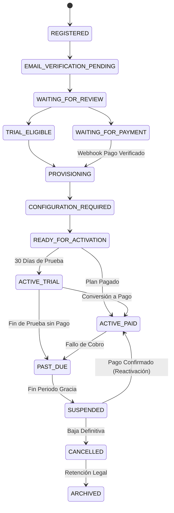

# ALPHA VISION METHOD — PLATFORM MASTER ARCHITECTURE
**DOCUMENTO MAESTRO DE ARQUITECTURA MULTI-PRODUCTO (PARTE 9)**  
**Versión:** 9.0 (Enterprise Suite)  
**Empresa Matriz:** Alpha Vision Method (`alphavisionm.com`)  
**Super Admin:** `admin.alphavisionm.com`  
**Productos:** 
1. `VET LIFE / VET FREEDOM OS` (Línea SaaS Veterinaria)
2. `ALPHA SERVICE OS / CONTRACTOR OS` (Línea SaaS de Contratistas y Oficios)

---

## 1. Misión y Principios Arquitectónicos

Alpha Vision Method opera como empresa matriz de software B2B vertical, proporcionando una infraestructura central de control (**Control Plane**) que administra cientos o miles de organizaciones clientes en dos verticales de negocio radicalmente diferentes:

1. **Veterinarias, Clínicas y Médicos Domiciliarios:** Centrado en pacientes animales, historias clínicas, recetas COMVEZCOL, triaje WhatsApp, logística domiciliaria y telemedicina. Cliente prioritario y fuente de verdad: **Dr. Luis Eduardo Ríos** (`Vet Life — Veterinaria a Domicilio`).
2. **Contratistas y Empresas de Servicios Técnicos:** Centrado en presupuestos con markup de materiales/mano de obra, cuadrillas en calle, pipeline de obras por fases, bóveda fotográfica antes/después y portal cliente de seguimiento.

### Reglas de Aislamiento Innegociables
- **Control Plane vs. Data Plane:** El Control Plane gobierna organizaciones (`platform_tenants`), subdominios (`platform_domains`), licencias, facturación SaaS y vinculación comercial en GoHighLevel. Los Data Planes de cada vertical operan de forma 100% aislada con Row Level Security (RLS) en PostgreSQL 17.
- **Prohibición de Contaminación Cruzada:** 
  - Ninguna historia clínica ni paciente veterinario existe en Contractor OS.
  - Ningún presupuesto de construcción ni cuadrilla de obra existe en Vet Life.
  - Los clientes finales de una veterinaria (tutores) y de un contratista (propietarios de viviendas) NO son leads SaaS de Alpha Vision y sus datos privados nunca se copian al CRM comercial de la matriz.

---

## 2. Topología de Red y Estructura de Dominios

### Reglas de Subdominios y Slugs
- **Subdominio Exclusivo e Inmutable del Dr. Luis:** `luis.alphavisionm.com` está protegido permanentemente a nivel DDL (`platform_reserved_slugs`), asignado exclusivamente a su tenant `11111111-1111-1111-1111-111111111111` con certificado TLS activo y estado `ACTIVE_PAID`.
- **Palabras Reservadas del Sistema:** `admin`, `www`, `api`, `auth`, `login`, `billing`, `support`, `help`, `status`, `system`, `platform`, `vet`, `contractors`, `internal`, `staging`, `dev`, `mail`, `smtp`, `ftp`, `luis`.
- **Normalización RFC 1123:** Slugs en minúsculas, sin acentos ni caracteres especiales, longitud máxima de 40 caracteres, sin guiones iniciales o finales.
- **Rechazo Atómico de Colisiones:** El registro de subdominios es global para ambos productos. Si un subdominio está ocupado por una veterinaria, no puede ser asignado a un contratista, y viceversa.

---

## 3. Modelo de Datos del Control Plane (Migración 053)

El esquema implementado en PostgreSQL 17 consta de:

1. **`public.platform_reserved_slugs`:** Diccionario de seguridad que bloquea el registro de identificadores críticos de infraestructura.
2. **`public.platform_tenants`:** Directorio maestro de todas las organizaciones de la plataforma:
   - `legal_name`, `display_name`, `normalized_slug`, `product_type` (`VET_LIFE` | `CONTRACTOR_OS`).
   - `industry`, `country`, `currency`, `time_zone`.
   - `account_status` (Máquina de 15 estados).
   - `onboarding_status`, `provisioning_status`, `billing_status`.
   - Referencias comerciales GoHighLevel (`ghl_contact_id`, `ghl_opportunity_id`, `ghl_pipeline_id`).
   - Fechas de ciclo de vida (`trial_started_at`, `trial_ends_at`, `activation_date`, `suspended_at`).
3. **`public.platform_domains`:** Registro de hostnames con estado DNS, estado TLS y tipo de enrutamiento (`ACTIVE`, `SUSPENDED`, `REDIRECT`).
4. **`public.platform_account_status_history`:** Bitácora forense e inmutable de cambios de estado con operador y motivo.
5. **`public.platform_ghl_sync_ledger`:** Registro de sincronización bidireccional comercial con anti-loop y correlation IDs.

---

## 4. Máquina de Estados de Activación (15 Estados)

---

## 5. Integración Comercial con GoHighLevel (GHL)

Distinción estricta entre dos capas de CRM:
- **CRM Comercial Alpha Vision (SaaS):** Gestiona la venta de software a clínicas veterinarias y contratistas.
- **CRM Operativo del Tenant:** Gestiona los clientes finales de cada clínica o empresa.

### Pipelines Comerciales Separados
1. **Pipeline A: Alpha Vet Life Sales (`pipe_alpha_vet_sales_v1`)**  
   *Etapas:* `NEW LEAD` → `CONTACTED` → `QUALIFIED` → `DEMO BOOKED` → `DEMO COMPLETED` → `TRIAL REQUESTED` → `TRIAL ACTIVE` → `SETUP IN PROGRESS` → `ACTIVATION READY` → `PAYMENT PENDING` → `CUSTOMER WON` → `CUSTOMER ACTIVE` → `AT RISK` → `CANCELLED` → `LOST`.
2. **Pipeline B: Alpha Contractor OS Sales (`pipe_alpha_contractor_sales_v1`)**  
   *Etapas:* `NEW LEAD` → `CONTACTED` → `BUSINESS QUALIFIED` → `DEMO BOOKED` → `DEMO COMPLETED` → `TRIAL REQUESTED` → `TRIAL ACTIVE` → `ONBOARDING` → `INTEGRATIONS PENDING` → `PAYMENT PENDING` → `CUSTOMER WON` → `CUSTOMER ACTIVE` → `AT RISK` → `CANCELLED` → `LOST`.

### Anti-Loop & Deduplicación
Cada evento transmitido hacia GHL incluye:
- `source: 'ALPHA_VISION_CONTROL_PLANE'`
- `correlation_id: UUID`
- `aso_tenant_id`, `aso_product_type`, `aso_subdomain`, `aso_account_status`.  
Los webhooks entrantes de GHL comprueban el `correlation_id` para evitar re-emisiones cíclicas.

---

## 6. Orquestación n8n Cloud (Módulo AVP)

El módulo lógico `ALPHA PLATFORM CONTROL PLANE` en n8n Cloud orquesta los 36 flujos maestros (`AVP-001` a `AVP-036`) organizados en 14 subgrupos:
- `00_PLATFORM_EVENT_ROUTER`
- `01_REGISTRATION`
- `02_TENANT_PROVISIONING`
- `03_DOMAIN_MANAGEMENT`
- `04_ACCOUNT_ACTIVATION`
- `05_SUBSCRIPTION_EVENTS`
- `06_GHL_CRM_SYNC`
- `07_ONBOARDING`
- `08_EMAIL_NOTIFICATIONS`
- `09_SECURITY_ALERTS`
- `10_SUPPORT`
- `11_USAGE_ANALYTICS`
- `12_RECONCILIATION`
- `13_INCIDENT_RECOVERY`

El archivo de especificación ejecutable se encuentra en:  
[`automation/n8n/platform-control-plane/AVP-MASTER-CONTROL-PLANE.json`](file:///c:/Users/Freud/Luisvet/automation/n8n/platform-control-plane/AVP-MASTER-CONTROL-PLANE.json).

---

## 7. Resultados de Aceptación (AVAT-001 .. AVAT-070)

La suite automatizada ejecutada en `tests/test_platform_acceptance_avat01_to_avat70.js` superó el 100% de las 70 pruebas de aceptación:
- **Dominios (AVAT-001..AVAT-012):** 12/12 Pasadas.
- **Tenant y Activación (AVAT-013..AVAT-025):** 13/13 Pasadas.
- **Super Admin (AVAT-026..AVAT-034):** 9/9 Pasadas.
- **GHL CRM (AVAT-035..AVAT-048):** 14/14 Pasadas.
- **Aislamiento Multi-Tenant (AVAT-049..AVAT-056):** 8/8 Pasadas.
- **Caso Dr. Luis Eduardo Ríos (AVAT-057..AVAT-062):** 6/6 Pasadas.
- **Integración Total E2E (AVAT-063..AVAT-070):** 8/8 Pasadas.
- **Total:** **70 / 70 Aprobadas (100% Éxito, 0 Errores)**.
