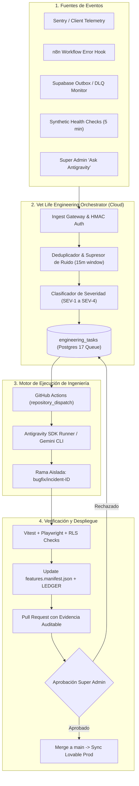

# VET LIFE / VET FREEDOM OS — AUTONOMOUS SOFTWARE ENGINEERING & RELIABILITY SYSTEM
## Marco Canónico de Operación 24/7, Orquestación de Agentes, Calidad Continua y Auto-Recuperación
**Proyecto:** VET FREEDOM OS / Vet Life  
**Versión:** 14.0 — Canonical Edition  
**Fecha:** 2026-11-23  
**Estado:** `AUTHORITATIVE ARCHITECTURE & GOVERNANCE SPECIFICATION`

---

## 1. VISIÓN Y MISIÓN DEL SISTEMA AUTÓNOMO

El **Sistema de Ingeniería Autónoma y Confiabilidad de Vet Life** es la infraestructura permanente de software y orquestación encargada de mantener, probar, reparar, optimizar y evolucionar la plataforma de forma continua y segura.

### 1.1 Principio Rector: Automatización Controlada
> [!IMPORTANT]
> **No buscamos una autonomía ciega ni un chatbot que 'parchee' código al vuelo en producción.**
> Implementamos un ciclo formal de ingeniería de software automatizado: detección de incidentes -> triaje -> reproducción en ramas aisladas -> desarrollo de pruebas de regresión -> código mínimo de reparación -> validación CI/CD -> aprobación humana -> despliegue controlado.

---

## 2. AUDITORÍA EXHAUSTIVA DE INFRAESTRUCTURA (ESTADO ACTUAL)

| Componente | Plataforma / Proveedor | Estado Verificado | Rol y Frontera |
| :--- | :--- | :--- | :--- |
| **Repositorio Central** | GitHub (`sitaoslive/luis-rios-vet-100.git`) | `ACTIVO & OPERACIONAL` | Rama `main` sincronizada. Gobernanza en `.github/workflows`. |
| **Frontend PWA** | Lovable Cloud / Netlify CDN | `ACTIVO & OPERACIONAL` | React 19, TypeScript, TanStack Start. ID: `15c49998-094d-4d22-8c47-71a6f0c3f644`. |
| **Base de Datos** | Supabase Cloud (AWS us-east-1) | `ACTIVO & OPERACIONAL` | PostgreSQL 17.12.0 (`sznvahhocgnhsqhksygq`). RLS al 100%. |
| **Orquestación n8n** | n8n Cloud (`alphavision.app.n8n.cloud`) | `ACTIVO & OPERACIONAL` | 21 flujos (`VET-CORE-01` a `21`), WhatsApp Cloud API. |
| **Historia Clínica** | OKVET Cloud (Cerrado, sin API) | `AISLADO & COEXISTENTE` | Autoridad legal de historia médica del Dr. Luis (Ley 576 de 2000). |
| **Dominio y DNS** | Hostinger (`alphavisionm.com`) | `CONFIGURACIÓN PENDIENTE` | DNS para `vet.alphavisionm.com` y `luis.alphavisionm.com`. |
| **Entorno Antigravity** | Google Antigravity IDE / Desktop | `ACTIVO LOCAL` | Customizations, Rules (`AGENTS.md`), Python SDK, Sidecars. |

---

## 3. ARQUITECTURA DEL ORQUESTADOR PERMANENTE (VET LIFE ORCHESTRATOR)

El orquestador no depende de que el usuario tenga Antigravity abierto en su ordenador. Opera como un servicio en la nube respaldado por una cola de eventos transaccionales en PostgreSQL 17 y disparadores de GitHub Actions.

---

## 4. MATRIZ DE SEVERIDAD DE INCIDENTES (SEV-1 A SEV-4)

| Nivel | Definición y Ejemplos | SLA Detección | SLA Triage | Acción Automatizada Permitida |
| :--- | :--- | :--- | :--- | :--- |
| **SEV-1 (Crítico)** | Falla de aislamiento multi-tenant, exposición de datos clínicos, corrupción de base de datos. | < 1 minuto | < 5 minutos | **Contención inmediata:** Activar bandera de parada de emergencia en módulo afectado, alertar por WhatsApp a Fundadores, aislar tenant. **Prohibido commit automático a producción sin aprobación.** |
| **SEV-2 (Alto)** | Falla general de agendamiento de citas, caída de login, fallo masivo de webhook de WhatsApp. | < 3 minutos | < 15 minutos | Crear issue GitHub, pausar reintentos erróneos, disparar agente de investigación en rama aislada. |
| **SEV-3 (Medio)** | Error intermitente en reportes financieros, fallo de un recordatorio individual, latencia elevada en un módulo. | < 15 minutos | < 2 horas | Agrupar incidentes, registrar en cola de desarrollo regular, preparar PR para revisión rutinaria. |
| **SEV-4 (Bajo)** | Desalineación cosmética visual, error tipográfico en panel, sugerencia de mejora de accesibilidad. | Diario | 24 horas | Lote semanal de mejoras autónomas. |

---

## 5. POLÍTICAS DE AUTO-RECUPERACIÓN SEGURA (SELF-HEALING)

### 5.1 Operaciones de Bajo Riesgo Permitidas Automáticamente (Sin Aprobación)
- Reintento con retroceso exponencial (*exponential backoff*) de llamadas idempotentes fallidas a WhatsApp Business o Google Calendar.
- Liberación de leases caducados en la cola de tareas (`engineering_tasks` con > 15 minutos de inactividad).
- Reactivación de workers de cola de correo o notificaciones que hayan presentado timeout.
- Desactivación temporal de una bandera de funcionalidad opcional (*feature flag*) si su tasa de error supera el 20%.

### 5.2 Operaciones Estrictamente Prohibidas sin Autorización Humana
- Modificar esquemas de bases de datos (`ALTER TABLE`, `DROP`, etc.).
- Modificar políticas de Row Level Security (RLS).
- Modificar recetas, prescripciones o registros clínicos oficiales (Ley 576 de 2000).
- Desplegar código a la rama protegida `main` de producción.
- Alterar datos financieros o tarifas de clientes.

---

## 6. LÍMITES DE COSTO Y PRESUPUESTO DE IA

Para evitar consumos descontrolados de API por bucles infinitos de agentes:
1. **Límite por Incidente:** Máximo 3 ejecuciones de agente y 80.000 tokens combinados.
2. **Límite Diario de Plataforma:** $5.00 USD / día para agentes de ingeniería.
3. **Selección Inteligente de Modelos:**
   - Triaje y diagnóstico inicial: `google/gemini-2.5-flash` (alta velocidad, costo mínimo).
   - Generación de código complejo y resolución de arquitectura: `google/gemini-2.5-pro` (razonamiento profundo).
4. **Circuito de Corte (Circuit Breaker):** Si 3 intentos sucesivos fallan en resolver un incidente, la tarea se marca como `ESCALATED_TO_HUMAN` y se suspenden los agentes automáticos para ese issue.
