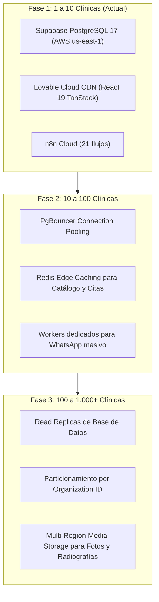

# VET LIFE / VET FREEDOM OS — OPERATIONAL READINESS & ENTERPRISE SCALABILITY
## Matriz Maestra de Operabilidad, Usabilidad Cero-Fricción y Confiabilidad Multi-Tenant
**Proyecto:** VET FREEDOM OS / Vet Life  
**Versión:** 15.0 — Authoritative Release Edition  
**Fecha:** 2026-11-23  
**Estado:** `AUTHORITATIVE OPERATIONAL DIRECTIVE`

---

## 1. PRINCIPIOS NO NEGOCIABLES DE ÉXITO

1. **Evidencia, No Suposiciones:** Ninguna funcionalidad se reporta como "completada" si no cuenta con su flujo de extremo a extremo probado con evidencia auditable.
2. **Extrema Simplicidad:** Cada pantalla debe poder ser operada por un usuario que nunca ha visto software veterinario en su vida. Cero jerga de ingeniería en interfaces operativas.
3. **Cero Duplicación de Aplicaciones:** Una sola base de código para todas las clínicas (`luis-rios-vet-100`). La diferenciación se realiza por datos (`organization_id`), temas visuales y políticas RLS en Postgres 17.
4. **Automatización Segura:** Tareas repetitivas automatizadas en n8n y Supabase; decisiones clínicas y recetas reservadas exclusivamente a médicos con tarjeta COMVEZCOL (Ley 576 de 2000).
5. **Aislamiento Multi-Tenant Absoluto:** Imposibilidad matemática y criptográfica de que la Clínica B vea las mascotas o recetas del Dr. Luis.
6. **Escalabilidad Elástica:** Capacidad de soportar desde 1 cliente (Dr. Luis) hasta 1.000+ organizaciones sin recrear bases de datos ni compilar forks separados.
7. **Fuente de Verdad Respetada:** OKVET es la autoridad legal para el Dr. Luis. No se finge sincronización donde no hay API.
8. **Plataforma Canónica Única:** Un solo repositorio GitHub (`https://github.com/sitaoslive/luis-rios-vet-100.git`) y un flujo de despliegue controlado.
9. **Calidad y Monitoreo Continuo:** Observabilidad en Sentry, Better Stack y n8n con respuesta autónoma de ingeniería vía Antigravity.
10. **Prohibición de Falso 100%:** No se usan porcentajes abstractos sin checklist auditable de criterios de aceptación cumplidos.

---

## 2. DEFINICIÓN ESTRICTA DE "HECHO" (DEFINITION OF DONE - 25 CRITERIOS)

Una funcionalidad se considera terminada ÚNICAMENTE cuando cumple los 25 puntos:
1. Interfaz de usuario renderizada y estilizada según la guía de diseño premium.
2. Todo botón, campo y enlace tiene comportamiento real implementado (cero dead-ends).
3. Conexión completa con el backend de Supabase o API autorizada.
4. Persistencia verificada: los datos se guardan y releen tras recargar la página.
5. Permisos de rol validados y aplicados en el cliente.
6. Aislamiento por `organization_id` verificado mediante políticas RLS en Postgres 17.
7. Estados de carga (*loading skeletons*) implementados.
8. Estados vacíos (*empty states*) con llamada a la acción clara implementados.
9. Mensajes de error claros y pedagógicos en lenguaje natural (sin códigos HTTP crudos).
10. Manejo de desconexión y fallos de red sin pérdida de datos en progreso.
11. Prevención de envíos dobles (*double submit prevention* / idempotencia).
12. Responsividad móvil verificada en pantallas de 360px a 430px.
13. Funcionalidad de escritorio verificada en 1280px+.
14. Contraste de colores y accesibilidad web básicos comprobados.
15. Conectores e integraciones requeridas validadas o con aviso de modo degradado.
16. Pruebas unitarias y de integración pasando en CI/CD.
17. Pruebas manuales exploratorias registradas con evidencia.
18. Revisión de seguridad de tokens y secretos completada.
19. Tiempos de carga y rendimiento de consultas dentro de umbrales (< 500ms API).
20. Documentación canónica en `docs/` actualizada con IDs estables.
21. Monitoreo y captura de excepciones conectado a Sentry/Telemetría.
22. Análisis de impacto y estrategia de rollback documentada.
23. Aprobación del rol responsable para comportamientos de alto impacto.
24. Verificación posterior al despliegue en ambiente de prueba.
25. Registro formal en `docs/features.manifest.json` e `IMPLEMENTATION_LEDGER.md`.

---

## 3. AUDITORÍA DE SIMPLICIDAD: ELIMINACIÓN DE JERGA TÉCNICA

| Término Técnico a Eliminar | Reemplazo Amigable para Veterinarios y Clientes |
| :--- | :--- |
| *Tenant / Multi-tenant* | Tu Veterinaria / Tu Clínica |
| *Webhook / API Endpoint* | Conexión Automática / Aplicación Conectada |
| *RLS / Row Level Security* | Privacidad y Seguridad de tus Datos |
| *Cursor de Sincronización* | Estado de Sincronización |
| *Feature Flag* | Funcionalidades Activas |
| *Environment Variable* | Configuración del Sistema |
| *Base de Datos Postgres 17* | Bóveda Segura de Información |
| *OAuth 403 Forbidden* | Revisa los permisos de tu cuenta para continuar |

---

## 4. MATRIZ DE ESCALABILIDAD (1 A 1.000+ CLÍNICAS)

