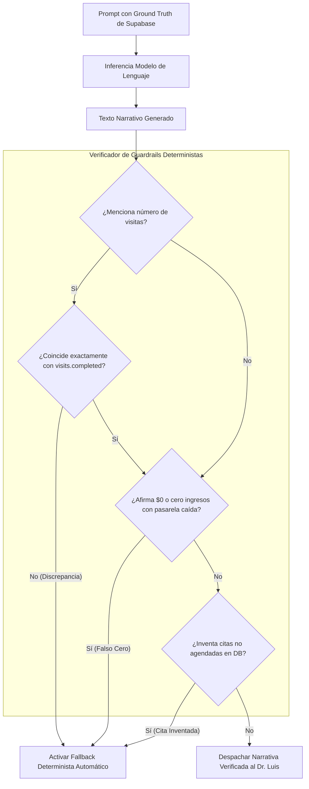

# Guardrails de IA y Fallback Determinista en Narrativas Ejecutivas (VET-CORE-16)

**Módulo:** `VET-CORE-16 | DAILY EXECUTIVE REPORTING`  
**Proyecto:** VET FREEDOM OS — Vet Life: Veterinaria a Domicilio  
**Dirección Médica:** Dr. Luis Eduardo Ríos  
**Dirección Estratégica:** Alpha Vision Method  
**Fecha:** 2026-11-21  

---

## 1. El Peligro de las Alucinaciones en Decisiones Médicas y Gerenciales

Los modelos generativos de IA (LLMs) son propensos a rellenar vacíos de información mediante extrapolaciones probabilísticas o "alucinaciones":
- Afirmar que *"se realizaron 15 visitas exitosas"* cuando en la base de datos sólo figuran 8.
- Afirmar que *"no hubo ingresos ($0 COP)"* cuando la pasarela de pagos simplemente estuvo caída.
- Inventar recomendaciones médicas o diagnósticos no formulados por el médico de turno.

En la dirección de una empresa médica domiciliaria como Vet Life, una sola alucinación numérica puede inducir a un error estratégico grave.

---

## 2. La Capa de Guardrails Deterministas

Antes de que cualquier texto generado por IA sea presentado al Dr. Luis Eduardo Ríos, pasa por el **Verificador de Integridad Numérica (Guardrail Engine)**:

---

## 3. Especificación del Fallback Determinista

Si el Guardrail detecta una falla, el motor n8n descarta inmediatamente la respuesta del LLM y construye el reporte a partir de una plantilla rígida pre-programada en JavaScript/TypeScript que toma los datos directos de los Stored Procedures de Supabase.

El resultado es 100% inmune a alucinaciones y garantiza que el Dr. Luis siempre reciba hechos fácticos e irrebatibles.
