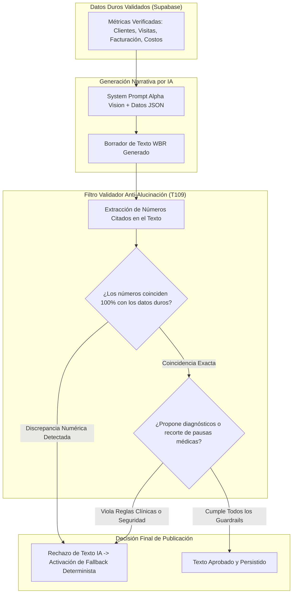

# Guardrails de IA y Verificación Anti-Alucinación Semanal (VET-CORE-17)

**Módulo:** `VET-CORE-17 | WEEKLY REPORTING`  
**Proyecto:** VET FREEDOM OS — Vet Life: Veterinaria a Domicilio  
**Dirección Médica:** Dr. Luis Eduardo Ríos  
**Dirección Estratégica:** Alpha Vision Method  
**Entorno:** DEVELOPMENT / QA  
**Fecha:** 2026-11-21  

---

## 1. El Riesgo de Alucinación en Decisiones Estratégicas

En un reporte ejecutivo semanal, una afirmación errónea generada por un modelo de lenguaje (como inventar un margen de utilidad del 85%, asegurar que se atendieron 120 clientes cuando fueron 42, o aconsejar reducir descansos del personal médico) puede comprometer la viabilidad financiera o la integridad física de los pacientes y profesionales.

---

## 2. Los 5 Guardrails Inquebrantables de IA

1. **Guardrail Numérico Estricto:** Si el texto menciona cifras monetarias, conteos de visitas o porcentajes de conversión que difieran en más de un 0.01% de las métricas persistidas en Supabase, el texto se descarta de inmediato.
2. **Guardrail Clínico y Diagnóstico:** El modelo de IA tiene prohibido emitir juicios clínicos diagnósticos o recomendar cambios farmacológicos en tratamientos de pacientes.
3. **Guardrail de Protección al Personal:** Queda bloqueada cualquier sugerencia orientada a eliminar los descansos mínimos obligatorios de bioseguridad y almuerzo o a sobrecargar a los veterinarios por encima de 6 visitas/día.
4. **Guardrail de Autonomía de Luis:** No clasificar como ineficiencia las firmas o aprobaciones exigidas por el marco legal de COMVEZCOL o la legislación colombiana.
5. **Fallback Determinista Inmediato (T109):** Ante cualquier fallo del validador de IA, timeout de la API o discrepancia de formato, el sistema conmuta instantáneamente a una plantilla estructurada construida mediante código JavaScript puro, asegurando entrega puntual y datos verídicos.
