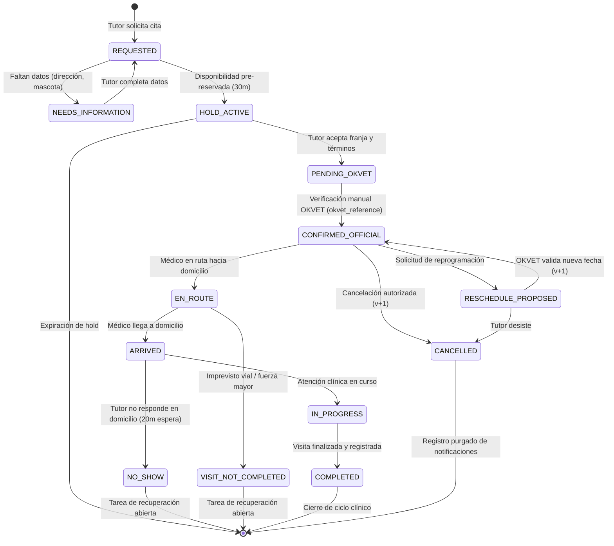

# VET FREEDOM OS — CICLO DE VIDA DE CITAS Y VISITAS DOMICILIARIAS
**Módulo:** VET-CORE-05 | Appointment Notification Service & Scheduling Gate  
**Dirección Médica:** Dr. Luis Eduardo Ríos  
**Dirección Estratégica:** Alpha Vision Method  
**Plataformas:** Google Antigravity + n8n Cloud + Supabase PostgreSQL 17 + Lovable  
**Zona Horaria:** America/Bogota  
**Moneda:** COP ($)

---

## 1. Visión General y Filosofía de Servicio

El modelo operativo de **Vet Life: Veterinaria a Domicilio** exige una gestión de citas diferenciada frente a una clínica tradicional de mostrador:
1. **La agenda no es solo tiempo, es geografía y desplazamiento:** En Bogotá y municipios de la Sabana, los tiempos de traslado, el tráfico, los cuadrantes y las condiciones climáticas condicionan directamente la viabilidad operativa de cada visita.
2. **Separación estricta entre intención y confirmación médica oficial:** Una solicitud de un tutor o un hold temporal NO es una cita confirmada. Solo cuando el equipo clínico verifica la disponibilidad y registra el acto en **OKVET**, la cita adquiere rango oficial (`CONFIRMED_OFFICIAL`).
3. **Monotonicidad y trazabilidad:** Toda alteración en hora, médico, servicios o ubicación incrementa la versión de la cita (`version = version + 1`) e invalida inmediatamente cualquier notificación o recordatorio planificado para la versión anterior.

---

## 2. Diagrama de Estados del Ciclo de Vida

---

## 3. Matriz Exhaustiva de Estados de Cita (25 Estados)

| Código de Estado | Descripción Operativa | Actores Involucrados | Acciones Permitidas |
| :--- | :--- | :--- | :--- |
| `REQUESTED` | Solicitud recibida por WhatsApp o Web. Pendiente de revisión de cobertura. | Tutor, IA Recepción | Completar datos, verificar zona. |
| `NEEDS_INFORMATION` | Faltan campos críticos (teléfono, especie, dirección exacta con torre/apto). | Tutor, Asistente | Enviar requerimiento de datos. |
| `VALIDATING_COVERAGE` | Verificación de cuadrante geográfico en Bogotá / Sabana Norte. | Coordinación | Aprobar zona o transferir a no cobertura. |
| `VALIDATING_AVAILABILITY` | Chequeo de agenda y tiempos de desplazamiento entre visitas. | Algoritmo / Coordinador | Identificar franja viable. |
| `PROVISIONAL` | Cita preliminar sugerida al tutor sin bloqueo en calendario. | Asistente, Tutor | Solicitar confirmación preliminar. |
| `HOLD_ACTIVE` | Franja bloqueada temporalmente (30 min) para evitar sobreventa. | Sistema | Extender hold o liberar. |
| `SCHEDULED` | Pre-agendada en sistema local pero pendiente de validación clínica. | Asistente | Enviar a revisión OKVET. |
| `PENDING_OKVET` | Franja aceptada por el tutor. Bloqueada a la espera de radicado en OKVET. | Coordinación Médica | Asignar número OKVET oficial. |
| `CONFIRMED_OFFICIAL` | Confirmada oficialmente con referencia OKVET y plan de recordatorios activo. | Dr. Luis Ríos, Tutor | Generar plan 24h/2h, despachar. |
| `RESCHEDULE_REQUESTED` | Solicitud de cambio de fecha iniciada por tutor o clínica. | Tutor / Médico | Evaluar nuevas franjas. |
| `RESCHEDULE_PROPOSED` | Propuesta de nueva fecha emitida al tutor con 24h de validez. | Sistema, Tutor | Aceptar o rechazar propuesta. |
| `RESCHEDULE_PENDING_ACCEPTANCE` | Esperando respuesta expresa del tutor ante franja sugerida. | Tutor | Aceptar o contraproponer. |
| `RESCHEDULE_PENDING_OKVET` | Tutor aceptó nueva fecha; esperando radicación en OKVET. | Coordinación | Registrar nueva fecha en OKVET. |
| `RESCHEDULED` | Estado transicional tras confirmación de nueva fecha (v+1). | Sistema | Migrar a `CONFIRMED_OFFICIAL`. |
| `CANCELLATION_REQUESTED` | Petición formal de desestimiento de la visita. | Tutor / Clínica | Validar motivo y autorizar. |
| `CANCELLED_CLIENT` | Cancelada por decisión o imprevisto del tutor. | Tutor | Purgar recordatorios, liberar cupo. |
| `CANCELLED_CLINICAL` | Cancelada por criterio médico veterinario (ej. remisión a UCI). | Dr. Luis Ríos | Notificar urgencia presencial. |
| `CANCELLED` | Cita cancelada y archivada. Cero mensajes posteriores. | Sistema | Bloquear reactivación directa. |
| `EN_ROUTE` | Veterinario desplazándose al domicilio en su móvil equipado. | Médico Veterinario | Enviar aviso de proximidad (2h o Waze). |
| `ARRIVED` | Veterinario presente en la portería o puerta del domicilio. | Médico Veterinario | Notificar llegada al tutor. |
| `IN_PROGRESS` | Consulta, vacunación o procedimiento en ejecución en domicilio. | Médico, Mascota | Registro clínico y anamnesis. |
| `COMPLETED` | Visita culminada con éxito, prescripción y pago conciliado. | Médico, Tutor | Disparar encuesta y seguimiento 48h. |
| `NO_SHOW` | Tutor ausente tras 20 minutos de espera protocolaria en domicilio. | Médico, Coordinación | Crear tarea de recuperación empática. |
| `VISIT_NOT_COMPLETED` | Visita abortada por fuerza mayor (tráfico, derrumbe, clima severo). | Coordinación | Reagendar prioritariamente. |
| `ADMINISTRATIVELY_CLOSED` | Expediente cerrado sin reprogramación tras agotar canales. | Coordinación | Archivo administrativo. |

---

## 4. Control de Versionado y Monotonicidad

Para evitar el envío de recordatorios obsoletos (problema crítico en sistemas distribuidos), cada cita posee un campo `version integer DEFAULT 1`:
- Al crearse la solicitud: `version = 1`.
- Al confirmarse con OKVET: `version = 2`.
- Al reprogramarse formalmente: `version = 3`.
- Al cancelarse: `version = 4`.

Todos los trabajos de notificación en `appointment_notification_jobs` almacenan el `appointment_version` para el que fueron concebidos. Si el procesador de jobs detecta que `appointments.version != jobs.appointment_version`, el job se marca inmediatamente como `SUPERSEDED` y se descarta su despacho.
