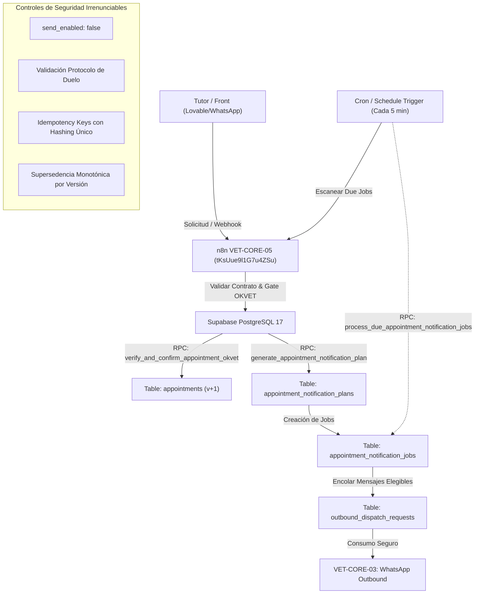

# VET FREEDOM OS — ARQUITECTURA DE NOTIFICACIONES DE CITAS
**Módulo:** VET-CORE-05 | Appointment Notification Service  
**Arquitectura:** Google Antigravity + Supabase PostgreSQL 17 + n8n Cloud  
**Dirección Médica:** Dr. Luis Eduardo Ríos  
**Dirección Estratégica:** Alpha Vision Method  
**Entorno:** DEVELOPMENT / SAFE SIMULATION (send_enabled: false)

---

## 1. Topología del Sistema y Flujo de Datos

---

## 2. Componentes Arquitectónicos Clave

### A. n8n Cloud Workflow (`VET-CORE-05` / ID: `tKsUue9l1G7u4ZSu`)
- **Triggers Múltiples:**
  - `Webhook`: Endpoint `/appointments/notify` para ingesta en tiempo real de eventos de cita provenientes de Lovable o webhooks clínicos.
  - `Schedule Trigger`: Cron configurado cada 5 minutos (`*/5 * * * *`) para escanear y ejecutar jobs vencidos en base de datos.
  - `Manual Trigger`: Franja de pruebas con `Mock Appointment Event` parametrizado con datos colombianos (`+573105550199`, Dr. Luis Eduardo Ríos).
- **Procesamiento y Enrutamiento:**
  - `Process Appointment Notification` (Code Node): Valida los contratos, detecta si proviene de un cron o un evento, efectúa el gate de validación OKVET, aplica reglas de plantilla y formatea la solicitud para `VET-CORE-03`.
  - `Check If Official Confirmation` (If Node): Separa los flujos que tienen confirmación oficial auditada de aquellos que son avisos de estado provisional.
  - `Dispatch Official Confirmation Notice` & `Dispatch Status Notice`: Registran metadatos y sellos de auditoría.

### B. Persistencia Durable en Supabase (PostgreSQL 17)
- **Cero dependencia de memoria volátil en n8n:** n8n jamás utiliza nodos `Wait` de 24 horas o 2 horas para citas futuras. Los nodos `Wait` colapsan ante reinicios de contenedores, despliegues o pausas de n8n.
- **Jobs durables en base de datos:** Cada notificación se programa como una fila en `appointment_notification_jobs` con:
  - `planned_for`: Fecha y hora exacta de disparo.
  - `eligible_after`: Umbral inferior de elegibilidad.
  - `expires_at`: Umbral superior tras el cual el mensaje caduca automáticamente.
  - `status`: `PENDING`, `DISPATCHED`, `SUPPRESSED`, `CANCELLED`, `SUPERSEDED`, `EXPIRED`.

---

## 3. Matriz de Integración Inter-Módulos

| Módulo Externo | Rol en la Arquitectura de Citas | Protocolo de Comunicación |
| :--- | :--- | :--- |
| **VET-CORE-01** (Event Dispatcher) | Emisión y consumo de eventos del outbox (`appointment.confirmed`, `appointment.cancelled`, etc.). | PostgreSQL Transactional Outbox |
| **VET-CORE-02** (WhatsApp Inbound) | Recepción de respuestas de tutores ("Sí, confirmo", "Deseo reagendar", "Cancelar"). | Webhook interno / RPC |
| **VET-CORE-03** (WhatsApp Outbound) | Generación y despacho controlado de solicitudes de plantillas oficiales de Meta. | `outbound_dispatch_requests` |
| **VET-CORE-04** (Handoff & Escalation) | Derivación a asesores humanos cuando un tutor rechaza una propuesta o reporta urgencia médica. | RPC `request_human_handoff` |
| **VET-CORE-06** (Google Calendar Sync) | Reflejo en tiempo real de franjas confirmadas en los calendarios oficiales de los veterinarios. | Sincronizador de Outbox |
| **VET-CORE-19** (Error & Retry Handler) | Captura de errores en base de datos o fallos de red durante el procesamiento de jobs. | Dead Letter Queue e Incidentes |
| **VET-CORE-20** (Health Monitoring) | Métricas de backlog de jobs pendientes y alertas ante retrasos en despacho. | RPC `get_system_health_summary` |
