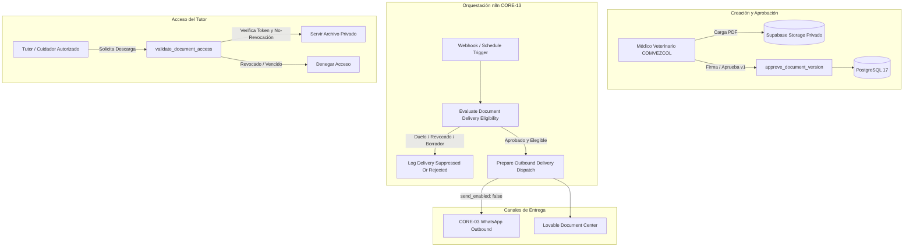

# VET FREEDOM OS — APPROVED DOCUMENT DELIVERY ARCHITECTURE
## Arquitectura Empresarial de Entrega Segura de Documentos Clínicos y Administrativos
**Módulo:** VET-CORE-13 | APPROVED DOCUMENT DELIVERY  
**Dirección Médica:** Dr. Luis Eduardo Ríos  
**Dirección Estratégica:** Alpha Vision Method  
**Plataformas:** Supabase Storage (Privado) + PostgreSQL 17 + n8n Cloud + Lovable Document Center  

---

## 1. Misión y Principios Arquitectónicos

El subsistema de entrega de documentos aprobados (`VET-CORE-13`) opera como la autoridad centralizada de distribución documental de Vet Life. Resuelve el riesgo crítico de divulgación no autorizada de historias clínicas, alteración de fórmulas médicas, entrega de borradores y filtración de datos privados a terceros o cuidadores revocados.

### Principios Inquebrantables:
1. **Almacenamiento Estrictamente Privado:** Ningún documento clínico se almacena en buckets públicos. Los objetos residen en `medical-records` y `referral-documents` con acceso público bloqueado (`public = false`).
2. **Separación de Estados:** La aprobación pertenece a una versión específica (`v1..vn`). `APPROVED` no equivale a `DELIVERED`, ni la creación de un enlace equivale a descarga o lectura.
3. **Autoridad Profesional Veterinaria:** Únicamente médicos veterinarios colegiados con matrícula profesional COMVEZCOL vigente pueden aprobar documentos clínicos (fórmulas, informes, certificados). La IA y el personal administrativo tienen prohibida la aprobación médica.
4. **Validación Previa al Despacho:** Antes de emitir cualquier acceso, se verifica la identidad del destinatario, su vigencia de parentesco con la mascota, ausencia de revocación y estado del protocolo de duelo (WFX-013).
5. **No a Enlaces Públicos Permanentes:** Se emplean dos estrategias de distribución:
   - **Estrategia A (Máxima Sensibilidad):** Gateway de descarga autenticado con verificación por sesión.
   - **Estrategia B (Mensajería Segura):** URLs firmadas temporales de 24 horas (`tokenized signed URLs`) con registro de auditoría observable.

---

## 2. Mapa de Integración y Flujo de Datos

---

## 3. Matriz de Componentes y Responsabilidades

| Componente | Rol en la Arquitectura | Restricción Técnica |
|---|---|---|
| **Supabase Storage** | Custodia de binarios en buckets privados (`medical-records`, `referral-documents`). | Sin lectura anónima; cuotas de 50MB; control estricto de MIME types. |
| **Supabase PostgreSQL 17** | Registro de metadatos, versiones v1..vn, checksums SHA-256, permisos de destinatarios y auditoría inmutable. | 100% de tablas protegidas con RLS; RPCs con `SECURITY DEFINER` y `search_path = public`. |
| **n8n Cloud (`VET-CORE-13`)** | Coordinador del flujo de validación, escaneo de solicitudes pendientes, filtros de duelo y encolamiento seguro. | Sin persistencia de binarios pesados en ejecuciones; Safe Mode activo (`send_enabled: false`). |
| **Lovable UI** | Centro de Documentos ("Document Center") para veterinarios, tutores y especialistas. | Sin service_role expuesto; URLs efímeras protegidas. |
| **CORE-03** | Motor de despacho hacia WhatsApp Business Platform. | Envío de notificaciones tokenizadas, respetando opt-out y ventana de 24 horas. |
| **OKVET** | Repositorio clínico legal de la República de Colombia. | Autoridad del expediente; Vet Freedom OS almacena referencias operativas aprobadas. |
