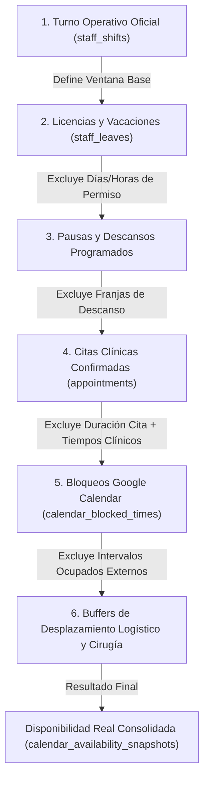

# FUENTE ÚNICA DE VERDAD DE DISPONIBILIDAD — VET FREEDOM OS
## Motor Consolidado de Agregación de Disponibilidad, Turnos, Permisos y Logística

**Proyecto:** VET FREEDOM OS  
**Módulo:** `VET-CORE-06 | GOOGLE CALENDAR SYNC`  
**Empresa:** Vet Life — Veterinaria a Domicilio  
**Dirección Médica:** Dr. Luis Eduardo Ríos  
**Dirección Estratégica:** Alpha Vision Method  
**Estado:** QA / STAGING (Safe Mode: `send_enabled: false`, `active: false`)

---

## 1. Declaración de Fuente Única de Verdad

En el modelo operativo de Vet Life — Veterinaria a Domicilio, **la base de datos Supabase PostgreSQL es la ÚNICA Fuente de Verdad (Single Source of Truth - SSOT)** para la disponibilidad médica y operativa.

Google Calendar NO determina la validez clínica de una cita; actúa como un sensor externo de indisponibilidad personal (Modo A) y un canal espejo de visualización operativa (Modo B).

---

## 2. Ecuación Determinista de Disponibilidad Unificada

La disponibilidad neta de un profesional veterinario en un instante $t$ o intervalo $[t_1, t_2]$ se calcula evaluando la conjunción de seis (6) capas jerárquicas:

$$\text{Disponible}(v, t_1, t_2) = \text{TurnoActivo}(v) \land \neg \text{EnLicencia}(v) \land \neg \text{EnDescanso}(v) \land \neg \text{CitaClinica}(v) \land \neg \text{BloqueoGoogle}(v) \land \text{BufferLogistico}(v)$$



---

## 3. Jerarquía de Componentes de Disponibilidad

### 3.1 Capa 1: Turnos Operativos Oficiales (`staff_shifts`)
- Representa el marco contractual y operativo donde el profesional está en servicio.
- Ningún servicio a domicilio se agenda fuera de la ventana de turno sin autorización de dirección médica.

### 3.2 Capa 2: Permisos, Incapacidades y Vacaciones (`staff_leaves`)
- Cualquier solicitud aprobada bloquea automáticamente la totalidad o fracción del día.
- Prevalece sobre cualquier disponibilidad reportada por Google Calendar.

### 3.3 Capa 3: Pausas y Descansos Activos
- Franjas de almuerzo y pausas de hidratación/descanso ergonómico para el equipo móvil.

### 3.4 Capa 4: Citas Clínicas Confirmadas (`appointments`)
- Citas confirmadas en Supabase vinculadas al expediente OKVET.
- Incluyen tiempo de atención médica domiciliaria (45 a 90 minutos según el tipo de servicio).

### 3.5 Capa 5: Bloqueos Sanitizados de Google Calendar (`calendar_blocked_times`)
- Eventos personales del profesional importados bajo la modalidad estricta `BUSY_ONLY`.
- Respetan la vida privada del médico pero protegen al paciente de solapamientos indeseados.

### 3.6 Capa 6: Buffers Logísticos de Desplazamiento y Ventanas Quirúrgicas
- **Buffer de Desplazamiento:** Mínimo 45 minutos entre domicilios en el perímetro de Bogotá.
- **Ventana Quirúrgica Protegida:** Mínimo 60 minutos de descanso y preparación antes y después de cirugías mayores dirigidas por el Dr. Luis Eduardo Ríos.

---

## 4. Estructura del Snapshot de Disponibilidad

El resultado consolidado se materializa en la tabla `calendar_availability_snapshots`:

```json
{
  "staff_profile_id": "s1000000-0000-0000-0000-000000000001",
  "target_date": "2026-11-21",
  "shift": { "start": "2026-11-21T08:00:00-05:00", "end": "2026-11-21T18:00:00-05:00" },
  "is_on_leave": false,
  "available_slots": [
    { "start": "2026-11-21T08:00:00-05:00", "end": "2026-11-21T10:00:00-05:00" },
    { "start": "2026-11-21T11:00:00-05:00", "end": "2026-11-21T14:00:00-05:00" },
    { "start": "2026-11-21T15:30:00-05:00", "end": "2026-11-21T18:00:00-05:00" }
  ],
  "busy_slots_count": 2,
  "data_freshness": "HEALTHY",
  "calculated_at": "2026-11-21T12:00:00.000Z"
}
```

Esta estructura permite a `VET-CORE-01 (Scheduling Engine)` consultar disponibilidad en tiempo constante ($O(1)$) garantizando tiempos de respuesta inferiores a 50 milisegundos.
