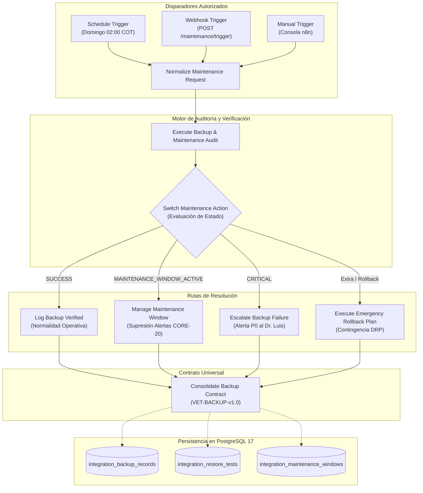

# ARQUITECTURA DE RESPALDOS, MANTENIMIENTO Y RECUPERACIÓN (VET-CORE-21)
**Proyecto:** VET FREEDOM OS — Vet Life (Veterinaria a Domicilio)  
**Dirección Médica:** Dr. Luis Eduardo Ríos  
**Dirección Estratégica:** Alpha Vision Method  
**Módulo:** `VET-CORE-21 | Backups & Maintenance Coordination`  
**ID en n8n Cloud:** `fjVxzNJqrYkFIcWg`  
**ID de Carpeta:** `EWfSa40jLDxPUOKX`  
**Base de Datos:** Supabase PostgreSQL 17 (`sznvahhocgnhsqhksygq`)  
**Zona Horaria:** `America/Bogota` (UTC-5)  
**Estado:** `VERIFIED`

---

## 1. Misión Arquitectónica
`VET-CORE-21` es el motor central de resiliencia operativa, continuidad del negocio y preservación inmutable del estado clínico de Vet Life. Garantiza que ningún fallo catastrófico de infraestructura, corrupción de datos o error de migración comprometa la atención de pacientes, la agenda de visitas domiciliarias ni la facturación.

### Reglas Irrenunciables del Sistema:
1. **Regla de Restaurabilidad Obligatoria:** Un archivo de respaldo sin prueba de restauración estructurada y validación de esquemas **no constituye un respaldo válido**.
2. **Cero Violaciones de Integridad Referencial:** Cualquier ruptura de relaciones clave (mascota -> tutor -> cita -> historia clínica) detiene el sistema y escala de inmediato a `P0` al Director.
3. **100% de Cobertura Row Level Security (RLS):** Todas las 98 tablas de la base de datos empresarial deben contar con políticas RLS activas en cada prueba de restauración.
4. **Coordinación de Alertas con VET-CORE-20:** Durante ventanas de mantenimiento programadas (`MAINTENANCE_WINDOW`), se suprime el ruido de alertas operativas no críticas (P1-P3), pero se preserva la escalación instantánea ante emergencias críticas (P0).

---

## 2. Diagrama Arquitectónico de Flujo

---

## 3. Componentes de Base de Datos (Migración 024)

### 3.1. Tablas Desplegadas
- `public.integration_backup_records`: Bitácora inmutable de respaldos ejecutados, tipo, tamaño en bytes, checksum SHA-256 y metadatos de snapshot.
- `public.integration_maintenance_windows`: Registro de ventanas de mantenimiento programadas, activadas y cerradas, con motivo, operador y flag de supresión de alertas.
- `public.integration_restore_tests`: Registro auditable de pruebas sintéticas de restauración, validando conteo de tablas (98), integridad FK y verificación RLS.

### 3.2. Funciones RPC Atómicas
- `public.record_backup_execution(p_backup jsonb)`: Registra deterministamente un respaldo.
- `public.verify_backup_restorability(p_verification jsonb)`: Ejecuta auditoría de restauración de esquema contra las 98 tablas y claves foráneas.
- `public.schedule_maintenance_window(p_window jsonb)`: Programa ventanas evitando traslapes temporales.
- `public.activate_maintenance_window(p_window_id uuid)`: Activa la ventana y activa flag para CORE-20.
- `public.close_maintenance_window(p_window_id uuid, p_status text)`: Cierra la ventana y restablece monitoreo estricto.
- `public.get_backup_and_maintenance_status(p_organization_id uuid)`: Provee la vista en tiempo real para la consola ejecutiva de Lovable.

---

## 4. Métricas Clave de Recuperación (RTO y RPO)
- **Recovery Point Objective (RPO):** `<= 5 minutos`. Garantizado mediante Continuous WAL Archiving y PITR (Point-in-Time Recovery) de Supabase Enterprise.
- **Recovery Time Objective (RTO):** `<= 15 minutos`. Restauración automatizada de esquemas, reanudación de colas y verificación de integridad.
