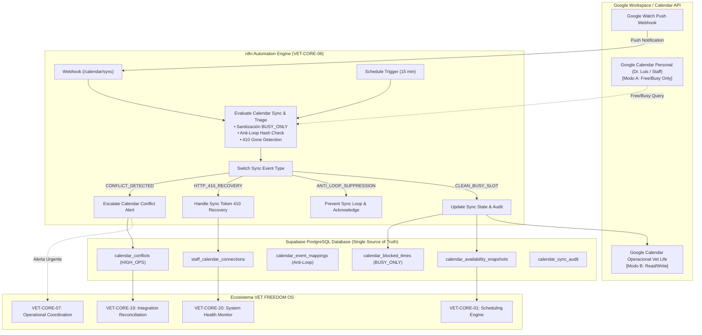

# ARQUITECTURA DE SINCRONIZACIÓN DE CALENDARIOS — VET-CORE-06
## Sistema Empresarial de Sincronización Bidireccional, Disponibilidad y Resiliencia

**Proyecto:** VET FREEDOM OS  
**Módulo:** `VET-CORE-06 | GOOGLE CALENDAR SYNC`  
**Empresa:** Vet Life — Veterinaria a Domicilio  
**Dirección Médica:** Dr. Luis Eduardo Ríos  
**Dirección Estratégica:** Alpha Vision Method  
**Estado:** QA / STAGING (Safe Mode: `send_enabled: false`, `active: false`)

---

## 1. Visión y Principios Arquitectónicos

El módulo `VET-CORE-06` articula la sincronización y agregación de calendarios en tiempo real entre los calendarios de los profesionales veterinarios (Google Calendar) y el núcleo operativo de Vet Freedom OS (Supabase + n8n + Lovable).

### Principios Irrenunciables:
1. **Privacidad Inviolable por Diseño (Modo A - BUSY_ONLY):** Los calendarios personales del Dr. Luis Eduardo Ríos y del equipo veterinario se integran exclusivamente bajo el principio de menor privilegio. Vet Freedom OS extrae únicamente intervalos de tiempo ocupados (`start`, `end`). Queda terminantemente prohibido almacenar, indexar o transmitir títulos de eventos, notas, descripciones, invitados, locaciones o enlaces de videollamadas privadas.
2. **Prevención Estricta de Bucles (Anti-Loop Invariant en Modo B):** La escritura hacia Google Calendar solo está autorizada en calendarios operacionales de Vet Life. Cada evento emitido genera un hash criptográfico determinista (`last_published_hash`) y versionamiento (`sync_generation`). Toda notificación push entrante generada como eco de una escritura propia es detectada y suprimida de inmediato.
3. **Invariante Clínico: CERO Cancelaciones Automáticas:** Un conflicto entre un evento externo de Google Calendar y una cita clínica confirmada NUNCA cancela ni reprograma automáticamente la cita en Supabase ni en OKVET. Todo conflicto se clasifica con severidad `HIGH_OPS` y se escala a coordinación operativa (`VET-CORE-07`).
4. **Recuperación Resiliente ante HTTP 410 Gone:** Si Google invalida el cursor de sincronización (`syncToken`), el sistema invalida el token, pasa a estado `STALE` y ejecuta una sincronización completa de espejo (`FULL_MIRROR`) sin eliminar jamás citas de negocio o registros clínicos en Supabase.

---

## 2. Diagrama de Arquitectura del Sistema

---

## 3. Modos de Integración: Modo A vs Modo B

| Parámetro | Modo A: Personal Free/Busy | Modo B: Operacional Vet Life |
| :--- | :--- | :--- |
| **Destinatarios** | Dr. Luis Eduardo Ríos, Veterinarios Staff, Auxiliares | Calendarios Institucionales de Vet Life |
| **Permisos Google API** | `https://www.googleapis.com/auth/calendar.events.freebusy` | `https://www.googleapis.com/auth/calendar.events` |
| **Dirección de Datos** | Exclusivamente Inbound (Lectura hacia Supabase) | Bidireccional Controlada (Inbound & Outbound) |
| **Almacenamiento en BD** | `sanitized_summary: 'OCUPADO / NO DISPONIBLE (BUSY_ONLY)'` | Mapeo estructurado con `google_event_id` y hash |
| **Escritura desde Vet OS** | **ESTRICTAMENTE PROHIBIDA** (Lanza Excepción SQL) | Permitida con verificación anti-bucle |
| **Propósito Operativo** | Detección de indisponibilidad y protección de privacidad | Sincronización oficial de citas de ruta y logística |

---

## 4. Estrategia de Concurrencia y Bloqueos

Para garantizar que múltiples instancias de n8n o ráfagas de notificaciones push de Google no corrompan el estado de sincronización:
- **Lease Pesimista (`acquire_calendar_sync_lease`):** Antes de ejecutar una sincronización incremental o full mirror, el worker adquiere un cerrojo exclusivo por conexión (`calendar_sync_leases`) con expiración automática (TTL: 120s). Si otro worker intenta sincronizar la misma conexión en paralelo, la solicitud se rechaza limpiamente evitando condiciones de carrera.
- **Idempotencia de Bloqueos:** La inserción de intervalos ocupados utiliza hashing determinista (`start_at`, `end_at`, `connection_id`) evitando duplicidades.
- **Coalescencia de Notificaciones Push (Debounce):** Si Google emite múltiples notificaciones push en milisegundos para el mismo calendario, el webhook registra el ping y unifica el procesamiento en una sola pasada.
