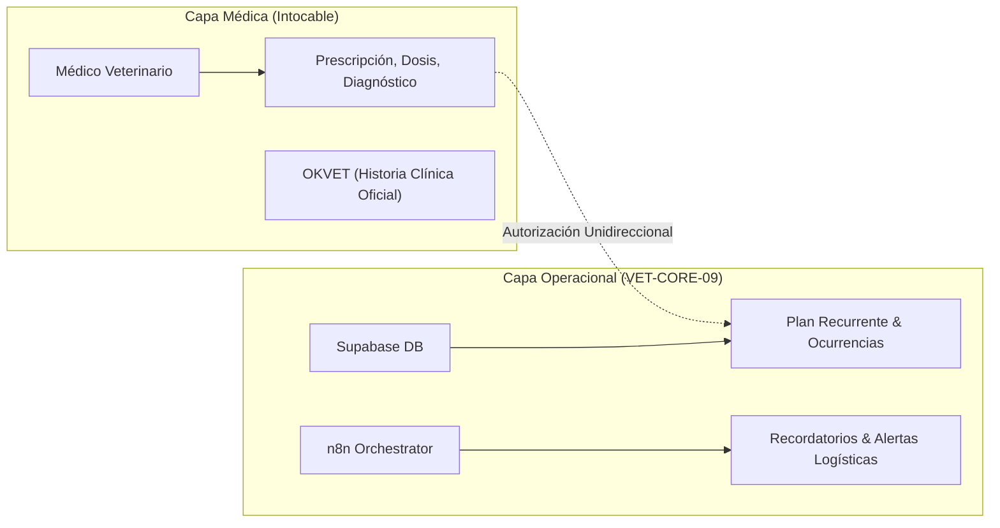

# VET FREEDOM OS — CLINICAL PLAN BOUNDARIES
## Fronteras Éticas, Legales y Clínicas en el Modelo Domiciliario
**Módulo:** VET-CORE-09  
**Dirección Médica:** Dr. Luis Eduardo Ríos  

---

## 1. Principio de No Invasión Médica por Automatización

En **Vet Life — Veterinaria a Domicilio**, la inteligencia artificial y las herramientas de automatización como **n8n** operan estrictamente en la capa de coordinación operacional, recordatorios y alertas logísticas.

### Límites Inviolables:
- **Cero Diagnóstico por IA:** Ningún LLM o agente conversacional puede interpretar signos clínicos para alterar un plan de manejo renal, cardiológico o fisioterapéutico.
- **Cero Recalibración Farmacológica:** Si una sesión de quimioterapia o fluidoterapia no se ejecuta, el sistema tiene terminantemente prohibido duplicar la dosis de la siguiente visita o ajustar la concentración de fármacos.
- **Cero Auto-Reprogramación en Ventanas Estrictas:** Ningún algoritmo de optimización de rutas (VET-CORE-08) puede postergar una visita con `is_window_strict = true` con el fin de ahorrar kilómetros o combustible.

---

## 2. Responsabilidades Profesionales y Registro Legal

1. **Titularidad del Plan:** Todo plan debe registrar el `prescribing_veterinarian_id`. En caso de auditoría de la autoridad sanitaria veterinaria (COMVEZCOL / ICA), el profesional firmante es el responsable legal de la terapia.
2. **Historia Clínica en OKVET:** El cierre operativo de una sesión en Vet Freedom OS (`COMPLETED`) es un hito logístico que facilita la facturación y la continuidad. La constancia legal del acto médico radica en el expediente clínico oficial registrado en OKVET.
