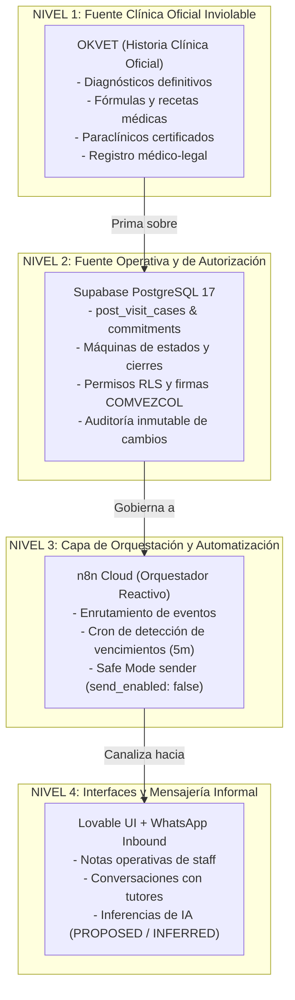

# VET FREEDOM OS — COMMITMENT SOURCE OF TRUTH HIERARCHY
## Jerarquía de Fuentes de Verdad, Autoridad Médica y Reconciliación de Contradicciones
**Módulo:** VET-CORE-12 | POST-VISIT COMMITMENTS  
**Dirección Médica:** Dr. Luis Eduardo Ríos  
**Estándar:** WFX-005, WFX-006 y WFX-018  

---

## 1. Pirámide Canónica de Fuentes de Verdad

---

## 2. Clasificación de Procedencia del Dato (`source_provenance`)

1. **`VERIFIED`:** Información originada en un acto médico directo o refrendada por historia clínica oficial en OKVET.
2. **`REPORTED`:** Información comunicada por el cliente o tutor (ej. "el perro vomitó la pasta"). Se registra como hecho comunicado, no como diagnóstico.
3. **`INFERRED`:** Candidatos extraídos por IA a partir de texto o transcripciones. **Axioma:** Una inferencia de IA **NUNCA** se convierte automáticamente en orden clínica ni en obligación contractual sin validación humana.
4. **`PENDING_CONFIRMATION`:** Obligaciones registradas de forma preliminar que requieren cotejo con la clínica externa.
5. **`STALE`:** Datos con más de 365 días de antigüedad sin actualización que exigen revalidación obligatoria (WFX-006).
6. **`CONFLICTING`:** Discrepancia explícita entre lo anotado informalmente y el registro oficial de OKVET (WFX-018).

---

## 3. Protocolo de Reconciliación de Contradicciones (WFX-018)

Si surge una discordancia (ejemplo: nota en chat indica *"dar 10 gotas"* mientras la historia oficial en OKVET indica *"dar 5 gotas"*):
- El compromiso se marca inmediatamente como `source_provenance = 'CONFLICTING'`.
- Se suspende de forma automática cualquier recordatorio programado hacia el tutor.
- Se genera una tarea de alta prioridad (`HIGH`) para el médico veterinario tratante.
- La historia en OKVET prevalece legal y clínicamente; la corrección se asienta con auditoría en `post_visit_audit`.
