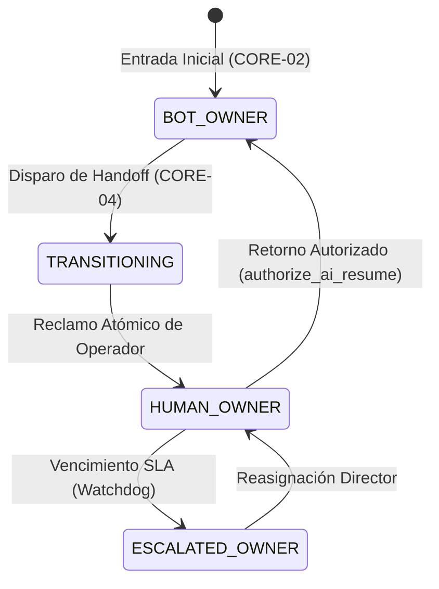

# CONVERSATION OWNERSHIP & SINGLE SOURCE OF TRUTH
## VET FREEDOM OS — VET-CORE-04 | Conversation Escalation & Human Handoff
**Dirección Médica:** Dr. Luis Eduardo Ríos  
**Dirección Estratégica:** Alpha Vision Method  
**Plataforma:** Supabase (PostgreSQL 17) + n8n Cloud + Lovable UI  
**Fecha:** 2026-11-21  
**Estado:** PRODUCCIÓN AUDITADA & VERIFICADA  

---

## 1. Principio Fundamental de Propiedad
En **Vet Freedom OS**, una conversación entre un tutor y Vet Life tiene **exactamente un único dueño activo en cualquier instante temporal**:

1. **Dueño IA (`BOT_AI`):** La IA procesa, clasifica y responde únicamente cuando:
   - `conversations.is_bot_locked = false`
   - `conversations.status = 'AI_ACTIVE'`
   - `conversations.assigned_agent_id IS NULL`
2. **Dueño Humano (`STAFF_HUMAN`):** Un profesional veterinario, coordinador o recepcionista asume la exclusividad del canal:
   - `conversations.is_bot_locked = true`
   - `conversations.assigned_agent_id = '<UUID_OPERADOR>'`
   - `conversations.status IN ('HUMAN_ASSIGNED', 'HUMAN_ACTIVE', 'WAITING_CUSTOMER', 'WAITING_INTERNAL_RESPONSE')`
3. **Dueño Supervisor (`DIRECTOR`):** En casos de emergencia crítica no atendida o discrepancias médicas, el Director Médico General (Dr. Luis Eduardo Ríos) toma control exclusivo con prioridad `CRITICAL`.

---

## 2. Inmutabilidad y Monotonía de Versión (`state_version`)
Para erradicar cualquier condición de carrera distribuida entre n8n Cloud, Supabase y Lovable:
- Cada conversación posee un contador entero monotónico `state_version` (valor inicial `1`).
- Toda transición de estado, solicitud de handoff, reclamo de operador o reanudación incrementa estrictamente `state_version := state_version + 1`.
- Cualquier proceso asíncrono de IA (drafts generados por LLMs) debe presentar su `draft_version`. Si `draft_version < state_version`, la función guardiana `verify_outbound_permission` **anula y desecha el borrador inmediatamente** con código `AI_SUPPRESSED_HUMAN_CONTROL_ACTIVE`.

---

## 3. Matriz de Equipos y Jerarquía de Propiedad

| Código Equipo | Rol en Supabase | Titular Primario | Cola Asignada | Tipo de Requerimiento |
|---|---|---|---|---|
| `DIRECTOR` | `DIRECTOR` | Dr. Luis Eduardo Ríos | `DIRECTOR_MEDICAL_EMERGENCY_QUEUE` | Emergencias vitales P0, duelo, quejas formales graves, expiración SLA |
| `VET` | `VETERINARIAN` | Dra. Camila Torres | `VET_CLINICAL_ENLACE_QUEUE` | Consultas de dosis farmacológicas, sintomatología, dudas clínicas |
| `COORDINACION`| `COORDINATOR` | Andrés Salcedo | `COORDINATION_DISPATCH_QUEUE` | Cambios de agenda, reprogramación, confirmación de llegada domiciliaria |
| `RECEPCION` | `RECEPTION` | Valentina Gómez | `RECEPTION_GENERAL_INBOX` | Datos del tutor, información de tarifas, dudas generales |
| `FINANZAS` | `FINANCE` | Paola Méndez | `FINANCE_BILLING_QUEUE` | Facturación electrónica Dian, soporte pagos PSE, discrepancias de cobro |
| `SOPORTE` | `TECH_SUPPORT` | Alpha Vision SRE | `TECH_SUPPORT_SRE_QUEUE` | Anomalías de plataforma, fallos de integración, auditoría de seguridad |

---

## 4. Garantías de Concurrencia (Anti-Colisión)
- **Bloqueo a Nivel de Fila:** Los reclamos de casos se ejecutan con `SELECT ... FOR UPDATE` sobre `public.conversation_handoffs` y `public.conversations`.
- **Primer Operador Gana:** Si dos operadores intentan reclamar simultáneamente el mismo handoff, la base de datos bloquea al segundo y le responde `ALREADY_ASSIGNED` con los datos del operador que ganó la asignación.
- **Cero Pérdida de Contexto:** Al transferir la propiedad a un humano, se preserva íntegro el historial reciente de mensajes y las notas internas acumuladas.
