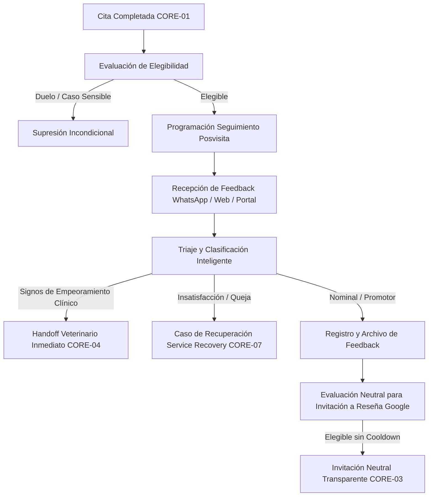

# VET FREEDOM OS — ARQUITECTURA DE EXPERIENCIA DEL CLIENTE (VET-CORE-15)

## 1. Visión General
El módulo **VET-CORE-15** constituye el núcleo de seguimiento posvisita, escucha activa, triaje inteligente de retroalimentación, escalación de quejas, recuperación de experiencias (*service recovery*), reputación auténtica y mejora continua para **Vet Life — Veterinaria a Domicilio**, bajo la dirección del **Dr. Luis Eduardo Ríos**.

## 2. Principios Rectores
1. **Seguridad Clínica Inquebrantable:** Ante cualquier manifestación de preocupación médica o empeoramiento posvisita, el sistema **JAMÁS** diagnostica, prescribe ni tranquiliza mediante IA. Desvía de inmediato el caso a un veterinario tratante a través de **VET-CORE-04**.
2. **Prohibición Estricta de Review Gating:** En estricto apego a las políticas de Google Business Profile y la ética de Vet Life, las invitaciones a reseñas públicas son neutrales y no están condicionadas por calificaciones previas de satisfacción (NPS/CSAT). Cero filtrado selectivo y cero incentivos económicos o descuentos a cambio de reseñas.
3. **Respeto Emocional y Supresión de Duelo:** Si el paciente ha fallecido o el tutor se encuentra en duelo, todas las comunicaciones comerciales, de satisfacción o de reputación quedan absoluta e incondicionalmente suprimidas.
4. **Service Recovery Riguroso:** Una disculpa no es una resolución. Todo caso de insatisfacción cuenta con asignación de responsable, SLA de contacto, investigación de causas, compromisos verificables y cierre formal auditable, permitiendo reapertura si surgen nuevos hechos.
5. **Modo Seguro (Safe Mode):** En entornos de desarrollo/QA, `send_enabled: false` y `active: false` en n8n (`YVEIO4UW2DWTztoy`), impidiendo despachos reales no autorizados.

## 3. Diagrama de Componentes

