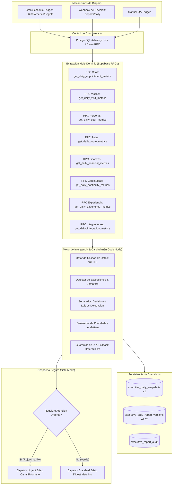

# Arquitectura del Sistema de Reporte Ejecutivo Diario (VET-CORE-16)

**Módulo:** `VET-CORE-16 | DAILY EXECUTIVE REPORTING`  
**Proyecto:** VET FREEDOM OS — Vet Life: Veterinaria a Domicilio  
**Dirección Médica:** Dr. Luis Eduardo Ríos  
**Dirección Estratégica:** Alpha Vision Method  
**Entorno:** DEVELOPMENT / QA  
**Fecha:** 2026-11-21  

---

## 1. Misión y Propósito Ejecutivo

El sistema de Reporte Ejecutivo Diario constituye el centro neurálgico de inteligencia, supervisión y soporte a decisiones de Vet Life. Su misión es condensar la totalidad de la operación diaria (citas, visitas, rutas, finanzas, personal, experiencia, especialistas, compromisos y salud técnica) en un brief accionable de **60 segundos** para el Dr. Luis Eduardo Ríos.

### Principios Rectores:
1. **La Verdad en los Datos (No Fabricación):** Los reportes se basan en métricas verificables y registradas en Supabase (`sznvahhocgnhsqhksygq`). Si un dato no existe o la fuente está caída, se marca explícitamente como `SOURCE_UNAVAILABLE` o advertencia; jamás se inventan ceros ni visitas ficticias.
2. **Inmutabilidad y Versionado Histórico:** Cada corte diario genera un Snapshot formal versionado (`v1..vn`). Los datos tardíos no sobreescriben la versión matutina, sino que crean una nueva versión trazable con auditoría de diferencias.
3. **Decisiones vs. Delegación:** Distingue con precisión milimétrica las decisiones reservadas para el criterio de la Dirección Médica (Dr. Luis) de las tareas operativas delegables a la Coordinación, Veterinarios de Ruta o Facturación.
4. **Resguardo de Privacidad y Safe Mode:** En fase QA, todos los despachos externos están deshabilitados (`send_enabled: false`, `active: false`), garantizando cero impacto en clientes o personal sin autorización previa.

---

## 2. Diagrama de Arquitectura Global

---

## 3. Componentes del Ecosistema

### 3.1. Orquestador n8n (`VET-CORE-16`)
- **Cloud ID:** `LHYUw9Pe93pDXaTw`
- **Zona Horaria:** `America/Bogota` (UTC-5)
- **Disparador:** Diario a las 06:00 AM (Schedule Trigger) y bajo demanda vía Webhook autenticado.
- **Modo Seguro:** Salidas Set formateadas con `send_enabled: false`, `active: false`.

### 3.2. Capa de Base de Datos (Supabase PostgreSQL 17.12)
- **Migración 037:** 17 tablas relacionales dedicadas al reporting ejecutivo y auditoría.
- **14 Stored Procedures (`SECURITY DEFINER`):** Encapsulan la agregación atómica de métricas, claim de generación, registro de excepciones y auditoría inmutable.
- **Seguridad RLS:** Restricción estricta por `organization_id` con acceso restringido a roles `DIRECTOR` y `COORDINATION`.

### 3.3. Motor de Guardrails de IA y Fallback
- Si se activa asistencia de lenguaje natural (LLM) para generar la narrativa matutina, sus afirmaciones numéricas se contrastan contra las métricas deterministas de Supabase.
- En caso de alucinación (discrepancia en visitas, recaudo inventado ante corte de pasarela, etc.), el sistema aborta la narrativa sintética y emite el **Resumen Ejecutivo Determinista** predefinido.

---

## 4. Enlaces de Referencia

- [Migración Supabase 037](file:///c:/Users/Freud/N8NVET/supabase/migrations/037_daily_executive_reporting_and_decision_intelligence_hub.sql)
- [Workflow n8n VET-CORE-16](file:///c:/Users/Freud/N8NVET/automation/n8n/workflows/VET-CORE-16.json)
- [Suite de Pruebas Automatizadas](file:///c:/Users/Freud/N8NVET/tests/test_core_16_t01_to_t110.js)
