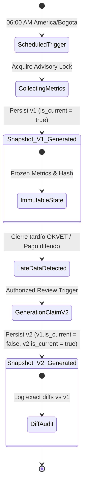

# Modelo de Snapshots y Versionado Histórico del Reporte Ejecutivo

**Módulo:** `VET-CORE-16 | DAILY EXECUTIVE REPORTING`  
**Proyecto:** VET FREEDOM OS — Vet Life: Veterinaria a Domicilio  
**Dirección Médica:** Dr. Luis Eduardo Ríos  
**Dirección Estratégica:** Alpha Vision Method  
**Fecha:** 2026-11-21  

---

## 1. Justificación del Modelo de Snapshot Inmutable

En operaciones clínicas domiciliarias, la realidad de los datos evoluciona a lo largo de la jornada:
- Un médico veterinario puede finalizar una historia clínica en OKVET a altas horas de la noche por falta de conectividad en una zona rural.
- Una pasarela de pago puede confirmar una transferencia diferida horas después del corte matutino.
- Un tutor puede confirmar una cita reprogramada fuera de horario de oficina.

Si el sistema sobreescribiera el reporte emitido a las 06:00 AM, el Dr. Luis Eduardo Ríos perdería la referencia histórica de lo que se le informó al inicio del día, invalidando la rendición de cuentas. Por ello, se implementó el **Modelo de Snapshots Versionados Inmutables** en la tabla `executive_daily_snapshots` y `executive_daily_report_versions`.

---

## 2. Diagrama de Estados del Snapshot



---

## 3. Esquema de Metadatos de Cada Versión

Cada registro en `executive_daily_snapshots` almacena:

```json
{
  "snapshot_id": "snap-org-vet-life-2026-11-21-v1",
  "organization_id": "org-vet-life",
  "report_date": "2026-11-21",
  "version_number": 1,
  "is_current": true,
  "trigger_reason": "SCHEDULED_MORNING",
  "metrics_payload": {
    "appointments": { "scheduled": 10, "confirmed": 9, "quality": "VERIFIED" },
    "visits": { "completed": 8, "pending_closure": 0, "quality": "VERIFIED" },
    "finances": { "verified_cop": 2450000, "quality": "VERIFIED" }
  },
  "summary_60s": "...",
  "evaluation": {
    "traffic_light": "VERDE",
    "alert_level": "INFORMATIONAL",
    "alerts_count": 0
  },
  "integrity_hash_sha256": "e3b0c44298fc1c149afbf4c8996fb92427ae41e4649b934ca495991b7852b855",
  "created_at": "2026-11-21T06:00:02-05:00"
}
```

---

## 4. Auditoría de Diferencias (Diffs) entre Versiones

Cuando se genera la versión `v2`, el sistema ejecuta la función `executive_report_audit` registrando:
1. Las métricas que variaron (ej. `visits.completed: 8 -> 9`).
2. El motivo de la actualización (`trigger_reason: LATE_CLINICAL_CLOSURE_OKVET`).
3. El usuario o proceso autorizador de la nueva versión.
4. Preservación absoluta de la versión `v1` para efectos legales y auditorías de COMVEZCOL.
