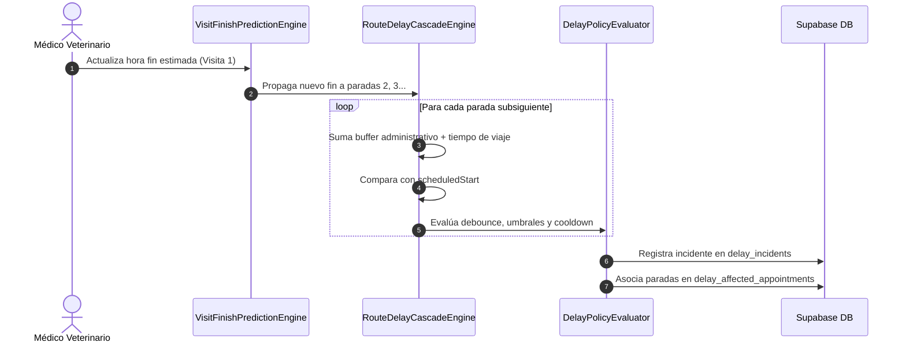

# VET FREEDOM OS — DELAY PREDICTION & CASCADE PROPAGATION
## Modelo Predictivo de Retrasos en Cascada y Políticas Autónomas de Despacho
### Versión 15B.0 — Antigravity + Supabase + n8n

---

## 1. Detección y Cálculo de Retraso Individual

El motor `DelayPredictionEngine` determina si una cita experimentará un retraso operativo confirmado mediante la siguiente formulación:

$$\Delta t_{\text{nominal}} = \frac{t_{\text{predictedArrival}} - t_{\text{scheduledStart}}}{60 \times 1000}$$
$$\text{delayMinutes} = \max\left(0, \Delta t_{\text{nominal}} - \tau_{\text{tolerance}}\right)$$

Donde:
- $t_{\text{predictedArrival}}$: Hora estimada de arribo al domicilio calculada por `VetEtaEngine`.
- $t_{\text{scheduledStart}}$: Hora oficial pactada con la familia en la reserva.
- $\tau_{\text{tolerance}}$: Margen de cortesía estándar en Bogotá (por defecto 10 minutos, o 5 minutos en citas protegidas).

### 1.1 Matriz de Severidad

| Retraso Neto Calculado | Severidad | Acción del Sistema | Notificación al Cliente |
| :--- | :--- | :--- | :--- |
| **0 minutos** | `NONE` | Operación en tiempo | Ninguna |
| **1 a 14 minutos** | `LOW` | Monitoreo en segundo plano | No (bajo umbral estándar) |
| **15 a 29 minutos** | `MEDIUM` | Alerta interna + Evaluación de cliente | Sí (si cumple debounce y consentimiento) |
| **30 a 59 minutos** | `HIGH` | Alerta prioritaria a Coordinación | Sí (con seguimiento y opción de reacomodación) |
| **$\ge$ 60 minutos** | `CRITICAL` | Intervención manual del Dr. Ríos | Exige contacto telefónico directo |

---

## 2. Propagación en Cascada (`RouteDelayCascadeEngine`)

En la atención veterinaria domiciliaria, el retraso de una consulta impacta directamente a todas las citas subsiguientes de la jornada.

### 2.1 Algoritmo de Cascada
Para cada parada $i$ en la secuencia de la ruta:
1. **Hora de partida**: Si $i = \text{primera parada subsiguiente}$, $t_{\text{dep}, i} = t_{\text{finish}, \text{prev}} + \Delta t_{\text{buffer}}$.
2. **Hora de llegada prevista**: $t_{\text{arr}, i} = t_{\text{dep}, i} + \Delta t_{\text{travel}}(i-1 \to i)$.
3. **Hora de finalización prevista**: $t_{\text{fin}, i} = \max(t_{\text{arr}, i}, t_{\text{start}, i}) + \Delta t_{\text{service}, i} + \Delta t_{\text{buffer}}$.
4. **Cálculo de retraso**: Se evalúa contra el `scheduledStart` de la parada $i$.
5. Si una cita tiene `isProtected = true`, el sistema no permite recortar la duración del servicio para absorber el retraso, emitiendo una alerta inmediata a la coordinación para evaluar reasignación o ajuste de ruta.

---

## 3. Reglas de Filtrado y Estabilidad (Anti-Flapping)

Para garantizar que el sistema no emita comunicaciones erráticas o excesivas:

### 3.1 Debounce por Predicciones Consecutivas
Se requiere que al menos **2 lecturas consecutivas** confirmen el retraso antes de declarar la elegibilidad de una notificación al cliente. Si un semáforo largo genera un retraso momentáneo que se recupera en la siguiente cuadra, la notificación nunca se dispara.

### 3.2 Histéresis de Cambio Mínimo (5 Minutos)
Una vez notificada una familia, no se enviará una actualización posterior a menos que el retraso estimado varíe en al menos **$\pm 5$ minutos** respecto al último valor comunicado.

### 3.3 Cooldown Mínimo (30 Minutos)
Se prohíbe el envío de más de un mensaje automatizado de retraso a la misma familia dentro de una ventana de **30 minutos**, salvo que ocurra una reasignación formal de profesional o cancelación.

---

## 4. Resolución y Recuperación
Cuando el equipo médico avanza con mayor agilidad o el tráfico se descongestiona y el retraso cae por debajo de la tolerancia ($\text{delayMinutes} = 0$):
- El incidente en `delay_incidents` cambia a estado `RESOLVED`.
- Se cancelan las notificaciones pendientes en cola.
- No se envían mensajes redundantes ("ya no hay retraso") a menos que la coordinación lo juzgue clínicamente relevante.
