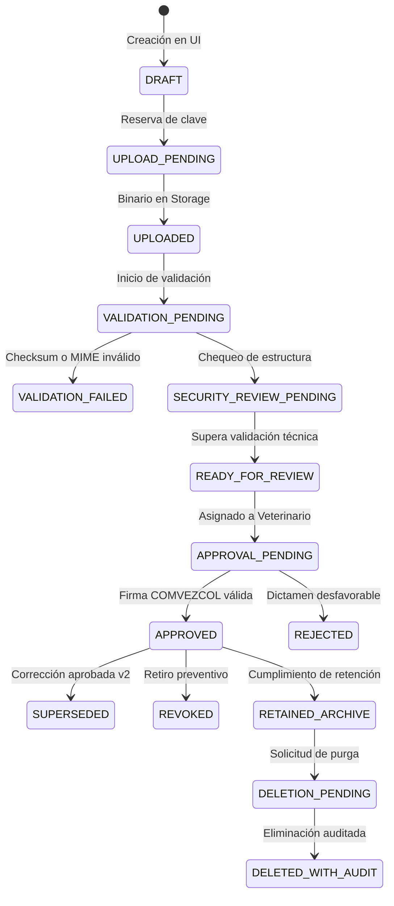

# VET FREEDOM OS — DOCUMENT STATE MACHINE
## Máquina de Estados Documentales y Estados de Entrega
**Módulo:** VET-CORE-13 | APPROVED DOCUMENT DELIVERY  
**Dirección Médica:** Dr. Luis Eduardo Ríos  
**Base de Datos:** PostgreSQL 17 (`documents`, `document_versions`, `document_delivery_requests`)  

---

## 1. La Separación Esencial: Documento vs Entrega

Un fallo común en sistemas documentales es mezclar el estado intrínseco del archivo con el estado de su distribución. En Vet Freedom OS, ambos ciclos operan en máquinas de estado independientes y desacopladas:

1. **Estado del Documento / Versión:** Describe la validez técnica, integridad, escaneo y dictamen médico colegiado del archivo.
2. **Estado de la Entrega:** Describe el proceso logístico y comunicacional de notificación, emisión de token, transmisión por mensajería y descarga observable por el destinatario.

---

## 2. Máquina de Estados del Documento (15 Estados)

| Estado | Significado Técnico | Acciones Permitidas |
|---|---|---|
| `DRAFT` | Documento en preparación inicial. | Edición interna; **Prohibida entrega a terceros**. |
| `UPLOAD_PENDING` | Clave de storage reservada, esperando archivo. | Carga de binario en Supabase Storage. |
| `UPLOADED` | Binario recibido en bucket privado. | Cálculo de SHA-256 e inspección MIME. |
| `VALIDATION_PENDING`| Verificación de tipo, estructura y tamaño en curso. | Ninguna acción externa. |
| `VALIDATION_FAILED` | Checksum erróneo, formato corrupto o tamaño excesivo. | Notificación de error a emisor; archivo no utilizable. |
| `SECURITY_REVIEW_PENDING` | Revisión de extensiones engañosas o ejecutables. | Escaneo técnico. |
| `READY_FOR_REVIEW` | Archivo íntegro listo para inspección clínica. | Visualización por veterinario asignado. |
| `APPROVAL_PENDING` | Solicitud formal de aprobación generada. | Revisión en Lovable Document Center. |
| `APPROVED` | Dictaminado y firmado por médico con COMVEZCOL. | **Habilitado para entrega y emisión de enlaces**. |
| `REJECTED` | Rechazado con motivo médico documentado. | Archivo inhabilitado; genera solicitud de corrección. |
| `SUPERSEDED` | Reemplazado formalmente por versión corregida (v2). | Conservado para auditoría histórica; bloquea nuevas entregas. |
| `REVOKED` | Retirado por motivos de seguridad o error sobreviniente. | Bloqueo inmediato de accesos futuros. |
| `RETAINED_ARCHIVE` | En custodia histórica conforme a política legal. | Consulta de auditoría y peritaje. |
| `DELETION_PENDING` | Solicitud de purga en revisión por Dirección Médica. | Evaluación de plazos legales (20 años en historia clínica). |
| `DELETED_WITH_AUDIT`| Binario purgado de Storage conservando registro de auditoría. | Solo lectura en logs forenses. |

---

## 3. Máquina de Estados de la Entrega (18 Estados)

| Estado | Significado Operativo | Evidencia Instrumental |
|---|---|---|
| `REQUESTED` | Solicitud de entrega registrada en cola. | Inserción en `document_delivery_requests`. |
| `PENDING_AUTHORIZATION`| Verificación de parentesco y consentimientos en curso. | Consulta a `document_recipient_permissions`. |
| `AUTHORIZED` | Destinatario y finalidad legalmente autorizados. | Permiso activo no revocado. |
| `PENDING_DELIVERY` | En cola para preparación técnica del enlace. | Asignación de canal (WhatsApp / Lovable). |
| `ACCESS_PREPARED` | Token opaco generado y URL firmada de 24h construida. | Inserción en `document_access_grants`. |
| `MESSAGE_REQUESTED` | Petición enviada a CORE-03 para despacho. | Outbox event hacia mensajería. |
| `PROVIDER_ACCEPTED` | Meta WhatsApp Platform aceptó el mensaje. | Payload con WAMID preliminar. |
| `MESSAGE_SENT` | Notificación emitida hacia el teléfono del tutor. | Timestamp de despacho. |
| `MESSAGE_DELIVERED`| Mensaje entregado en el dispositivo del destinatario. | Doble check gris de Meta. |
| `ACCESS_REQUESTED` | El destinatario abrió el enlace en el navegador. | Solicitud entrante al gateway. |
| `ACCESS_AUTHORIZED` | Token revalidado exitosamente por el gateway. | Evento `DOCUMENT_ACCESS_AUTHORIZED`. |
| `CONTENT_SERVED` | Stream del archivo privado transmitido al navegador. | Evento `DOCUMENT_CONTENT_SERVED`. |
| `DOWNLOAD_COMPLETED_WHEN_OBSERVABLE` | Descarga de bytes completada con código HTTP 200. | Bytes transferidos confirmados. |
| `ACKNOWLEDGED_BY_RECIPIENT` | El cliente confirmó explícitamente recepción. | Respuesta o mensaje interactivo del tutor. |
| `FAILED` | Fallo de canal, red o cuota de proveedor. | Error code registrado en delivery attempts. |
| `EXPIRED` | El token superó su ventana de vigencia (24 horas). | Acceso denegado con `TOKEN_EXPIRED`. |
| `REVOKED` | Acceso revocado antes o después del despacho. | Permiso anulado; rechazo en gateway. |
| `RECONCILIATION_REQUIRED`| Discrepancia entre estado de proveedor y base local. | Tarea generada para CORE-18. |
