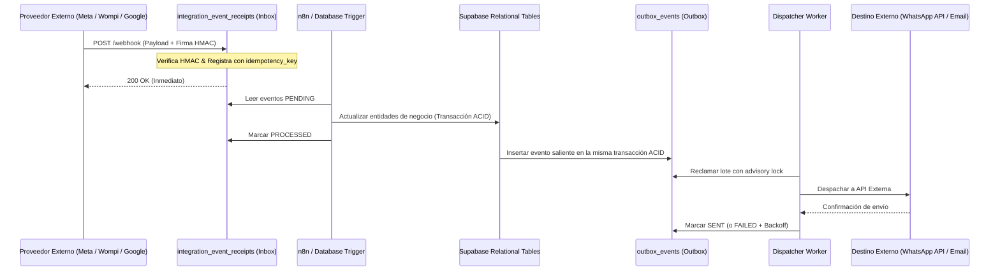

# VET FREEDOM OS — CONCILIACIÓN DE BANDEJAS TRANSACTIONAL INBOX & OUTBOX
## Patrón Transaccional, Garantías Exactly-Once Semantics e Idempotencia Operacional

---

### 1. El Patrón Transaccional Inbox / Outbox

Para evitar problemas de "Dual Writes" (inconsistencias generadas cuando una base de datos se actualiza pero el webhook externo falla, o viceversa), **VET FREEDOM OS** implementa el patrón formal de **Transactional Inbox & Outbox**:

---

### 2. Detección y Tratamiento de Anomalías en las Bandejas

El motor **VET-CORE-18** audita periódicamente ambas bandejas buscando anomalías:

1. **Eventos en Outbox Atascados (`stalled outbox events > 5 min`)**:
   - Eventos con estado `PENDING` o `PROCESSING` cuyo `locked_at` supera los 5 minutos sin confirmación.
   - Causa: Caída de worker de n8n, timeout de red o error no capturado.
   - **Acción Segura**: Liberar el lock expirado (`propose_safe_repair`), resetear intentos con backoff exponencial y reintentar despacho.
2. **Eventos Duplicados en Inbox**:
   - Proveedores externos (ej. Meta) reintentan el envío de webhooks si la respuesta tarda más de 3 segundos.
   - **Acción Segura**: Detección mediante índice único `(connector_id, idempotency_key)`. El duplicado se marca como `DUPLICATE_IGNORED` sin ejecutar lógica de negocio por segunda vez.
3. **Eventos Fuera de Orden Temporal**:
   - Un webhook de "Mensaje Entregado" llega antes que el webhook de "Mensaje Enviado".
   - **Regla**: El motor valida la jerarquía de estados. Un estado más avanzado (`READ` o `DELIVERED`) jamás es degradado por la llegada tardía de un estado anterior (`SENT`).
4. **Firma HMAC Inválida**:
   - Webhook recibido con firma alterada o clave no coincidente.
   - **Acción**: Rechazo inmediato (HTTP 401/403), almacenamiento del payload en Dead Letter Queue (DLQ) para auditoría de seguridad y cero inserción en la lógica de negocio.

---

### 3. Política de Replay Seguro (Reejecución de Eventos)

Cuando una falla de red o error de infraestructura exige reejecutar eventos almacenados en el Inbox:

- **Idempotencia Obligatoria**: La lógica debe garantizar que reejecutar un evento 10 veces tenga exactamente el mismo efecto que ejecutarlo una sola vez.
- **Invariante de Cero Re-Cobros**: El replay de eventos tiene **terminantemente prohibido** gatillar nuevas solicitudes de débito bancario o envíos de cobro a pasarelas.
- **Invariante de Cero Spam**: El replay no debe re-emitir mensajes salientes a tutores sobre acciones que ya ocurrieron en el mundo real.
