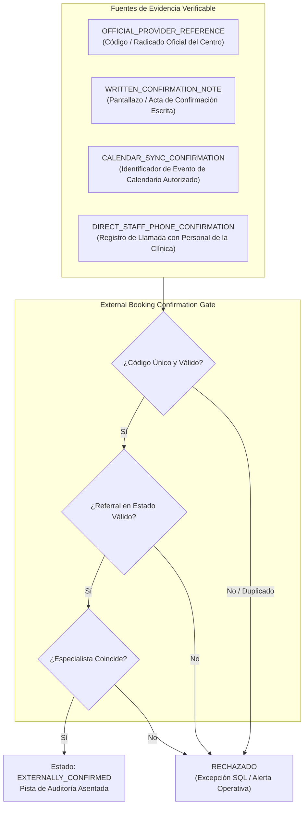

# VET FREEDOM OS — EXTERNAL BOOKING CONFIRMATION GATE
## Protocolo Estricto de Confirmación de Citas Externas y Verificación de Evidencia
**Módulo:** VET-CORE-11 | SPECIALIST COORDINATION  
**Dirección Médica:** Dr. Luis Eduardo Ríos  
**Entorno:** DEVELOPMENT / QA (Safe Mode: CERO reservas reales en producción)

---

## 1. El Axioma Fundamental de Reserva Externa

> **AXIOMA FUNDAMENTAL:**  
> La selección de un cupo u horario por parte del cliente o la colocación de un hold provisional **NUNCA** constituye una cita confirmada.  
> Ninguna cita con un especialista externo será considerada como programada ni notificada como tal al cliente sin la superación exitosa del **Gate de Evidencia Externa**.

---

## 2. Tipos de Evidencia Aceptables para el Gate

Para que el Stored Procedure `confirm_external_specialist_booking` autorice la transición a `EXTERNALLY_CONFIRMED`, el operador o el sistema debe aportar obligatoriamente al menos uno de los siguientes tipos de evidencia documental:

### Tabla de Requisitos por Tipo de Evidencia

| Tipo de Evidencia (`evidence_type`) | Campo Obligatorio | Validación en Base de Datos |
|---|---|---|
| `OFFICIAL_PROVIDER_REFERENCE` | `external_booking_reference` | String alfanumérico no nulo, único a nivel global (`UNIQUE`). |
| `WRITTEN_CONFIRMATION_NOTE` | `confirmation_notes` | Texto descriptivo de mínimo 10 caracteres que identifica al funcionario del centro. |
| `CALENDAR_SYNC_CONFIRMATION` | `external_calendar_event_id` | Identificador de evento emitido por la API autorizada del proveedor. |
| `DIRECT_STAFF_PHONE_CONFIRMATION` | `confirmed_by_staff_id` + notas | Usuario administrativo autenticado que realizó la llamada y registró fecha/hora. |

---

## 3. Comportamiento ante Fallas y Ambigüedad Externa

1. **Rechazo Inmediato:** Si el centro médico informa que el cupo se agotó entre la selección del tutor y la reserva formal:
   - El estado transita a `EXTERNAL_BOOKING_FAILED`.
   - Se notifica de inmediato al equipo de coordinación mediante tarea en VET-CORE-07.
   - Se regenera la oferta con nuevas opciones o se consulta al especialista de respaldo.
2. **Respuesta Ambigua o No Concluyente:**
   - La remisión permanece en `EXTERNAL_BOOKING_PENDING`.
   - Se prohíbe terminantemente emitir mensajes al cliente confirmando la cita.
   - Se abre un temporizador de 120 minutos para que el equipo humano concilie con la recepción de la clínica.
3. **Idempotencia y Prevención de Doble Reserva:**
   - La tabla `specialist_external_confirmations` impone un índice único sobre `external_booking_reference`. Si dos procesos intentan registrar la misma confirmación, el motor relacional aborta la segunda transacción, evitando duplicación de citas y cobros erróneos.
