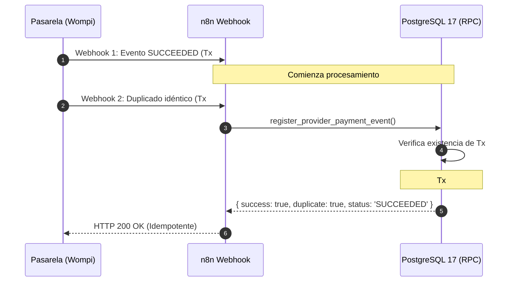

# VET FREEDOM OS — FINANCIAL EVENT IDEMPOTENCY
## Arquitectura de Idempotencia, Deduplicación y Consistencia Causal
**Módulo:** VET-CORE-14 | FINANCIAL NOTIFICATIONS  
**Dirección Médica:** Dr. Luis Eduardo Ríos  
**Dirección Estratégica:** Alpha Vision Method  
**Plataforma:** PostgreSQL 17 + n8n Cloud

---

## 1. Principio Fundamental de Idempotencia Financiera

En un sistema distribuido que procesa dinero real, la red es intrínsecamente no confiable:
- Las pasarelas reintentan webhooks cuando no reciben respuesta en 3-5 segundos.
- Los clientes hacen doble clic en botones de pago.
- Las solicitudes HTTP pueden duplicarse en proxies intermedios.

**Regla de Oro:** La ejecución de la misma operación financiera $N$ veces debe producir exactamente el mismo efecto en la base de datos que ejecutarla una única vez ($f(f(x)) = f(x)$), sin duplicar cargos, pagos ni emisiones fiscales.

---

## 2. Claves de Idempotencia por Entidad

| Entidad | Clave de Idempotencia Única | Comportamiento ante Duplicado |
|---|---|---|
| **Cotización** | `(appointment_id, version_number)` | Retorna la versión existente sin mutar ítems. |
| **Solicitud de Pago** | `idempotency_key` (UUID v4) | Si existe, retorna el registro actual sin crear nuevo cobro. |
| **Transacción de Pasarela** | `(provider, provider_transaction_id)` | Si ya existe y está `SUCCEEDED`, retorna HTTP 200 sin reaplicar saldo. |
| **Transferencia Bancaria** | `(bank_name, bank_movement_id)` | Impide que el mismo extracto liquide dos facturas distintas. |
| **Recibo de Efectivo** | `receipt_number` (Secuencial Único) | Bloquea duplicidad de arqueo en caja. |
| **Factura Electrónica** | `invoice_number` / `cufe` | Retorna el CUFE existente; previene doble radicación en la DIAN. |
| **Reembolso** | `(original_transaction_id, refund_request_id)` | Bloquea cobros dobles de reversión bancaria. |

---

## 3. Patrón de Consistencia Causal y Ordenamiento

### Manejo de Eventos Fuera de Orden:
Si llega un webhook de cancelación posterior a un webhook de liquidación confirmada, la máquina de estados ignora la transición inválida y registra una anomalía en auditoría sin degradar el estado contable verificado.
