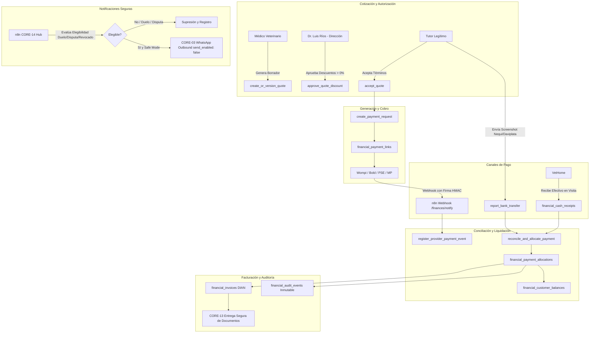

# VET FREEDOM OS — FINANCIAL NOTIFICATIONS ARCHITECTURE
## Arquitectura Financiera, Facturación, Pasarelas y Notificaciones Seguras
**Módulo:** VET-CORE-14 | FINANCIAL NOTIFICATIONS  
**Dirección Médica:** Dr. Luis Eduardo Ríos  
**Dirección Estratégica:** Alpha Vision Method  
**Plataformas:** PostgreSQL 17 (Supabase) + n8n Cloud + Wompi/Bold/PSE/Mercado Pago + Lovable + DIAN Invoicing Provider  
**Zona Horaria:** America/Bogota  
**Moneda:** COP (Pesos Colombianos)

---

## 1. Misión y Principios de la Arquitectura Financiera

El subsistema `VET-CORE-14` orquesta de extremo a extremo el ciclo de vida financiero de Vet Life: cotizaciones aprobadas, solicitudes de cobro con expiración, enlaces de pago multi-pasarela, conciliación bancaria y en efectivo, prevención contra fraudes de capturas de pantalla, facturación electrónica con validación previa de la DIAN, resolución de disputas, y recordatorios de pago inteligentes con supresión compasiva ante protocolos de duelo.

### Principios Inquebrantables de Diseño:
1. **Supabase como Única Fuente de Verdad:** Ni la pasarela de pagos ni n8n determinan el saldo contable o la titularidad de una obligación. Todo cambio de saldo o estado se procesa mediante Stored Procedures con aislamiento y bloqueos de fila (`FOR UPDATE`).
2. **Cero Captura ni Almacenamiento de Datos de Tarjeta (PCI-DSS):** El sistema nunca recibe, procesa ni almacena números completos de tarjetas (PAN) ni códigos de seguridad (CVV/CVC). Toda interacción con tarjetas se delega a pasarelas tokenizadas autorizadas (Wompi, Bold, Mercado Pago, PSE).
3. **El Comprobante / Screenshot es Intención, No Pago:** Las capturas de pantalla de transferencias por WhatsApp (Nequi, Daviplata, Bancolombia, Bre-B) se registran estrictamente en estado `PENDING_VERIFICATION`. Queda terminantemente prohibido marcarlas automáticamente como `PAID` sin conciliación bancaria verificable por un humano con extracto real.
4. **Protección Clínica y Supresión Compasiva:** 
   - La atención veterinaria de urgencia **nunca** se bloquea ni condiciona por deudas o saldos pendientes.
   - Si un paciente o tutor entra en **Protocolo de Duelo (WFX-013)**, cualquier cobro o recordatorio se suprime de forma inmediata e incondicional.
   - Si existe una **Disputa Abierta**, los recordatorios se congelan hasta su resolución humana.
   - Si un cuidador o contacto ha sido **Revocado**, sus datos no reciben información financiera.
5. **Aislamiento Multitenant (RLS):** Cada registro financiero cuenta con políticas de seguridad a nivel de fila (`ROW LEVEL SECURITY`) que garantizan que tutores y veterinarios solo accedan a las transacciones que legalmente les corresponden.

---

## 2. Mapa Arquitectónico Integral

---

## 3. Matriz de Componentes y Funciones

| Componente | Rol en el Ecosistema | Garantía de Seguridad / Operación |
|---|---|---|
| **`financial_service_rates`** | Tarifario oficial autorizado de servicios y procedimientos. | Solo tarifas con `is_active = true` y fecha vigente pueden usarse en presupuestos. |
| **`financial_quotes` & `_versions`** | Cotizaciones versionadas monótonamente (`v1..vn`). | La aceptación de una versión sella la cotización. Modificaciones posteriores crean nueva versión. |
| **`financial_payment_requests`** | Solicitudes de pago formalizadas con fecha límite. | Clave de idempotencia única; previene duplicidad de cobros. |
| **`financial_payment_transactions`** | Bitácora de transacciones de pasarelas. | Verificación de firma HMAC (`x-event-checksum` o secreto de proveedor); replay attacks prevenidos. |
| **`financial_bank_transfer_reports`** | Declaraciones de pago por transferencia. | Siempre `PENDING_VERIFICATION`. Requiere extracto para liquidar. |
| **`financial_payment_reconciliations`** | Registro auditable de conciliación contable. | Aprobado únicamente por personal autorizado con identificación bancaria. |
| **`financial_invoices`** | Facturación electrónica compatible con DIAN. | CUFE, número consecutivo, QR, y delegación de entrega a CORE-13. |
| **`financial_refund_requests`** | Solicitudes y liquidaciones de devoluciones. | Doble aprobación requerida; prohibido procesar reembolsos automáticos sin firma médica. |
| **`financial_disputes`** | Gestión de contracargos y reclamos de tutores. | Pausa inmediata de cobranzas y alertas a atención al cliente. |
| **`n8n VET-CORE-14`** | Orquestador de eventos financieros y recordatorios. | Safe Mode activo (`send_enabled: false`); no envía mensajes reales en QA. |

---

## 4. Requisitos de Alta Disponibilidad e Idempotencia

1. **Aislamiento de Transacciones:** Todas las operaciones de asignación de pago y conciliación corren bajo transacciones PostgreSQL con nivel de aislamiento estricto y bloqueos sobre el registro de saldo del tutor.
2. **Manejo de Reintentos de Red:** Si una pasarela reenvía un webhook exitoso, el sistema detecta el `provider_transaction_id` existente y responde `HTTP 200` de forma idempotente sin duplicar saldos a favor.
3. **Persistencia Previa:** Los eventos externos se guardan primero en crudo en `financial_audit_events` y `financial_payment_transactions` antes de aplicar la lógica contable.
