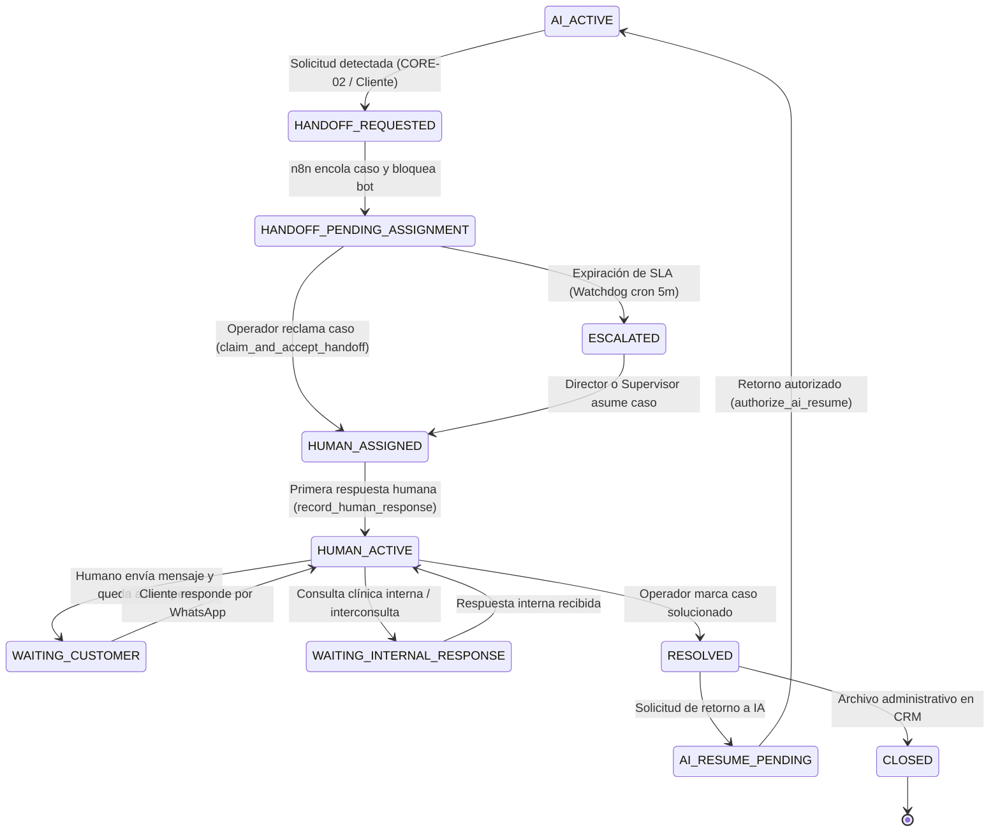

# HUMAN HANDOFF FINITE STATE MACHINE (FSM)
## VET FREEDOM OS — VET-CORE-04
**Dirección Médica:** Dr. Luis Eduardo Ríos  
**Dirección Estratégica:** Alpha Vision Method  
**Fecha:** 2026-11-21  

---

## 1. Diagrama de Estados Completo

---

## 2. Catálogo Oficial de Estados

| Estado | Significado Operativo | Bot Bloqueado | Actor Responsable |
|---|---|---|---|
| `AI_ACTIVE` | IA en control total de la conversación | No (`false`) | IA (`BOT_AI`) |
| `AI_HANDLING` | IA procesando un turno de mensaje | No (`false`) | IA (`BOT_AI`) |
| `HANDOFF_REQUESTED` | Evento de transferencia recibido, evaluando cola | Sí (`true`) | Sistema n8n |
| `HANDOFF_PENDING_ASSIGNMENT` | Encolado en la bandeja del equipo respectivo | Sí (`true`) | Cola de Espera |
| `HUMAN_ASSIGNED` | Operador ha tomado el caso, preparando respuesta | Sí (`true`) | Operador Asignado |
| `HUMAN_ACTIVE` | Interacción activa en curso con operador humano | Sí (`true`) | Operador Asignado |
| `WAITING_CUSTOMER` | Operador emitió mensaje; esperando respuesta del tutor | Sí (`true`) | Tutor / Cliente |
| `WAITING_INTERNAL_RESPONSE`| Interconsulta médica interna o revisión financiera | Sí (`true`) | Especialista Interno |
| `ESCALATED` | Handoff no atendido en SLA o escalado por severidad | Sí (`true`) | Director Médico |
| `RESOLVED` | Causa de la transferencia resuelta por el equipo humano | Sí (`true`) | Operador / Director |
| `AI_RESUME_PENDING` | Verificación de seguridad previa a reactivar el bot | Sí (`true`) | Sistema Guardián |
| `AI_RESUMED` | Estado efímero de confirmación de reactivación | No (`false`) | Sistema |
| `CLOSED` | Sesión concluida y archivada para histórico clínico | Sí (`true`) | Sistema / CRM |

---

## 3. Disparadores y Condiciones de Guardia

### Transición `AI_ACTIVE` -> `HANDOFF_PENDING_ASSIGNMENT`:
- **Disparador:** Intención explícita del tutor ("quiero hablar con un humano"), emergencia clínica vital (P0), reclamo grave, consulta de dosificación de fármacos.
- **Acción:** `request_human_handoff()`.
- **Efecto Inmediato:** `is_bot_locked := true`, `state_version := state_version + 1`, evento `conversation.handoff_requested` en outbox.

### Transición `HANDOFF_PENDING_ASSIGNMENT` -> `HUMAN_ASSIGNED`:
- **Disparador:** Acción de "Reclamar / Atender" en Lovable UI.
- **Acción:** `claim_and_accept_handoff(handoff_id, agent_user_id)`.
- **Guardia:** `SELECT ... FOR UPDATE` verifica que `status != 'ACCEPTED'`. Si ya fue tomado, aborta con `ALREADY_ASSIGNED`.

### Transición `HUMAN_ASSIGNED` -> `HUMAN_ACTIVE`:
- **Disparador:** Operador envía el primer mensaje al cliente.
- **Acción:** `record_human_response()`.
- **Efecto:** Registro en `public.messages` con `sender_type = 'STAFF_HUMAN'`, `first_human_response_at = now()`.

### Transición `HANDOFF_PENDING_ASSIGNMENT` -> `ESCALATED`:
- **Disparador:** Pulso periódico de SRE Watchdog (n8n Schedule Trigger cada 5 minutos).
- **Acción:** `expire_unaccepted_handoffs()`.
- **Guardia:** `expires_at < now() AND accepted_at IS NULL`.
- **Efecto:** Asignación automática a `DIRECTOR` con prioridad `CRITICAL` y alerta SMS/Modal al Dr. Luis Ríos.

### Transición `RESOLVED` / `HUMAN_ACTIVE` -> `AI_ACTIVE`:
- **Disparador:** Operador humano presiona "Cerrar atención y reactivar IA".
- **Acción:** `authorize_ai_resume(conversation_id, authorizing_user_id, reason)`.
- **Guardia Clínica Crítica:** Si `handoff_priority = 'CRITICAL'` y la emergencia no fue resuelta formalmente, la función **bloquea la reactivación** con error `CANNOT_RESUME_AI_DURING_CRITICAL_EMERGENCY`.
