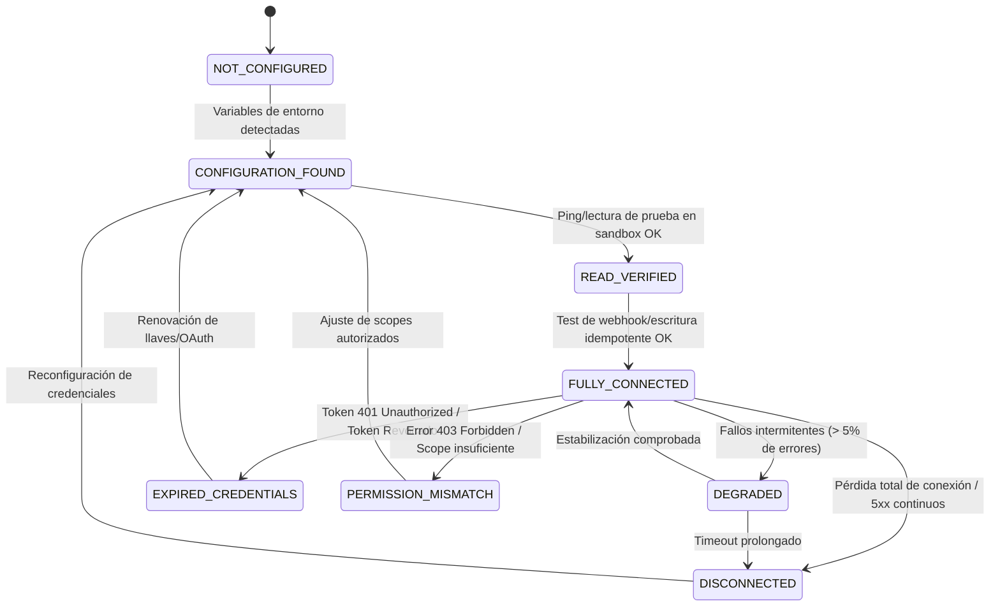

# VET FREEDOM OS — MATRIZ DE CAPACIDADES DE CONECTORES
## Catálogo Oficial de Conectores, Estados Operacionales y Modos de Acceso

---

### 1. Catálogo Oficial de Conectores (`integration_connectors`)

La tabla `integration_connectors` en Supabase registra y gobierna cada interfaz externa que interactúa con la plataforma de Vet Life.

| Connector Key | Nombre del Conector | Tipo de Servicio | Modo Autorizado | Estado en QA | Autorización Requerida |
| :--- | :--- | :--- | :--- | :--- | :--- |
| `google_calendar` | Google Calendar API | Calendario / Disponibilidad | `BIDIRECTIONAL_AUTHORIZED` | `CONFIGURATION_FOUND` | OAuth 2.0 (Scopes restringidos) |
| `whatsapp_business`| Meta Cloud API | Mensajería / Webhooks | `BIDIRECTIONAL_AUTHORIZED` | `CONFIGURATION_FOUND` | System User Token + Webhook HMAC |
| `okvet_assisted` | OKVET Clinical Records | Historia Clínica Oficial | `MANUAL_IMPORT_ONLY` | `CONFIGURATION_FOUND` | Verificación Médica COMVET |
| `supabase_outbox` | Supabase Transactional Outbox | Bus de Eventos Local | `EVENT_DRIVEN` | `FULLY_CONNECTED` | Service Role / Database Trigger |
| `wompi_payments` | Wompi Bancolombia API | Pasarela de Pagos | `EVENT_DRIVEN` | `CONFIGURATION_FOUND` | Public Key + Integrity Secret |
| `dian_invoicing` | Facturación Electrónica DIAN | Facturación Fiscal | `MANUAL_IMPORT_ONLY` | `NOT_CONFIGURED` | Certificado Digital + Software ID |
| `specialist_portal`| Red de Especialistas Externos| Interconsultas Médicas | `MANUAL_CONFIRMATION` | `CONFIGURATION_FOUND` | Token de Acceso Profesional |

---

### 2. Modos de Operación y Sincronización

1. **`READ_ONLY`**:
   El conector solo extrae información de la fuente externa hacia Supabase. Queda bloqueado cualquier intento de escritura, inserción o borrado en el sistema externo.
2. **`WRITE_ONLY`**:
   El sistema despacha información hacia el destino (ej. envío de notificaciones o telemetría) sin ingerir actualizaciones de estado por este canal.
3. **`BIDIRECTIONAL_AUTHORIZED`**:
   Permite lectura y escritura cruzada, sujeta rigurosamente a la matriz de autoridad por campo (`FIELD-AUTHORITY-MATRIX.md`).
4. **`MANUAL_IMPORT_ONLY`**:
   No existe conexión directa API automatizada. La información ingresa a Supabase mediante importación asistida de archivos CSV/JSON o carga documental revisada por un operador humano.
5. **`MANUAL_CONFIRMATION`**:
   Toda sincronización o cambio propuesto requiere confirmación explícita mediante firma o aprobación humana en la interfaz de Lovable antes de persistirse.
6. **`EVENT_DRIVEN`**:
   Sincronización reactiva gatillada en tiempo real mediante webhooks firmados criptográficamente (HMAC SHA-256).
7. **`PERIODIC_RECONCILIATION`**:
   Sincronización por lotes ejecutada en horarios de baja demanda (ej. 02:00 AM America/Bogota) para cotejo exhaustivo de estados.

---

### 3. Estados Operacionales del Conector

Para evitar asumir ciegamente que una integración está operativa solo porque existen credenciales o variables de entorno cargadas, VET FREEDOM OS aplica una máquina de estados estricta:

- **Invariante Crítica**: Jamás se declara un conector como `FULLY_CONNECTED` ni `VERIFIED` sin una prueba instrumental auditable registrada en `integration_event_receipts` o `integration_reconciliation_audit`.
