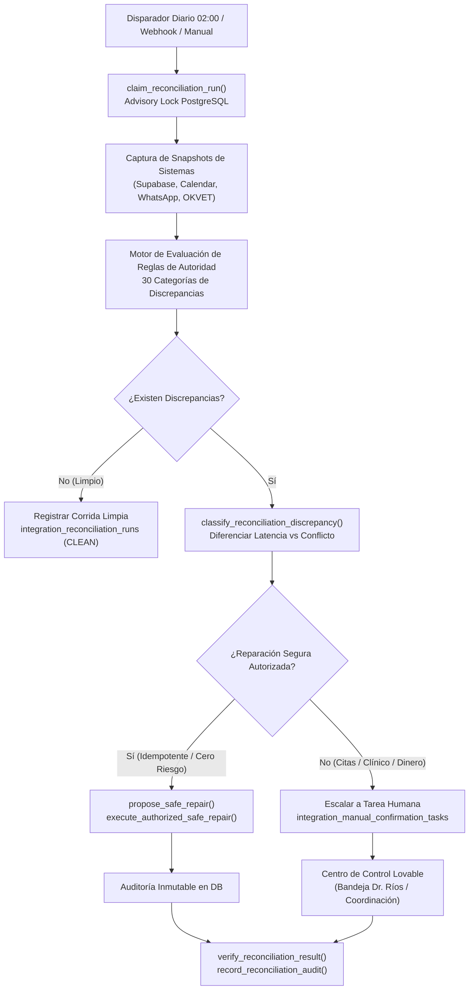

# VET FREEDOM OS — ARQUITECTURA DE CONCILIACIÓN TRANSVERSAL
## Módulo: VET-CORE-18 | INTEGRATION RECONCILIATION

---

### 1. Visión General y Propósito del Sistema

El módulo **VET-CORE-18 (Integration Reconciliation)** constituye el árbitro central de verdad, consistencia de datos y auditoría operacional transversal de **VET FREEDOM OS** para la empresa **Vet Life — Veterinaria a Domicilio**, bajo la dirección técnica del Dr. Luis Eduardo Ríos.

En una arquitectura distribuida donde coexisten múltiples sistemas asíncronos:
1. **Supabase (PostgreSQL 17)**: Fuente única de verdad operacional, reglas de negocio y autorización.
2. **Google Calendar**: Agenda de bloques médicos y disponibilidad de visitas domiciliarias.
3. **Meta WhatsApp Business Platform**: Canal de comunicaciones bidireccionales con clientes y tutores.
4. **OKVET**: Sistema de historia clínica oficial (integrado mediante procedimiento manual/asistido autorizado).
5. **Wompi / Pasarelas de Pago**: Conciliación de dispersiones y comprobantes bancarios.
6. **DIAN**: Facturación electrónica reglamentaria colombiana.
7. **Portal de Especialistas**: Red de interconsultas y remisiones externas.

La asincronía natural, la latencia de red, los reintentos y las intervenciones humanas fuera de banda provocan inevitablemente discrepancias de datos ("data drift"). El propósito de VET-CORE-18 es detectar continuamente estas divergencias, tipificarlas rigurosamente, clasificar desfases temporales normales frente a discrepancias verdaderas, y ejecutar reparaciones seguras o escalar a revisión humana médica/operativa sin riesgo de corrupción ni duplicación.

---

### 2. Principios Inmutables de Diseño

1. **Autoridad por Dominio (No "Latest Timestamp Wins")**:
   Ningún sistema sobrescribe a otro basándose únicamente en marcas de tiempo más recientes. La autoridad de cada dato está fijada por la matriz de gobernanza (`FIELD-AUTHORITY-MATRIX.md`).
2. **Safe Mode Absoluto en QA / Desarrollo**:
   - `send_enabled: false`
   - `active: false`
   - Cero mensajes reales a clientes o especialistas.
   - Cero modificaciones a agendas productivas o historias clínicas en OKVET.
3. **Cero Scraping y Cero Invención de APIs**:
   OKVET no posee API pública homologada. Todo registro en OKVET requiere procedimiento asistido verificado con firma médica (COMVET).
4. **Separación Estricta entre Reparación Segura y Aprobación Humana**:
   Las reparaciones que alteran estados de citas, montos de dinero o identidades clínicas jamás son automatizadas ciegamente; generan tareas de confirmación humana en el Centro de Control de Lovable.
5. **Auditoría Inmutable (Append-Only)**:
   Toda ejecución de conciliación, evidencia recolectada y decisión tomada queda registrada con hash SHA-256 en tablas protegidas por Row Level Security (RLS).

---

### 3. Diagrama de Flujo Arquitectónico

---

### 4. Capas del Motor de Conciliación

1. **Capa de Ingesta y Conectores (`integration_connectors`)**:
   Mantiene el estado operacional de cada integración, su nivel de permisos (READ_ONLY, WRITE_ONLY, etc.) y credenciales validadas instrumentalmente.
2. **Capa de Snapshots y Cursores (`integration_sync_cursors`)**:
   Registra las marcas de sincronización (checkpoints y cursors de eventos) para reanudar lecturas incrementales sin saturar APIs externas ni perder transacciones.
3. **Capa de Identidad y Mapeo (`integration_external_identity_map`)**:
   Vincula IDs externos (ej. Google Calendar event ID, WhatsApp Phone, OKVET ID) con las entidades canónicas de Supabase (`clients`, `patients`, `appointments`), categorizando el nivel de confianza y bloqueando fusiones automáticas dudosas.
4. **Capa de Reglas de Autoridad y Clasificación**:
   Evalúa el estado comparativo contra las 30 categorías oficiales de discrepancias descritas en la especificación.
5. **Capa de Reparación y Orquestación**:
   Genera propuestas de reparación atómicas sujetas a aprobación o ejecución controlada.
6. **Capa de Auditoría y Verificación**:
   Comprueba el resultado post-reparación y sella la auditoría para inspección administrativa y legal.

---

### 5. Integración con los 21 Módulos VET-CORE

| Módulo VET-CORE | Objeto Conciliado | Canal / Sistema Cotejado | Criterio de Consistencia |
| :--- | :--- | :--- | :--- |
| **CORE-01** | Event Dispatcher | Transactional Outbox / Event Inbox | Latencia < 5 min, 0 eventos atascados |
| **CORE-02** | Initial Contact | WhatsApp Incoming / CRM Lead | Identidad de tutor y canal registrado |
| **CORE-03** | Triage & Routing | Casos de Triaje / Rutas de Atención | Prioridad clínica no degradada |
| **CORE-04** | Booking & Rescheduling | Supabase `appointments` / Google Calendar | Horario y dirección domiciliaria coincidente |
| **CORE-05** | Pre-Visit Checklist | Formulario / Requisitos Previos | Estado completado verificado |
| **CORE-06** | Calendar Sync | Google Calendar API / Supabase Locks | Detección de bloqueos personales y drift |
| **CORE-07** | Operational Reminders | Cola de Mensajería / Webhooks Meta | Tareas humanas no ignoradas |
| **CORE-08** | In-Route Updates | Despacho Domiciliario / Estados Ruta | Notificación al tutor en ventana acordada |
| **CORE-09** | Clinical Procedure Support | Constancias de Procedimiento / OKVET | Matrícula médica verificada |
| **CORE-10** | Prevention Comms | Esquemas de Vacunación / Desparasitación | Alertas preventivas según protocolo |
| **CORE-11** | Specialist Coordination | Remisiones a Terceros / Radicados | Confirmación de especialista antes de cerrar |
| **CORE-12** | Post-Visit Commitments | Compromisos y Tareas Post-Visita | Verificación de evidencia documental |
| **CORE-13** | Approved Document Delivery | Links Efímeros / Supabase Storage | Caducidad 24h y revocación inmediata |
| **CORE-14** | Financial Notifications | Pagos Wompi / Facturas DIAN | Conciliación bancaria al centavo COP |
| **CORE-15** | Post-Service CX | Encuestas de Satisfacción / Feedbacks | Consentimiento y 0 spam a clientes |
| **CORE-16** | Daily Reporting | Métricas Diarias Ejecutivas | Datos auditados sin cifras fantasma |
| **CORE-17** | Weekly Reporting | Rentabilidad y Capacidad Semanal | Coherencia con libros contables |
| **CORE-18** | Integration Reconciliation | Todos los Conectores y Bases de Datos | Consistencia transversal 100% |
| **CORE-19** | Exception Monitoring | Incidentes y Dead Letter Queue | Backlog de resolución y tiempos SLA |
| **CORE-20** | Health Monitor | Healthchecks de Servicios Externos | Alertas tempranas ante indisponibilidad |
| **CORE-21** | System Configuration | Feature Flags / Secretos / Safe Mode | Gobernanza centralizada y bloqueo de bypass |

---

### 6. Cumplimiento de Invariantes y Seguridad

- **RLS Riguroso**: Todas las tablas de conciliación tienen Row Level Security activado y forzado (`FORCE ROW LEVEL SECURITY`), garantizando aislamiento multi-empresa e impidiendo que datos de Vet Life o Alpha Vision colisionen.
- **Auditoría Legal**: Los registros de discrepancias y reparaciones se conservan durante un mínimo de 5 años conforme a la legislación comercial y médica colombiana.
