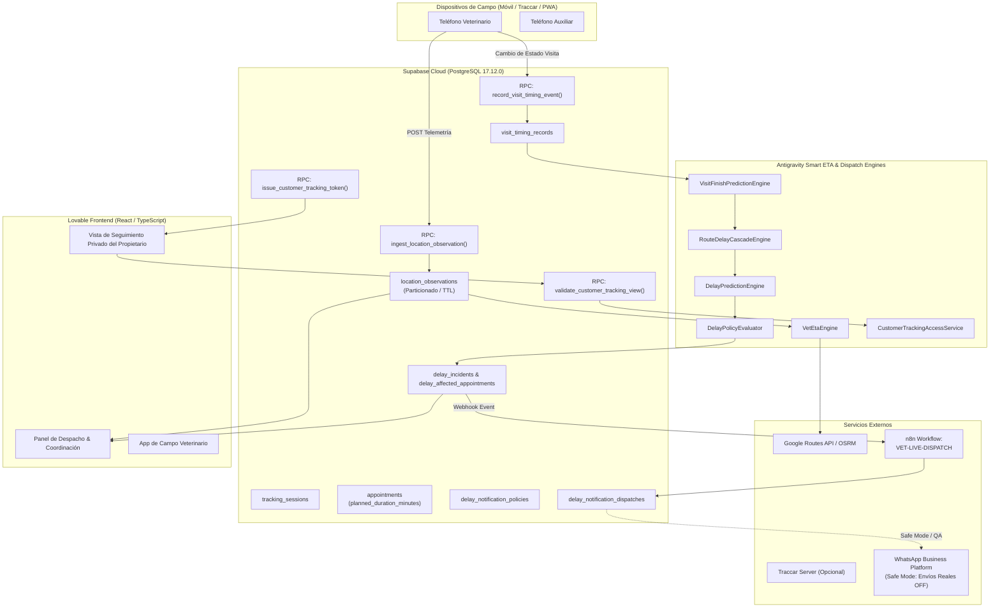

# VET FREEDOM OS — LIVE DISPATCH & GPS TRACKING ARCHITECTURE
## Arquitectura Empresarial de Despacho en Vivo, Telemetría GPS y Orquestación de Campo
### Versión 15B.0 — Antigravity + Supabase + n8n + Lovable

---

## 1. Visión y Propósito
El módulo **Live Dispatch & GPS Tracking** de Vet Freedom OS proporciona visibilidad operativa en tiempo real para las atenciones domiciliarias de **Vet Life — Veterinaria a Domicilio**, bajo la dirección médica del Dr. Luis Eduardo Ríos.

Su propósito central es:
1. Monitorear el progreso y la localización del equipo veterinario durante las jornadas de atención en Bogotá.
2. Calcular tiempos estimados de llegada (ETA) con alta precisión usando modelos de tráfico urbano en vivo y buffers de seguridad.
3. Predecir y gestionar retrasos operativos en cascada antes de que afecten la experiencia del propietario o la continuidad de la atención.
4. Proporcionar a los clientes una experiencia de seguimiento transparente y privada ("estilo Uber") que preserva estrictamente el secreto profesional y la confidencialidad de otros domicilios.
5. Mantener la integridad de los registros clínicos: OKVET continúa como la única fuente de verdad clínica bajo la Ley 576 de 2000 (COMVEZCOL).

---

## 2. Diagrama de Arquitectura

---

## 3. Componentes Principales

### 3.1 Duraciones Dinámicas de Consulta
- **`appointment_types`**: Catálogo base (`CONSULTA_GENERAL`, `VACUNACION`, `INTERCONSULTA`, `PROCEDIMIENTO_MENOR`).
- **`appointment_type_versions`**: Historial inmutable de versiones de duración nominal y buffers.
- **`appointment_duration_overrides`**: Ajustes específicos por reserva (e.g. paciente geriátrico o múltiple) autorizados formalmente.

### 3.2 Registro Temporal de Visitas (`visit_timing_records`)
Registra la cronología exacta de cada atención en campo:
- `TRAVEL_STARTED`: Inicio del desplazamiento hacia el domicilio.
- `ARRIVED`: Llegada física al punto de atención.
- `SERVICE_STARTED`: Inicio de la consulta clínica.
- `ESTIMATED_FINISH_UPDATED`: Modificación de la hora estimada de culminación por criterio del veterinario.
- `SERVICE_FINISHED`: Culminación formal del procedimiento.

### 3.3 Motor de ETA (`VetEtaEngine`)
- Admite múltiples proveedores vía interfaz desacoplada `RoutingProvider` (`GoogleRoutesProvider` con tráfico en tiempo real o `OsrmRoutingProvider` como contingencia).
- Aplica caching geográfico por celdas (TTL 5 minutos) y compensaciones específicas para las horas pico de Bogotá (mañana: 06:30–08:30, tarde: 17:00–19:30).
- Emite métricas de confianza (`HIGH`, `MEDIUM`, `LOW`, `UNAVAILABLE`) basadas en la frescura del GPS (umbral de obsolescencia: 5 minutos) y la precisión satelital (< 50 metros).

### 3.4 Motor de Predicción en Cascada (`RouteDelayCascadeEngine`)
- Si una visita se extiende o el tráfico demora el arribo, recalcula progresivamente las horas estimadas de llegada para **todas las citas restantes** de la jornada.
- Incorpora buffers de descanso y traslado (`defaultBufferMinutesBetweenVisits`).
- Protege citas prioritarias (`isProtected: true`, e.g. pacientes críticos, sedaciones programadas o interconsultas con especialistas externos) alertando inmediatamente sobre cualquier desvío.

### 3.5 Evaluación de Políticas y Notificaciones Autónomas (`DelayPolicyEvaluator`)
- **Debounce de 2 predicciones consecutivas**: Evita disparar alertas por fluctuaciones transitorias del tráfico.
- **Histéresis (mínimo 5 min de cambio)**: No molesta al cliente si el nuevo ETA solo varía 1 o 2 minutos.
- **Cooldown (mínimo 30 min)**: Previene la saturación de mensajes a los propietarios.
- **Modos de Operación**:
  - `INTERNAL_ONLY`: Alerta únicamente a la coordinación y al Dr. Ríos.
  - `HUMAN_APPROVAL`: Requiere que el coordinador presione "Aprobar Envío" en Lovable.
  - `AUTOMATIC_ELIGIBLE`: Envío autónomo previa verificación de filtros.
  - `OFF`: Desactivado.

---

## 4. Seguridad, Autorización y RLS
- **Aislamiento Organizacional**: 100% de las tablas nuevas de la migración `043_live_dispatch_gps_and_smart_eta.sql` cuentan con `ENABLE ROW LEVEL SECURITY` y `FORCE ROW LEVEL SECURITY`.
- **Acceso Administrativo**: Limitado a personal verificado mediante la función PostgreSQL `is_org_staff(organization_id)`.
- **Acceso de Campo**: Los profesionales solo pueden consultar y actualizar sus propias sesiones de tracking (`staff_id = auth.uid()`).
- **Acceso Público del Propietario**: No existe acceso directo a las tablas de base de datos. Se utiliza exclusivamente la función RPC con seguridad del definidor `validate_customer_tracking_view()`, validando el hash criptográfico SHA-256 del token temporal.

---

## 5. Invariables Fundamentales del Negocio
1. **Inmutabilidad de la Agenda Oficial**: Ningún cálculo predictivo de ETA modifica los campos `scheduled_start_at` de las citas en Supabase ni en Google Calendar. Solo se actualizan proyecciones en `eta_predictions`.
2. **Autoridad Clínica**: El tracking GPS y los estados de visita son operativos; ningún algoritmo diagnostica, prescribe o cierra historias clínicas.
3. **Modo Seguro por Defecto**: Todas las notificaciones externas nacen con `send_enabled: false` en los entornos de desarrollo y QA.
