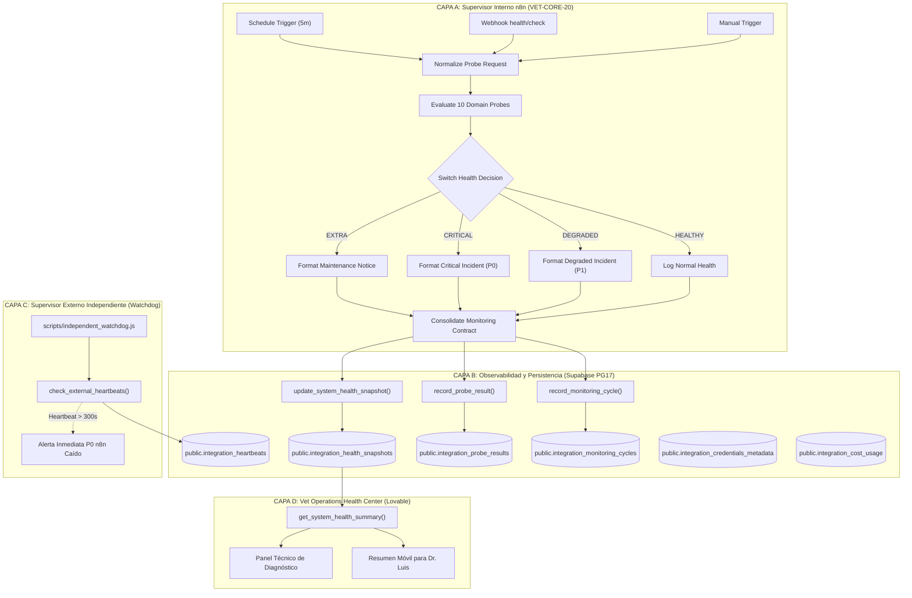

# ARQUITECTURA DE OBSERVABILIDAD Y MONITOREO DE SALUD — VET FREEDOM OS
**Módulo:** `VET-CORE-20 | Integration Health Monitoring`  
**Cliente:** Dr. Luis Eduardo Ríos — *Vet Life: Veterinaria a Domicilio*  
**Dirección Estratégica:** Alpha Vision Method  
**Entorno:** Google Antigravity + n8n Cloud + Supabase (PostgreSQL 17) + Lovable  
**Zona Horaria:** `America/Bogota` (UTC-5)  

---

## 1. Visión General de la Arquitectura en 4 Capas

El sistema de observabilidad de Vet Freedom OS no es un panel decorativo de luces verdes. Es un motor determinista de detección temprana, telemetría continua y contención proactiva diseñado en cuatro capas independientes:

---

## 2. Los 10 Dominios de Telemetría Evaluados

1. **N8N_ENGINE:** Verificación de conectividad (`/healthz`), readiness (`/healthz/readiness`), latencia de respuesta y registro de latidos.
2. **SUPABASE_DB:** Latencia de base de datos relacional, 100% de tablas protegidas con RLS (95 tablas), integridad referencial y funciones de resiliencia activas.
3. **EVENT_QUEUES:** Monitoreo del backlog en `transactional_outbox`, detección de eventos en vuelo estancados (`CLAIMED` > 5m) y acumulación en `dead_letter_queue`.
4. **WHATSAPP_GATEWAY:** Estado del canal oficial Meta Cloud API, validación de firmas criptográficas HMAC, tasa de entrega y mensajes entrantes sin procesar.
5. **GOOGLE_CALENDAR:** Estado de tokens OAuth de profesionales, frescura de sincronización bidireccional y detección de conflictos de agenda o doble reserva.
6. **AI_ASSISTANT:** Disponibilidad de modelos (OpenAI / Anthropic / Gemini), latencia en llamadas estructuradas, tasa de rechazo de herramientas y control presupuestal de tokens.
7. **OKVET_BRIDGE:** Integridad clínica del registro oficial, importaciones pendientes, visitas sin conciliar y validación de referencias oficiales.
8. **CLINICAL_APPOINTMENTS:** Solicitudes sin asignar, bloqueos provisionales expirados, doble reservas potenciales y médicos ausentes con visitas asignadas.
9. **FINANCES:** Conciliación de pagos, cobros pendientes de verificación, discrepancias tarifarias y facturación de visitas cerradas.
10. **SECURITY_CREDENTIALS:** Credenciales con expiración inferior a 48 horas, intentos de acceso multitenant indebidos y detección de firmas alteradas.

---

## 3. Estados de Salud Canónicos

| Estado | Significado Operativo | Acción del Sistema |
|---|---|---|
| `HEALTHY` | Todos los servicios operan dentro de los umbrales nominales. | Registro rutinario en snapshot. Sin alertas. |
| `DEGRADED` | Falla parcial o latencia elevada que no detiene la atención clínica. | Alerta P1/P2 a Coordinación/Soporte. Enrutado a CORE-19. |
| `UNHEALTHY` | Servicio específico inoperativo con mecanismo de contingencia activo. | Alerta P1. Registro de incidente en Supabase. |
| `UNKNOWN` | No hay evidencia reciente para certificar operatividad. | Marcado como sospechoso; prohíbe asumir operatividad. |
| `NOT_CONFIGURED`| Integración aún no habilitada en desarrollo/producción. | Omitido de la alerta sin generar falso positivo. |
| `PAUSED` | Mantenimiento o pausa autorizada por el Dr. Luis Eduardo Ríos. | Alertas suprimidas con registro de vigencia y responsable. |
| `MAINTENANCE` | Ventana de mantenimiento programada activa. | Alertas rutinarias suprimidas; P0 permitidas. |
| `CRITICAL` | Falla total que amenaza la seguridad, privacidad o continuidad operativa. | Alerta P0 inmediata al Director Dr. Luis y escalamiento manual. |
