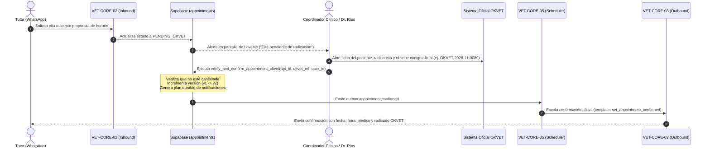

# VET FREEDOM OS — GATE DE CONFIRMACIÓN OFICIAL OKVET
**Módulo:** VET-CORE-05 | Appointment Notification Service & Scheduling Gate  
**Dirección Médica:** Dr. Luis Eduardo Ríos  
**Plataforma de Historia Clínica Oficial:** OKVET  
**Base de Datos Operativa:** Supabase PostgreSQL 17

---

## 1. Principio Fundamental de Segregación Clínica

En el diseño arquitectónico de **Vet Freedom OS**, la historia clínica y el registro legal oficial residen exclusivamente en **OKVET**.
- **Supabase** es la fuente de verdad operativa, logística y de autorizaciones.
- **n8n** es el orquestador de eventos y comunicaciones.
- **Lovable** es la interfaz de usuario para el equipo de Vet Life.
- **OKVET** es el registro clínico oficial veterinario obligatorio.

> [!IMPORTANT]
> **REGLA DE ORO:** Bajo ninguna circunstancia una cita se considera confirmada para un tutor ni se envía la plantilla de confirmación oficial sin que exista un radicado válido y verificado en OKVET.

---

## 2. Flujo del Gate Clínico Asistido por Humanos

Dado que OKVET no cuenta con una API pública documentada y abierta para este entorno, la confirmación se implementa como un **Gate Asistido con Doble Verificación**:



---

## 3. Especificación de la Función RPC

```sql
public.verify_and_confirm_appointment_okvet(
  p_appointment_id uuid,
  p_okvet_reference text,
  p_verified_by uuid,
  p_notes text DEFAULT NULL
) RETURNS jsonb
```

### Validaciones Internas Inviolables:
1. **Presencia de Referencia:** Si `p_okvet_reference` es nulo o vacío, aborta con `OKVET_REFERENCE_REQUIRED`.
2. **Bloqueo Pesimista:** Ejecuta `SELECT * FROM appointments WHERE id = p_appointment_id FOR UPDATE;` garantizando serialización ante llamadas concurrentes.
3. **Validación de Cancelación:** Si la cita tiene estado `CANCELLED` o `CANCELLED_*`, rechaza la confirmación con `CANNOT_CONFIRM_CANCELLED_APPOINTMENT`.
4. **Idempotencia:** Si la cita ya está en `CONFIRMED_OFFICIAL` y posee exactamente la misma referencia OKVET, responde con `ALREADY_CONFIRMED` sin recrear jobs duplicados ni disparar eventos espurios.
5. **Auditoría Plena:** Registra `okvet_verified_at = now()`, `okvet_verified_by = p_verified_by` y genera una fila en `appointment_status_history`.
6. **Planificación Durable:** Invoca internamente `generate_appointment_notification_plan` para la nueva versión de la cita.
