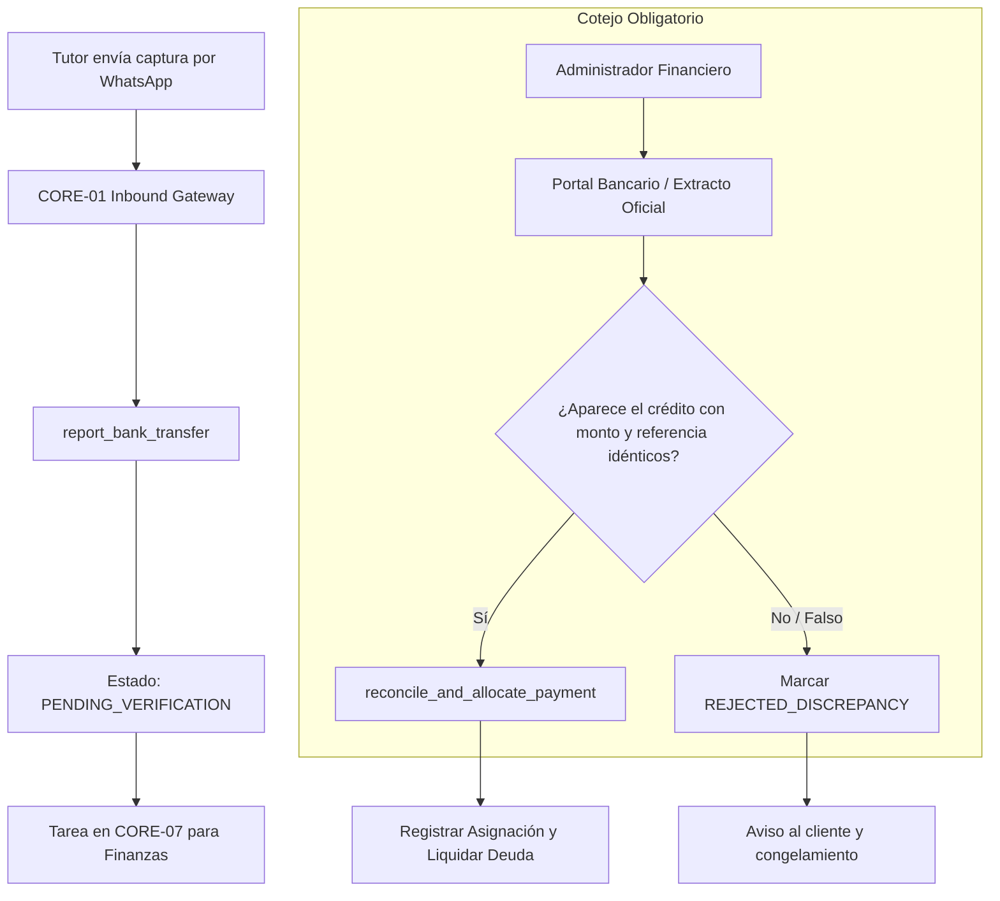

# VET FREEDOM OS — PAYMENT RECONCILIATION
## Arquitectura y Procedimiento de Conciliación Bancaria y Liquidación Contable
**Módulo:** VET-CORE-14 | FINANCIAL NOTIFICATIONS  
**Dirección Médica:** Dr. Luis Eduardo Ríos  
**Dirección Estratégica:** Alpha Vision Method  
**Plataforma:** PostgreSQL 17 + Supabase Storage

---

## 1. El Reto de la Conciliación Veterinaria Multicanal

Vet Life opera bajo un modelo híbrido y domiciliario de atención veterinaria. Por ende, los flujos de recaudo provienen de múltiples fuentes dispares:
1. **Pasarelas de Pago Tokenizadas:** Wompi, Bold, PSE, Mercado Pago (conciliación automatizada mediante webhooks con firma criptográfica).
2. **Transferencias Bancarias Locales:** Nequi, Daviplata, Bancolombia, Bre-B (notificadas por clientes mediante comprobantes de pago / capturas de pantalla).
3. **Efectivo en Domicilio:** Recaudado directamente por los médicos veterinarios durante la visita en casa de la familia.

---

## 2. Flujo de Conciliación de Transferencias Bancarias (Regla Anti-Fraude)

### Reglas Esenciales:
- **Cero Auto-Paid:** El sistema tiene terminantemente prohibido utilizar OCR, visión artificial o LLM para marcar un pago como `PAID` basado únicamente en una imagen. Toda transferencia requiere confirmación en extracto.
- **Doble Imputación Prevenida:** Un extracto bancario con una referencia externa única no puede ser conciliado dos veces gracias a la restricción `UNIQUE (bank_name, bank_movement_id)`.

---

## 3. Protocolo de Conciliación de Efectivo Domiciliario

1. **Recepción en Domicilio:** El veterinario emite un recibo provisional de caja digital mediante la aplicación móvil Lovable (`financial_cash_receipts` en estado `RECEIVED_BY_STAFF`).
2. **Custodia y Arqueo:** Al finalizar el turno o jornada operativa, el veterinario entrega el dinero en físico en la sede central o consigna en la cuenta designada.
3. **Cierre de Caja y Verificación:** El responsable financiero cuenta los fondos y ejecuta `reconcile_and_allocate_payment` con método `CASH`, pasando el recibo a `VERIFIED_DEPOSITED`.
4. **Discrepancias:** Si existe faltante o sobrante, se registra un incidente de auditoría en `financial_audit_events` para revisión por la Dirección Operativa.
