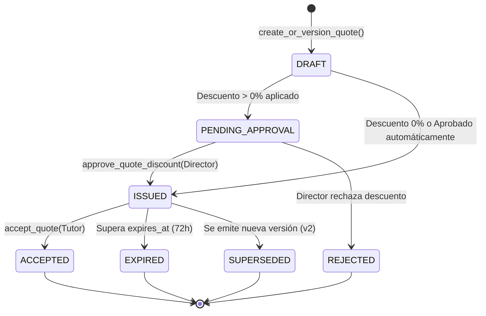
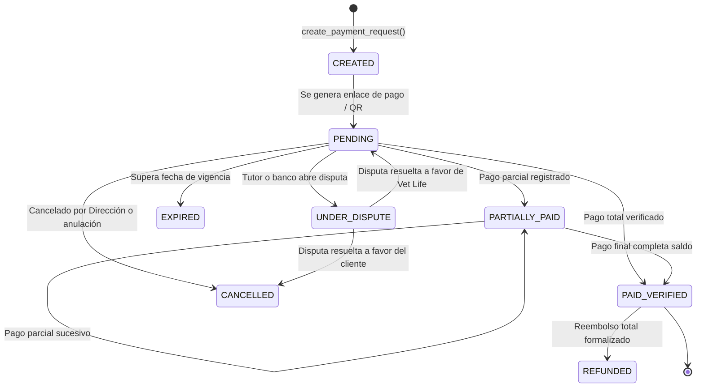
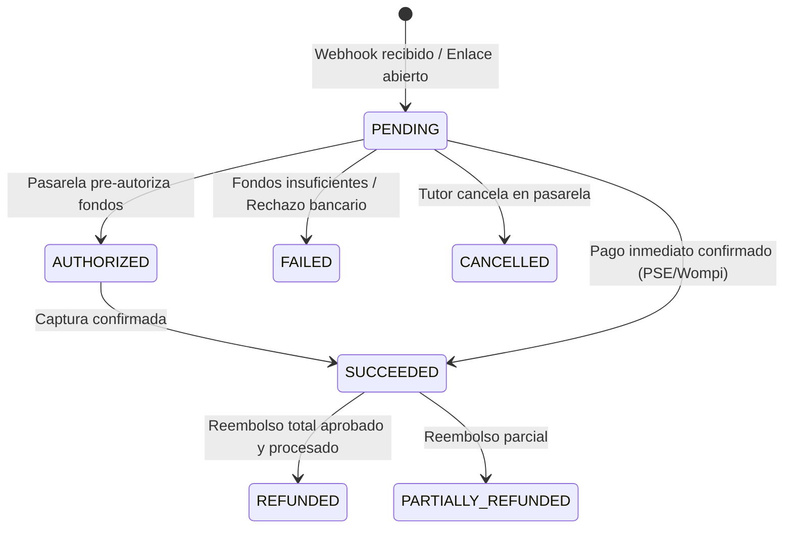

# VET FREEDOM OS — PAYMENT STATE MACHINE
## Máquinas de Estado de Cotizaciones, Solicitudes de Cobro y Transacciones
**Módulo:** VET-CORE-14 | FINANCIAL NOTIFICATIONS  
**Dirección Médica:** Dr. Luis Eduardo Ríos  
**Dirección Estratégica:** Alpha Vision Method  
**Plataforma:** Supabase PostgreSQL 17

---

## 1. Ciclo de Vida de Cotizaciones (`financial_quotes`)

### Transiciones y Reglas de Negocio:
- **DRAFT -> PENDING_APPROVAL:** Todo presupuesto que otorgue un descuento sobre la tarifa de lista oficial debe pasar por el gate de aprobación de la Dirección Médica (Dr. Luis Ríos).
- **ISSUED -> ACCEPTED:** Solo el tutor legítimo del paciente (con parentesco activo no revocado) puede aceptar la cotización. Al aceptarse, el snapshot de ítems y precios queda inmutable.
- **ISSUED -> SUPERSEDED:** Si se crea una nueva versión de la cotización (`v2`), la versión previa pasa a `SUPERSEDED` y no puede ser aceptada posteriormente.

---

## 2. Ciclo de Vida de Solicitudes de Cobro (`financial_payment_requests`)

### Reglas Críticas:
- **`PARTIALLY_PAID` vs. `PAID_VERIFIED`:** Una solicitud NUNCA pasa a `PAID_VERIFIED` mientras exista saldo pendiente (`amount_due - amount_paid > 0`).
- **Bloqueo en `UNDER_DISPUTE`:** Cuando una solicitud entra en disputa, se suprimen automáticamente todos los cobros, reintentos y recordatorios automáticos.

---

## 3. Ciclo de Vida de Transacciones de Pasarelas (`financial_payment_transactions`)

- Cada cambio de estado de transacción registra el hash SHA-256 de la carga del webhook y valida la firma HMAC del proveedor antes de permitir mutaciones.
