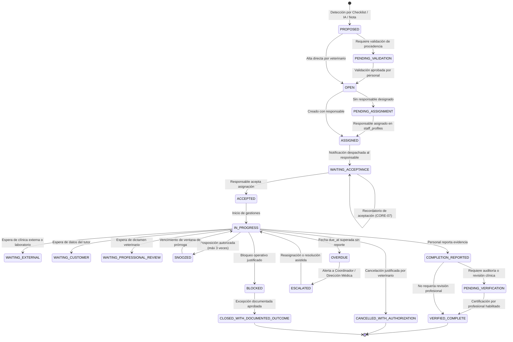

# VET FREEDOM OS — POST-VISIT COMMITMENT STATE MACHINE
## Ciclo de Vida y Máquina de Estados de Compromisos Post-Visita
**Módulo:** VET-CORE-12 | POST-VISIT COMMITMENTS  
**Dirección Médica:** Dr. Luis Eduardo Ríos  
**Plataforma:** PostgreSQL 17 (Supabase) + n8n Cloud  

---

## 1. Diagrama de Transición de Estados

---

## 2. Catálogo Canónico de los 20 Estados

| # | Estado | Definición Operativa | Restricción / Invariante |
|---|---|---|---|
| 1 | `PROPOSED` | Candidato a compromiso extraído por IA o borrador. | No visible para tutores ni activo en cron. |
| 2 | `PENDING_VALIDATION` | Requiere verificación humana de procedencia (WFX-005). | Prohibido auto-aprobar por inferencias. |
| 3 | `OPEN` | Compromiso formalmente abierto y activo. | Cuenta en `open_commitments_count`. |
| 4 | `PENDING_ASSIGNMENT` | Compromiso huérfano sin responsable asignado. | Alerta inmediata a coordinación (CORE-07). |
| 5 | `ASSIGNED` | Responsable asignado formalmente en `staff_profiles`. | Requiere staff activo. |
| 6 | `WAITING_ACCEPTANCE` | Responsable notificado; espera acuse de recibo. | Plazo de 2 horas para aceptación. |
| 7 | `ACCEPTED` | Responsable asumió formalmente la tarea. | Registra timestamp en assignments. |
| 8 | `IN_PROGRESS` | Tarea en curso de resolución activa. | Permite adjuntar evidencia parcial. |
| 9 | `WAITING_EXTERNAL` | Esperando respuesta de especialista o centro externo. | No computa como negligencia interna. |
| 10 | `WAITING_CUSTOMER` | Esperando que el tutor envíe datos o confirme. | Sujeto a horario hábil. |
| 11 | `WAITING_PROFESSIONAL_REVIEW`| Esperando dictamen de médico veterinario colegiado. | Solo asignable a rol `VETERINARIAN`. |
| 12 | `BLOCKED` | Tarea detenida por impedimento material o legal. | Requiere `blocking_reason` obligatorio. |
| 13 | `SNOOZED` | Tarea pospuesta legítimamente con nueva fecha futura. | Límite estricto de 3 posposiciones. |
| 14 | `OVERDUE` | Plazo `due_at` superado sin reporte de cumplimiento. | Dispara watchdog automático. |
| 15 | `ESCALATED` | Tarea escalada a supervisión o dirección médica. | Registrado en `post_visit_commitment_escalations`. |
| 16 | `COMPLETION_REPORTED` | Evidencia adjuntada por el ejecutor de la tarea. | No es equivalente a verificación médica. |
| 17 | `PENDING_VERIFICATION` | En espera de certificación por veterinario tratante. | Exclusivo para tareas clínicas. |
| 18 | `VERIFIED_COMPLETE` | **Cumplimiento certificado:** Tarea formalmente cerrada. | Habilita el Gate de Cierre de continuidad. |
| 19 | `CANCELLED_WITH_AUTHORIZATION`| Compromiso anulado con justificación clínica. | Requiere firma de veterinario activo. |
| 20 | `CLOSED_WITH_DOCUMENTED_OUTCOME`| Cierre excepcional documentado (imposibilidad material). | Justificación mínima de 15 caracteres. |
