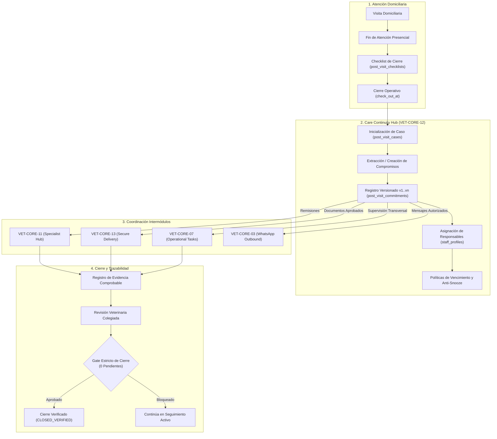

# VET FREEDOM OS — POST-VISIT CONTINUITY ARCHITECTURE
## Arquitectura de Continuidad Posterior a Visitas y Gestión Integral de Compromisos
**Módulo:** VET-CORE-12 | POST-VISIT COMMITMENTS  
**Dirección Médica:** Dr. Luis Eduardo Ríos  
**Arquitectura:** Google Antigravity + n8n + Supabase + Lovable  
**Huso Horario:** America/Bogota  
**Entorno:** DEVELOPMENT / QA (Safe Mode: Envíos externos desactivados)

---

## 1. Visión Holística del Ecosistema de Continuidad

El subsistema **Post-Visit Continuity Hub (VET-CORE-12)** es el garante de que ninguna atención médica domiciliaria prestada por Vet Life quede truncada o desatendida tras concluir la presencia física del veterinario en el hogar del paciente.

---

## 2. Invariantes Arquitectónicas Fundamentales

1. **Persistencia Centralizada en Supabase:** El estado de las obligaciones asistenciales reside exclusivamente en Supabase PostgreSQL 17 (`post_visit_cases`, `post_visit_commitments`). n8n actúa únicamente como orquestador reactivo de eventos; ningún compromiso reside en memoria efímera de workflows.
2. **Autoridad Médica Exclusiva:** Solo profesionales veterinarios con tarjeta profesional activa (COMVEZCOL) pueden dictaminar informes clínicos, validar resultados de laboratorio o certificar aplicaciones. La IA tiene estrictamente prohibido emitir órdenes médicas o instrucciones terapéuticas.
3. **No Pérdida de Pendientes:** El cierre presencial de una visita domiciliaria (`operational_closed_at`) bajo ninguna circunstancia borra o descarta compromisos posteriores (remisiones, paraclínicos, documentos).
4. **Idempotencia y Monotonía:** La creación de compromisos utiliza claves de unicidad (`idempotency_key`) para evitar duplicaciones por reintentos de red. Cada cambio de estado genera una versión inmutable (`post_visit_commitment_versions`).
5. **Auditoría Permanente:** Toda delegación, posposición, asignación y cambio de estado se registra de forma inmutable en `post_visit_audit`.
