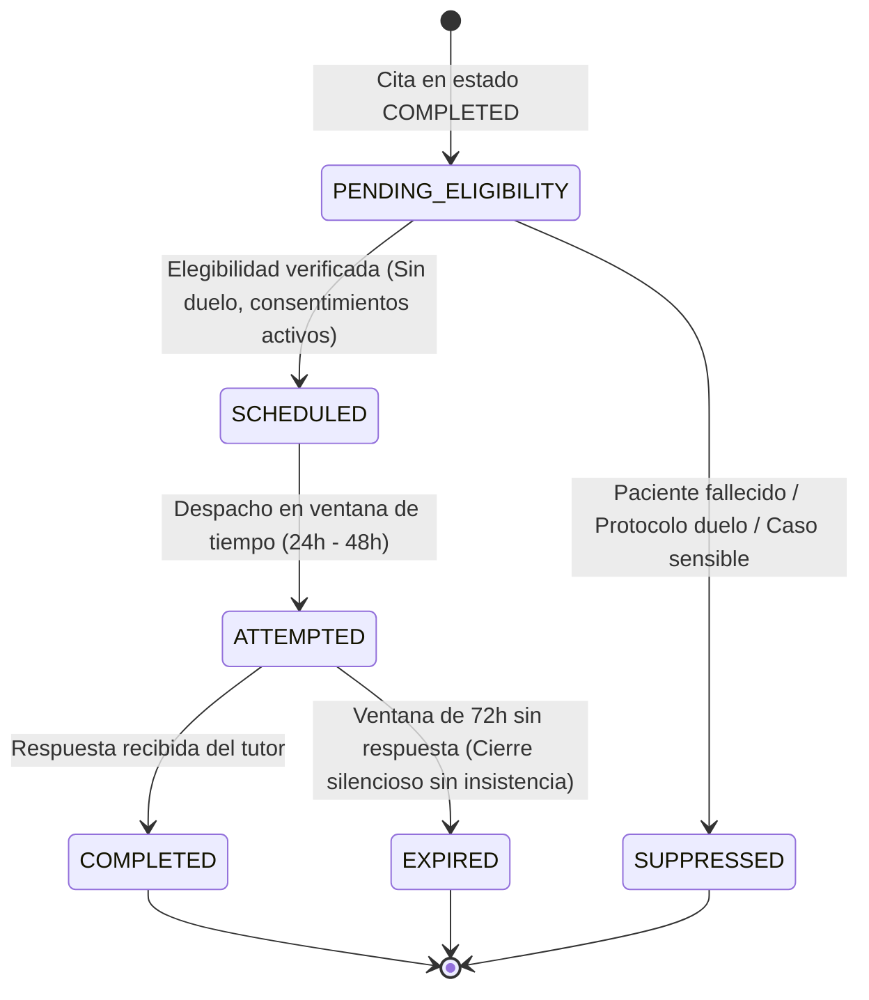

# VET FREEDOM OS — MÁQUINA DE ESTADOS: SEGUIMIENTO POSVISITA

## 1. Ciclo de Vida del Seguimiento Posvisita
El seguimiento posvisita se gestiona a través de la tabla `customer_experience_followups` y sus procedimientos asociados.

## 2. Invariantes Operativas
- **Ventana de Maduración:** No se contacta al tutor antes de 24 horas posteriores al término de la atención para permitir que el paciente descanse y se observe la respuesta clínica inicial.
- **No Duplicidad:** Máximo un seguimiento por cita médica completada.
- **Cierre Silencioso:** Si el tutor no responde a la invitación de feedback, no se realizan llamadas de insistencia ni mensajes de spam.
