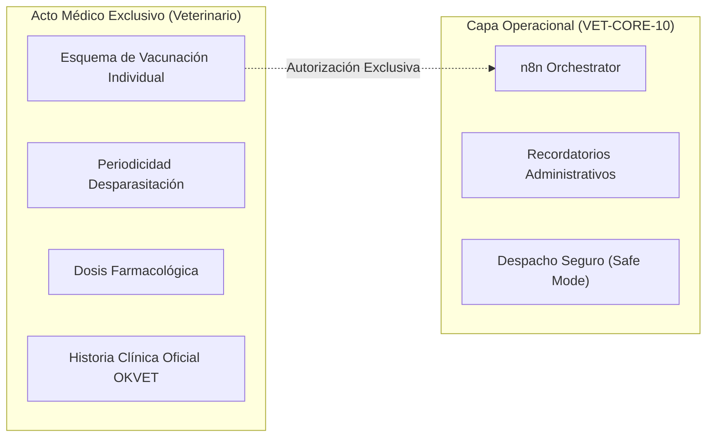

# VET FREEDOM OS — PREVENTION CLINICAL BOUNDARIES
## Fronteras Éticas y Legales de la Prevención Veterinaria
**Módulo:** VET-CORE-10  
**Dirección Médica:** Dr. Luis Eduardo Ríos  

---

## 1. Prohibiciones Estrictas de Automatización

En **Vet Life**, la prevención de enfermedades infecciosas y parasitarias es un acto médico indelegable sujeto a las regulaciones sanitarias de Colombia (COMVEZCOL / ICA).

### Prohibiciones Técnicas Inviolables:
- **CERO Cálculo de Dosis por Peso:** Ningún script, nodo de código o LLM puede calcular miligramos, mililitros o unidades de desparasitante o vacuna basándose en el peso de la mascota.
- **CERO Recomendación de Fármacos:** La IA tiene prohibido sugerir marcas comerciales, principios activos o combinaciones antiparasitarias al tutor.
- **CERO Asunción de Inmunidad:** La existencia de un registro administrativo o una cita confirmada no permite declarar a una mascota como "inmunizada" o "protegida".
- **CERO Reglas Universales:** Las vacunas no se infieren automáticamente por tablas de edad sin una prescripción médica firmada en el expediente.
