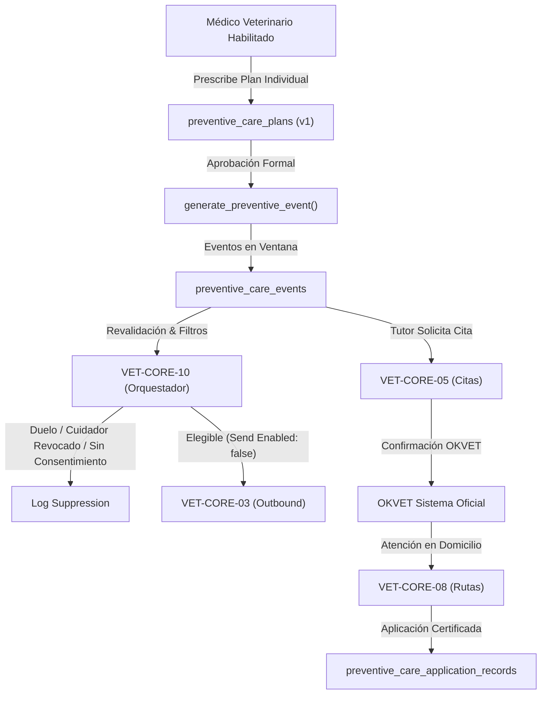

# VET FREEDOM OS — PREVENTION COMMUNICATIONS ARCHITECTURE
## Módulo: VET-CORE-10 | Prevention Communications & Individualized Preventive Care
**Dirección Médica:** Dr. Luis Eduardo Ríos  
**Dirección Estratégica:** Alpha Vision Method  
**Plataformas:** Google Antigravity + Supabase (PostgreSQL 17) + n8n Cloud + Lovable  
**Modo:** DEVELOPMENT / SAFE MODE (CERO ENVÍOS EXTERNOS REALES)

---

## 1. Misión del Módulo

El módulo **VET-CORE-10 (Prevention Communications)** gobierna la continuidad administrativa de programas preventivos individualizados, aprobados previamente por médicos veterinarios.

A diferencia de los sistemas genéricos que emiten recordatorios universales cada $N$ meses por especie o edad, **Vet Freedom OS** basa su prevención en:
1. **Prescripción Médica Individualizada:** Cada mascota posee un plan aprobado por su veterinario tratante (`is_clinical = true`).
2. **Vigencia y Trazabilidad de Datos:** Registros auditados con procedencia clara (OKVET oficial, importación certificada o historia clínica).
3. **Protección Ética Inviolable:** Prohibición absoluta de cálculo de dosis, sugerencia de fármacos o invención de calendarios clínicos por modelos de IA o automatizaciones.
4. **Trazabilidad Farmacéutica:** Control estricto de lotes, fechas de vencimiento y cadena de frío (2-8°C).

---

## 2. Axiomas Fundamentales de Seguridad Clínica

1. **Autoridad Médica Exclusiva:** Solo un médico veterinario habilitado puede aprobar un plan de vacunación, desparasitación o control geriátrico.
2. **Cero Inferencia Universal:** Queda terminantemente prohibido utilizar calendarios universales de internet o reglas automáticas basadas únicamente en edad o raza sin orden médica.
3. **Control de Lotes y Cadena de Frío:** Ningún biológico o vacuna puede liberarse para la valija domiciliaria si su lote está expirado o presenta quiebres no resueltos en su cadena de frío.
4. **Cero Auto-Aplicación:** Una cita agendada o un mensaje de WhatsApp no certifican la aplicación clínica de un producto. La aplicación exige el registro oficial de un veterinario habilitado (`VERIFIED_APPLIED`).
